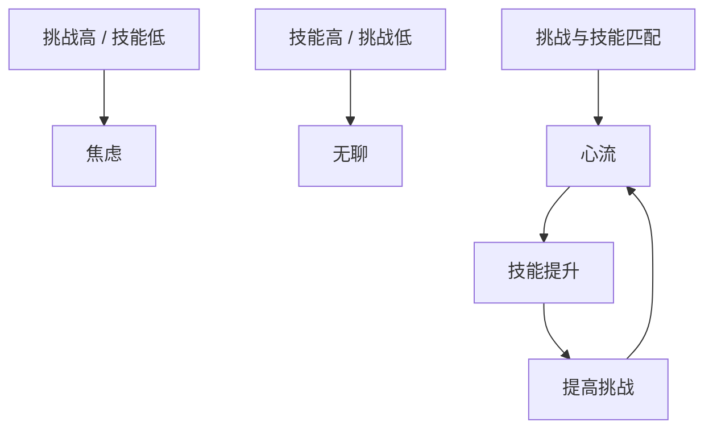

# 心流与游戏：把挑战、反馈与注意力设计成体验

<ArticleTags />

“好玩”很难直接设计，但“进入心流”可以被拆成条件。米哈里·契克森米哈赖在《Flow（心流）》里研究的不是游戏，而是一个更普遍的问题：人在什么状态下会全神贯注、忘记时间，并觉得这段经历值得？

游戏恰好是制造这种状态的机器。这篇笔记把书中的最优体验条件翻译成游戏设计语言，并给出可检查的落地点。

## 1. 心流不是“爽”，而是注意力有序

心流是一种完全投入的状态：注意力集中在有限的目标上，行动与意识融合，周围无关的事情暂时消失。它不是单纯的快乐，也不是放松，而是一种**有方向的紧张**。

书里用“意识中的秩序”描述它：当信息与目标一致，注意力可以顺畅地流动，人会感到掌控与清晰；当信息不断制造冲突，意识进入“精神熵”，人就会焦虑、分心或疲惫。

对游戏来说，这意味着两件事：

- 游戏不能只提供刺激，还要提供**可理解的目标与反馈**；
- 游戏不能只占用注意力，还要让注意力**有地方可去**。

## 2. 享受与快乐：奖励不能替代体验

书里区分了 pleasure（快乐/愉悦）与 enjoyment（享受）：

- **Pleasure** 更接近恢复平衡：吃、睡、放松，能让人舒服，但不一定带来成长；
- **Enjoyment** 包含挑战、投入与自我扩展，结束后会觉得“我变得不一样了”。

很多游戏把“奖励”当成“享受”：掉金币、开箱子、数值上涨。奖励能制造短期快感，但如果核心循环没有挑战与投入，玩家很快会疲劳。

一个可执行的判断：

- 玩家是在“领取结果”，还是在“参与过程”？
- 关掉奖励，核心动作还愿意重复吗？
- 失败后，玩家想再试一次，还是只想退出？

## 3. 心流的八个条件，对应游戏机制

| 心流条件 | 游戏中的落点 | 可测信号 |
| - | - | - |
| 清晰目标 | 当前任务、路线、胜利条件 | 玩家能否一句话说出“现在要做什么” |
| 即时反馈 | 命中、受击、资源变化、UI 提示 | 输入到反馈的延迟 |
| 挑战与技能平衡 | 难度曲线、匹配、DDA、关卡选项 | 失败率、重试率、流失点 |
| 行动与意识融合 | 输入响应、取消、连招 | 操作是否“想到即发生” |
| 注意力集中 | 画面层级、UI 噪声、节奏 | 视线是否被无关元素拉走 |
| 控制感 | 可取消、可撤退、可选择 | 玩家是否觉得“输是我自己的问题” |
| 忘我 | 少打断、少弹窗、少强制等待 | 战斗中被 UI 打断的次数 |
| 时间感改变 | 节奏、波次、Boss 阶段 | 单局时长与“还想再来一局” |

这些条件不需要同时满格。心流是一个区间，不是一次开关。

## 4. 挑战与技能：心流通道

最常被引用的是“挑战—技能”模型：



同一个难度对不同玩家意味着不同状态。高手觉得无聊的关卡，新手可能直接焦虑。因此心流设计不是“找一个平均难度”，而是：

- 提供多个难度/流派入口；
- 用短期反馈判断玩家当前能力；
- 让挑战随技能增长，而不是一次定死；
- 允许玩家主动选择更难的内容。

一个简化的动态难度思路：

```csharp
float targetSuccess = 0.65f;
float recentSuccess = wins / Mathf.Max(1, attempts);

if (recentSuccess < targetSuccess - 0.15f)
    difficulty = Mathf.Max(minDifficulty, difficulty - 1);
else if (recentSuccess > targetSuccess + 0.15f)
    difficulty = Mathf.Min(maxDifficulty, difficulty + 1);
```

这只是一个起点。真正的 DDA 要避免“玩家一死就变简单”的羞辱感，也要避免把高手锁在低难度；更好的做法是调整敌人组合、资源投放或路线选择，而不是只改数值。

## 5. 反馈与掌控：让玩家知道“是我做的”

心流需要行动与意识融合，而融合的前提是反馈足够快、足够清楚。

- 输入延迟要稳定，不能时快时慢；
- 命中反馈要区分“打到了”“打死了”“打偏了”；
- 失败要能归因：是站位、时机、资源，还是数值不够；
- 重要状态变化不能只靠小图标，要有层级与节奏。

“控制感”不等于“简单”。玩家可以接受难，但不能接受“我明明做对了却没反应”或“系统替我做了决定”。

## 6. 自成目标：为什么肉鸽能让人一直再来一局

书里用“autotelic”描述那些以体验本身为目的的活动：做这件事不是为了外部奖励，而是因为过程本身就值得。

肉鸽的“再来一局”很接近这种结构：

- 每局有清晰目标与短周期反馈；
- 构筑与随机性提供新鲜感；
- 失败带来信息，而不是纯损失；
- 玩家逐渐把“变强”内化为自己的目标。

但自成目标也可能被滥用：如果游戏只靠可变奖励与损失厌恶把人留在循环里，玩家获得的不是心流，而是被设计的强迫感。区别在于：

- 结束后是“满足/想休息”，还是“空虚/停不下来”；
- 玩家是否能主动选择退出与暂停；
- 挑战是否在成长，而不是只靠数值墙。

## 7. 工作、休闲与游戏

书里有一个重要观察：工作经常具备心流的条件（目标、反馈、挑战），而被动休闲反而容易无聊。游戏设计可以借鉴这一点：

- 让玩家“做决定”，而不是只看过场；
- 让重复动作有技巧空间，而不是纯等待；
- 让休息与节奏成为体验的一部分，而不是用持续刺激填满每一秒。

## 8. 用数据验收心流，而不是只看留存

留存是结果，不是体验本身。可以组合这些指标：

- **失败后重试率**：失败是否带来“想再试一次”；
- **单局时长分布**：是否出现大量过早退出；
- **挑战自评**：玩家觉得“太简单/刚好/太难”的比例；
- **反馈延迟**：输入到视觉/音频反馈的时间；
- **打断次数**：战斗中弹窗、加载、强制镜头的频率；
- **主动休息率**：玩家是否愿意在合适的时候停下。

如果留存很高但重试率低、负面情绪高，可能是“被留住”，而不是“进入心流”。

## 9. 设计检查清单

- 当前目标能否用一句话说清？
- 玩家是否在 100ms 内感知到操作反馈？
- 难度是否随技能变化，而不是一次定死？
- 失败是否可归因、可学习？
- 战斗/解谜中是否被 UI 或加载打断？
- 玩家是否有取消、撤退、重试的选择？
- 核心循环去掉奖励后是否仍然成立？
- 是否提供了主动休息与退出的空间？
- 数据是否同时看留存与体验信号？

心流不是“让玩家一直玩”，而是让玩家在一段时间里**注意力有秩序、行动有意义、挑战与能力相匹配**。游戏能做的，是把这些条件设计得更容易发生，而不是用奖励掩盖它们的缺失。

## 参考与延伸

- 米哈里·契克森米哈赖：《心流：最优体验心理学》（*Flow: The Psychology of Optimal Experience*）。本文参考其最优体验、心流条件与自成目标等概念，未逐字摘录扫描版原文。
- 相关文档：[游戏心理学框架](/Design/Game_Psychology_DeepDive)、[成长心理学](/Design/Psychology/Progression_Psychology)、[斯金纳箱与成瘾](/Design/Psychology/Skinner_Box_and_Addiction)、[新手引导最佳实践](/Design/UX/FTUE_Best_Practices)。
