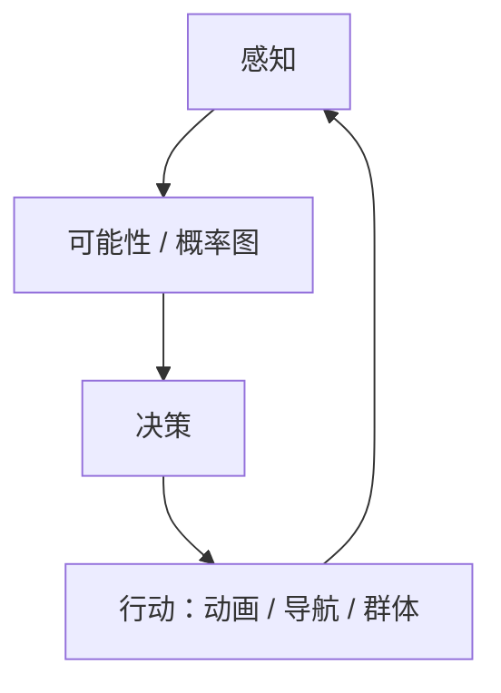

# 游戏 AI 开发：从感知到群体协作

<ArticleTags />

游戏 AI 的目标不是“造一个真正聪明的人”，而是**让玩家相信眼前这个角色在观察、判断、行动**。它不需要通过图灵测试，但必须让玩家觉得：它看见了我、它记得我、它在做决定。

Micael DaGraça 的《游戏AI开发实用指南》把这件事拆成一条可实现的管线：感知 → 可能性/概率图 → 决策 → 动画/导航 → 群体协作 → 规划。这篇笔记按书的十章结构整理这条管线，并补上工程实践中的调试与性能问题。

::: warning 关于本文
原书为中文译本，本文依据目录、关键章节与公开资料整理，**不是译文**；代码为 Unity C# 场景的原创示例，用来演示结构，不追求直接复制进项目即可运行。
:::

::: tip 怎么读
做 FPS/潜行 AI，重点读第 2、3、10 节；做 RTS/群体 AI，重点读第 8、9 节；做动作游戏，重点读第 6、7 节。所有项目都建议先读第 1 节的三层结构。
:::

## 1. 三层结构：感知、决策、行动

书里反复强调：不同的问题需要不同的解决方案。敌人 AI、友军 AI、群体 AI、潜行 AI 的目标不同，不能套同一个模板。但它们的运行时结构可以统一成三层：

| 层 | 回答的问题 | 本书对应 |
| - | - | - |
| 感知 | 我知道什么？我看到/听到了什么？ | 第 10 章、第 1 章 |
| 决策 | 我该做什么？为什么？ | 第 2、3、9 章 |
| 行动 | 我怎么动、怎么表现？ | 第 4–8 章 |



“可信”比“聪明”更重要。一个只会追击的敌人，如果视野、听觉、记忆、动画都自洽，玩家会觉得它像个角色；一个会复杂规划的敌人，如果隔墙知道玩家位置、转身瞬间完成，玩家只会觉得它在作弊。

## 2. 感知：AI 怎么看见、听见、记住

### 2.1 视觉：视野、距离与遮挡

最基本的视觉感知由三个条件组成：在视野角度内、在视距内、视线没有被遮挡。书里用“基本视线检测”讲这件事；工程上通常用射线检测实现。

```csharp
[SerializeField] float viewDistance = 20f;
[SerializeField] float viewAngle = 100f;
[SerializeField] LayerMask obstacleMask;

bool CanSee(Transform target)
{
    var eye = transform.position + Vector3.up * 1.6f;
    var to = target.position - eye;

    if (to.magnitude > viewDistance) return false;
    if (Vector3.Angle(transform.forward, to) > viewAngle * 0.5f) return false;

    return !Physics.Linecast(eye, target.position, obstacleMask);
}
```

只做一次射线还不够：目标可能被部分遮挡、可能蹲在掩体后、可能只在边缘露出。实用做法是检测多个点（头、胸、脚），或者用视锥体 + 遮挡查询。

### 2.2 听觉、记忆与不确定性

视觉之外，声音是第二感知通道：脚步、枪声、爆炸会触发“去查看”的行为。AI 还需要**记忆**：最后一次看到玩家的位置、最后一次听到声音的位置、过了多久、是否已经搜索过。

书里在潜行章节强调感知与战术的关系：AI 不应该全知全能，而应该有“怀疑—搜索—确认”的过程。工程上可以用一个简单的黑板（blackboard）保存：

| 数据 | 用途 |
| - | - |
| 最后可见位置 | 追击/搜索目标 |
| 最后可见时间 | 判断信息是否过期 |
| 最后听到位置 | 调查声音 |
| 警觉度 | 决定搜索范围/速度 |
| 已搜索区域 | 避免重复搜索 |

### 2.3 感知要服务于玩法

感知不是越真实越好。潜行游戏需要玩家能预测 AI 的视野；FPS 需要敌人有反应时间；RTS 需要单位共享视野。**感知参数是玩法的一部分**，不是物理模拟的副产品。

## 3. 可能性图与概率图：玩家可能在哪

这是本书比较有特色的一章。传统寻路回答“怎么从 A 到 B”，可能性图/概率图回答“玩家可能在哪、我该去哪找”。

### 3.1 可能性图

把地图切成若干区域/触发区，标记“玩家可能出现的区域”。在 FPS 例子里，AI 可以把地图分成 YES/NO 区域：玩家进入 YES 区会触发 AI 从被动转为警戒/进攻。

可能性图适合：
- 敌人需要在地图上巡逻/搜索；
- 关卡设计师想用区域控制 AI 的反应；
- 需要让 AI 的注意力有“空间感”。

### 3.2 概率图

概率图给每个区域一个权重：玩家在这里的可能性有多大。视觉/声音事件会更新权重；AI 去权重最高的区域搜索，找不到再降低该区域权重。

| | 可能性图 | 概率图 |
| - | - | - |
| 数据 | 区域是否可能/是否触发 | 每个区域的概率/权重 |
| 更新 | 进入区域、事件触发 | 看到/听到/搜索后更新 |
| 用途 | 状态切换、区域警戒 | 搜索优先级、资源分配 |
| 优点 | 简单、可控 | 更自然、可累积 |
| 风险 | 容易僵硬 | 权重难调、可能抖动 |

工程上不必做完整的贝叶斯网络；一个带衰减的权重表 + 事件更新就够用。关键是**让 AI 的搜索有依据**，而不是随机游走。

## 4. 决策：产生式系统、FSM 与效用函数

### 4.1 产生式系统与自动 FSM

产生式系统可以理解为“条件 → 动作”的规则集：如果玩家可见且距离近，则攻击；如果血量低，则找掩体；如果听到声音，则调查。

自动有限状态机（FSM）把状态与转换显式化：巡逻、警戒、追击、攻击、撤退。书里用“可能性计算”决定状态切换，而不是只靠硬编码条件。

FSM 的优点是**可读、可调试**；缺点是状态一多，转换表会爆炸。状态少、行为边界清晰的敌人，FSM 仍然是最好的选择。

### 4.2 效用函数

当决策要考虑多个因素（距离、血量、弹药、掩体、队友、玩家威胁）时，效用函数比 FSM 更合适：每个动作算一个分数，选最高分。

```csharp
float ChaseScore()  => visible ? 0.8f : 0.1f;
float CoverScore()  => health < 0.3f ? 0.9f : 0.2f;
float PatrolScore() => visible ? 0f : 0.6f;

string ChooseAction()
{
    var actions = new (string name, float score)[]
    {
        ("Chase", ChaseScore()),
        ("Cover", CoverScore()),
        ("Patrol", PatrolScore())
    };
    return actions.OrderByDescending(a => a.score).First().name;
}
```

效用函数的关键不是公式，而是**权重与曲线的调校**。同一个“血量低”在不同游戏里可能应该优先逃跑、找掩体或呼叫支援。

### 4.3 动态平衡

书里还讨论了游戏 AI 的动态平衡：根据玩家表现调整 AI 的进攻性、准确度、反应时间，让游戏既有挑战又不至于劝退。

动态平衡要避免“玩家赢了就暗改数值”的粗暴做法。更好的方式是调整**行为选择**：玩家连续失败时，AI 更少包抄、更多给玩家喘息；玩家连续碾压时，AI 更主动使用技能/掩体。

| 方法 | 适合 | 主要风险 |
| - | - | - |
| FSM | 状态少、转换明确 | 状态爆炸 |
| 产生式规则 | 条件驱动的反应 | 规则冲突、难调 |
| 效用函数 | 多因素权衡 | 权重难调、行为抖动 |
| 规划/搜索 | 多步目标 | 计算成本、可解释性 |

## 5. 环境交互：障碍、区域、地形与射线

AI 不能只在抽象网格里思考，它还要与环境交互。书里第 4 章讲了移动环境中的物体、障碍物、区域阻断、不稳定地形，以及用射线检测评估决策。

- **障碍物**：静态障碍用导航网格/碰撞体；动态障碍要更新寻路或做局部避让。
- **区域阻断**：用区域/体积标记“不可通行/危险/需要钥匙”，让 AI 的决策知道边界。
- **不稳定地形**：坡度、台阶、移动平台会影响移动；AI 需要地面检测、坡度限制、跳跃链接。
- **射线检测**：除了视线，还可以用射线判断掩体、可交互物、地面高度。

环境交互的输出应该交给导航层，而不是让决策层直接操作 Transform。这样 AI 的行为才能复用、可测试。

## 6. 动画：让决策看起来像动作

AI 的决策只有通过动画才能被玩家看见。书里第 5 章比较了 2D 精灵与 3D 骨骼动画，并讲了动画状态机与平滑过渡。

### 6.1 2D 与 3D

- **2D 精灵**：帧动画，状态切换靠播放不同序列；重点是帧率、朝向、过渡。
- **3D 骨骼**：骨骼/蒙皮，状态切换靠动画层与混合；重点是根运动、上半身/下半身分层、IK。

### 6.2 动画状态机与平滑过渡

动画状态机要跟 AI 状态机对齐，但不能完全等同：AI 可以在“追击”状态里播放跑步/转向/攻击多个动画；动画也可以有“受击/硬直”这类不由 AI 决策直接控制的状态。

```csharp
animator.SetFloat("Speed", agent.velocity.magnitude);
animator.SetBool("Armed", armed);
animator.CrossFade("Attack", 0.12f);
```

平滑过渡的关键是**过渡时间与取消窗口**：太短会跳变，太长会显得迟钝；攻击后摇要允许被下一个动作取消，否则玩家会觉得 AI 不听使唤。

## 7. 导航：从方向选择到 A*

书里把导航分成两层：第 6 章的导航行为（选择方向、点到点移动）与第 7 章的高级寻路（A*）。

### 7.1 方向选择与点到点移动

- **选择新方向**：根据目标、障碍、群体、巡逻点选择下一个朝向。
- **点到点移动**：seek（朝目标）、arrive（减速到达）、flee（远离）、wander（游荡）。
- **局部避让**：在移动过程中避开其他单位/动态障碍。

### 7.2 A* 寻路

A* 在网格/导航图上找路径：`f(n) = g(n) + h(n)`，`g` 是起点到当前的真实代价，`h` 是到目标的估计。完整推导可看站内[游戏编程算法与技巧](/notes/game-programming-algorithms)的 A* 一节。

```csharp
while (open.Count > 0)
{
    var current = open.MinBy(n => n.F);
    if (current == goal) return BuildPath(current);

    open.Remove(current);
    closed.Add(current);

    foreach (var next in current.Neighbors)
    {
        var g = current.G + Cost(current, next);
        if (g >= next.G) continue;

        next.G = g;
        next.F = g + Heuristic(next, goal);
        next.Parent = current;
        if (!open.Contains(next)) open.Add(next);
    }
}
return null;
```

工程上要注意：寻路请求分摊到多帧、路径平滑、动态障碍重规划、导航网格的生成与版本管理。不要让每个 AI 每帧都跑一次完整 A*。

## 8. 群体：组队、通信与避碰

书里第 8 章用《刺客信条》《GTA》《模拟人生》《FIFA/实况足球》说明：群体 AI 不是“很多个单体 AI”，而是**有角色分工、通信与协调的系统**。

| 游戏 | 群体 | AI 重点 |
| - | - | - |
| 刺客信条 | 人群/守卫 | 密度、社会潜行、群体反应 |
| GTA | 行人/交通 | 反应式群体、路径与避让 |
| 模拟人生 | 市民 | 需求、关系、社交行为 |
| FIFA/实况 | 球队 | 阵型、角色、传球/跑位协作 |

### 8.1 组队与通信

- **小组战斗**：分配角色（突击、掩护、狙击），共享目标与威胁。
- **警告区域**：一个 AI 发现玩家，向周围区域广播警情。
- **交谈/协作**：AI 之间交换信息，形成包抄、掩护、撤退。
- **团队竞技**：阵型、区域控制、资源分配。

### 8.2 群体避碰

群体移动常用分离/对齐/聚合（boids）加局部避让：

```csharp
Vector3 separation = ...; // 远离过近的邻居
Vector3 alignment  = ...; // 对齐邻居平均朝向
Vector3 cohesion   = ...; // 靠近邻居中心

var desired = separation * separationWeight
            + alignment  * alignmentWeight
            + cohesion   * cohesionWeight;
```

群体行为的关键是**稳定性**：权重太高会抖动，太低会挤成一团；角色分工和通信比“个体更聪明”更能产生可信的群体感。

## 9. 规划：动作序列与碰撞避免

书里第 9 章讲 AI 规划与碰撞避免。规划解决的是“多步目标”：不是选一个动作，而是找一串动作，让前置条件逐步满足。

一个实用的规划器通常包含：

| 部分 | 作用 |
| - | - |
| 世界状态 | 当前事实（有钥匙、门开着、玩家可见） |
| 动作 | 前置条件 + 效果 + 代价 |
| 搜索 | 从当前状态搜索到目标状态 |
| 执行 | 按计划执行，失败时重规划 |

规划适合 Boss、任务 AI、需要多步协作的场景；不适合每个小怪每帧都跑。工程上常把规划与效用/FSM 结合：高层用规划，底层用 FSM/行为树执行。

碰撞避免是规划的执行层问题：路径规划给出“应该走哪”，局部避让负责“实际怎么绕开”。两者要分层，否则会互相打架。

## 10. 工程实践：调试、性能与可读性

AI 最容易变成“黑盒”：行为不对，但不知道是感知、决策还是动画的问题。工程上要把可观测性做进系统：

| 技术 | 作用 | 风险 |
| - | - | - |
| 视野锥/视线可视化 | 看 AI 到底看到了什么 | 只在大屏/调试模式开启 |
| 状态/效用分数显示 | 看决策依据 | 文字太多遮挡画面 |
| 路径/导航网格显示 | 看寻路是否合理 | 性能开销 |
| AI 更新 LOD | 远处 AI 降频 | 行为不一致 |
| 异步寻路 | 避免主线程卡顿 | 结果延迟/过期 |
| 空间分区 | 降低感知/避碰查询成本 | 动态对象更新成本 |
| 固定测试场景 | 回归验证 | 场景维护成本 |

另外，AI 的随机性要可控：用带种子的随机数、记录输入与状态，才能复现“为什么这个敌人当时做了那个决定”。

## 11. 检查清单

- [ ] AI 的视野有角度、距离、遮挡与反应时间吗？
- [ ] AI 有听觉/记忆/最后已知位置吗？
- [ ] 可能性图/概率图是否会随事件更新并衰减？
- [ ] 决策方法（FSM/效用/规划）是否匹配问题规模？
- [ ] 状态与转换是否能在调试器里看见？
- [ ] 动画是否与决策同步，过渡与取消窗口是否合理？
- [ ] 寻路是否分摊到多帧，动态障碍是否会重规划？
- [ ] 群体是否有角色分工、通信与稳定的避碰？
- [ ] 规划失败时是否能重规划，而不是卡死？
- [ ] 是否有固定测试场景与可复现的随机种子？

## 12. 参考与延伸

- 原书：Micael DaGraça，《游戏AI开发实用指南》（Practical Game AI Programming）。本文依据目录、关键章节与公开资料整理，不是译文。
- 站内笔记：[游戏编程算法与技巧](/notes/game-programming-algorithms)、[守望先锋的 ECS 与网络代码](/notes/overwatch-ecs-netcode)、[游戏感](/notes/game-feel)、[心流与游戏](/notes/flow-game-design)。
- 站内实践：[决策系统](/Tech/Architecture/Decision_System)、[ECS 完整指南](/Tech/Architecture/ECS_Complete_Guide)。
