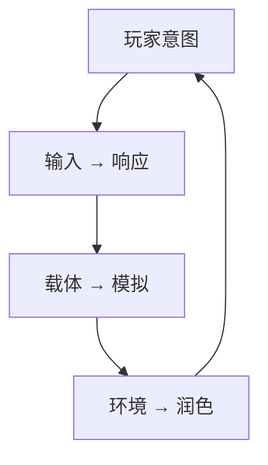

# 游戏感：虚拟感觉的六个要素

<ArticleTags />

游戏感不是“画面多好”或“特效多响”，而是玩家操控虚拟对象时，身体感到的那一下：起步的迟疑、转身的惯性、落地的重量、命中时的停顿。它很难说清，却决定了一个游戏是“能玩”还是“好操控”。

Steve Swink 的《游戏感：虚拟感觉的游戏设计师指南》把它拆成可分析、可调校的结构：**实时控制、模拟空间、润色**三大基础构件，以及**输入、响应、环境、润色、载体、模拟**六个分析要素。

这篇笔记按这个框架整理：先定义，再拆六要素，然后讲测量、调参、案例与常见误区。

::: warning 关于本文
附件中的两个 PDF 是同一扫描件（MD5 相同），OCR 文本不可靠。本文依据目录、译者序、关键页面与公开资料整理，**不是译文**；对书中观点的引用均为转述。
:::

::: tip 怎么读
如果你在做角色控制器，先读第 2 节的“输入、响应、载体、模拟”，再读第 5 节的调参顺序。如果你在做战斗/动作游戏，重点看“润色”和案例里的 Mario、Halo、Shadow of the Colossus。
:::

## 1. 游戏感是什么：控制感，而不是画面感

书里给出的核心定义可以压成一句话：**游戏感是玩家实时操控虚拟对象时，由输入、动作、空间与反馈共同产生的触觉和运动感觉**。

它包含三个基础构件：

| 构件 | 含义 | 对应六要素 |
| - | - | - |
| 实时控制 | 输入到动作的闭环，延迟低、可预测、可撤销 | 输入、响应、载体 |
| 模拟空间 | 运动遵循一致的规则，空间可读、可碰撞 | 模拟、环境 |
| 润色 | 视听与触觉反馈放大交互的力度 | 润色 |

三者缺一不可。只有实时控制，画面会很“干”；只有模拟空间，操作会像在冰上推箱子；只有润色，就是“特效很响但不好玩”。

### 1.1 游戏感不是 Juice

行业里常把“juice”和游戏感混在一起。两者相关，但不是一回事：

| | 游戏感 | Juice |
| - | - | - |
| 核心 | 控制、载体、模拟、环境、反馈的整体体验 | 视听反馈的强化 |
| 手段 | 输入曲线、加速度、转向、碰撞、镜头、动画 | 粒子、屏幕震动、音效、顿帧、闪光 |
| 关系 | 地基 | 放大器 |

Juice 能让一次命中有冲击力，但如果角色起步慢半拍、转身像卡车，粒子再多也救不了手感。**先有可操控的身体，再有值得放大的交互**。

## 2. 六个要素：一张分析地图



| 要素 | 核心问题 | 主要手段 | 失效症状 |
| - | - | - | - |
| 输入 | 意图能否准确进入游戏？ | 死区、响应曲线、重映射、输入缓冲 | 延迟、误触、方向不准 |
| 响应 | 动作是否跟手？ | 加速度、转向速度、动画取消、启动/停止 | 粘滞、滑冰、动作不听话 |
| 环境 | 空间是否支持并放大运动？ | 碰撞、坡度、摩擦、镜头、地标 | 穿模、卡住、迷失方向 |
| 润色 | 交互是否可信、有力度？ | 粒子、音效、震动、顿帧、动画 | 特效很响但动作很轻 |
| 载体 | 玩家操控的“身体”是什么？ | 尺寸、质量、轮廓、重心、动画集 | 轻飘、笨重、视觉与操作不一致 |
| 模拟 | 运动遵循什么规则？ | 重力、摩擦、弹性、步长、约束 | 抖动、穿透、帧率依赖 |

### 2.1 输入 Input

**核心问题**：玩家的意图能否被准确、及时地翻译成游戏动作？

输入不只是“按键映射”，还包括死区、响应曲线、连按窗口、输入缓冲、重绑定与多设备适配。摇杆的死区太小会漂移，太大会让微调失效；响应曲线太线性会让精细瞄准变难，太激进又会让操作不可预测。

**失效症状**：按下没反应、方向偏、轻推不动、重推过头。先测延迟，再调曲线；不要用动画掩盖输入问题。

### 2.2 响应 Response

**核心问题**：角色多快、多准确地回应输入？

响应是“意图”到“动作”的第一段。它由加速度、最大速度、转向速度、启动/停止时间、动画取消窗口等参数决定。响应太快会显得轻飘，太慢会显得粘滞；好的响应通常不是“零延迟”，而是**可预测的延迟**。

**失效症状**：起步像踩棉花、转身像开卡车、攻击后摇长到无法取消。先调启动/停止与转向，再调动画。

### 2.3 环境 Environment

**核心问题**：空间是否让运动变得可读、可碰撞、可发挥？

环境包括碰撞体、坡度、摩擦、平台边缘、镜头与地标。它不只是“关卡美术”，而是手感的物理背景：同样的跳跃参数，在平地、斜坡、窄墙和移动平台上感受完全不同。

**失效症状**：角色卡在墙角、镜头穿墙、玩家不知道自己在哪。环境问题常常被误判成“角色手感问题”。

### 2.4 润色 Polish

**核心问题**：交互是否被反馈“放大”了？

润色是粒子、音效、屏幕震动、顿帧、动画、UI 数字、手柄震动等反馈层。它让一次命中“有重量”、一次落地“有尘土”、一次升级“有仪式感”。

**失效症状**：动作很灵敏，但打起来像打空气；或者特效太吵，遮住了真正的操作反馈。润色要服务于交互，而不是替代交互。

### 2.5 载体 Carrier

**核心问题**：玩家操控的“身体”是什么？它的重量、尺寸、轮廓是否与动作一致？

载体是角色、车辆、飞船、光标或任何被操控的虚拟实体。它的视觉重心、碰撞体积、动画姿态会改变玩家对速度、重量与力量的感知。一个细长的角色看起来更快，一个敦实的角色看起来更重；如果视觉与参数不一致，玩家会觉得“这不是我”。

**失效症状**：角色很轻但动作很重、碰撞体和模型对不上、转身时视觉重心飘。先定载体，再调参数。

### 2.6 模拟 Simulation

**核心问题**：运动遵循什么规则？规则是否一致、稳定、可预测？

模拟包括重力、摩擦、弹性、惯性、约束与物理步长。它决定运动的“物理可信度”。真实物理不一定等于好手感：完全真实的惯性可能让角色难以控制；游戏需要的是**可信的、可玩的物理**。

**失效症状**：帧率一变手感就变、物体抖动、穿透、落地弹跳不自然。模拟要固定步长，参数要可调。

## 3. 玩家为什么会觉得“这是我的身体”

### 3.1 身体延伸

书里用“感觉的延伸”和“个体的延伸”解释游戏感：玩家会把控制器、角色、车辆当成自己身体的延伸。开车时，你会觉得车宽就是自己的身体宽度；玩 Mario 时，你会觉得自己就是那个会跳、会滑、会抓墙的小人。

这种延伸一旦建立，**延迟、动画错位、碰撞体与模型不一致**都会破坏它。玩家不会说“输入延迟 80ms”，只会说“这个角色很笨”。

### 3.2 三个阶段：熟悉、挑战、熟练

书里把游戏感的体验分成三个阶段：

1. **熟悉操作**：玩家理解输入与动作的对应关系。
2. **克服挑战**：玩家在失败与重试中感到“我能做到”。
3. **熟练操控**：玩家掌握技巧，能做出有表达性的动作。

这意味着游戏感不只是“前 10 秒的爽感”。新手需要可理解，中级玩家需要可挑战，熟练玩家需要可表达；只满足一个阶段的手感，留不住人。

### 3.3 动画要服从控制

动画是手感的一部分，但不能压过控制。攻击后摇、转身动画、落地硬直如果没有取消窗口，玩家会觉得“角色不听我的”。好的做法是：**动画表达动作，控制决定动作何时开始、何时能被下一个动作打断**。

## 4. 如何测量游戏感

书里用六要素做横向对照：同一类游戏，比较它们的输入、响应、环境、润色、载体、模拟，找出“为什么这个更跟手”。

| 游戏 | 载体 | 核心动词 | 手感关键 |
| - | - | - | - |
| 超级马里奥 64 | 马里奥 | 跑、跳、抓、踢 | 模拟摇杆、镜头、动画与宽容的跳跃 |
| Asteroids | 飞船 | 旋转、推进、射击 | 惯性、环绕地图、极简反馈 |
| 索尼克 | 索尼克 | 跑、滚、跳 | 动量、坡度、速度感 |
| Halo | 士官长 | 移动、瞄准、射击 | 摇杆曲线、辅助瞄准、护盾反馈 |
| 吉他英雄 | 吉他/音符轨 | 按弦、拨弦 | 判定窗口、音画同步 |
| 旺达与巨像 | 旺达与马 | 攀爬、抓握、骑行 | 重量、体力、镜头与抓握反馈 |

测量不只看参数，还要看玩家感知：

| 维度 | 要测什么 | 方法 |
| - | - | - |
| 输入延迟 | 按键到画面响应的时间 | 高速摄像、日志时间戳 |
| 响应时间 | 启动、停止、转向的帧数 | 逐帧录像、曲线 |
| 运动曲线 | 速度/加速度是否可读 | 画速度-时间图 |
| 镜头 | 跟随延迟、抖动、遮挡 | 录像回放、玩家测试 |
| 反馈 | 事件与音画是否同步 | 逐帧对照、慢放 |

## 5. 调参顺序：先控制，后模拟，最后润色

手感调校最常见的错误，是先加特效，再发现角色根本不好操控。更有效的顺序是：

1. **定载体与核心动词**：玩家操控什么？最重要的一两个动作是什么？
2. **调输入与响应**：死区、曲线、加速度、转向、启动/停止、动画取消。
3. **调模拟**：重力、摩擦、弹性、惯性、固定步长。
4. **调环境与镜头**：碰撞、坡度、平台、跟随、遮挡。
5. **最后加润色**：粒子、音效、震动、顿帧、UI。
6. **测试与迭代**：新手、熟练玩家、不同帧率、不同设备。

| 参数 | 调大后 | 调小后 | 注意 |
| - | - | - | - |
| 加速度 | 起步更快、更难停 | 起步更柔、更可控 | 与最大速度一起调 |
| 最大速度 | 更快、更刺激 | 更慢、更精确 | 受镜头与关卡尺度影响 |
| 摩擦/阻尼 | 停得更快 | 更滑、更有惯性 | 冰面/空中要单独调 |
| 重力 | 下落更快、更重 | 更飘、更慢 | 与跳跃初速度配套 |
| 转向速度 | 转身更快 | 更重、更慢 | 影响瞄准与镜头 |
| 动画取消窗口 | 更灵活 | 更硬直 | 不能破坏动作可读性 |
| 输入缓冲 | 更宽容 | 更精确 | 对连招/跳跃影响大 |
| 镜头跟随刚度 | 更紧跟 | 更拖沓 | 太紧会晕，太松会滞后 |
| 顿帧/震动 | 冲击更强 | 更轻 | 服务交互，不要滥用 |

一个可调参的载体配置大致长这样：

```csharp
[System.Serializable]
public sealed class FeelTuning
{
    public float acceleration = 60f;
    public float maxSpeed = 8f;
    public float friction = 40f;
    public float gravity = 30f;
    public float jumpVelocity = 12f;
    [Range(0f, 0.3f)] public float coyoteTime = 0.1f;
    [Range(0f, 0.3f)] public float inputBuffer = 0.12f;
    [Range(0f, 1f)] public float cameraStiffness = 0.2f;
}
```

这些参数不是书里的原表，而是把“输入、响应、模拟、环境、润色”落到 Unity 调参面板的示例。关键是**暴露参数、热重载、逐项对比**，而不是在代码里写死。

## 6. 案例：不同载体，不同手感

### 6.1 超级马里奥 64：把“身体”做清楚

Mario 64 的手感来自一整套配合：模拟摇杆给方向与力度，镜头提供空间参照，动画表达动作，跳跃与落地有宽容度。它不是某个参数特别神，而是输入、响应、载体、环境、模拟、润色互相咬合。

### 6.2 Asteroids：极简画面，强惯性

Asteroids 只有矢量线条，但飞船的旋转、推进、惯性、环绕地图让“操控”本身成为体验。它说明游戏感不依赖高保真画面，而依赖**载体与模拟是否一致**。

### 6.3 索尼克：动量就是角色

索尼克的核心不是“跑得快”，而是动量：加速、坡度、滚动、反弹。它的载体、模拟与环境共同制造速度感；如果只把最大速度调高，角色会变得难控，而不是更快。

### 6.4 Halo：第一人称的“重量”

Halo 的手感来自摇杆曲线、辅助瞄准、移动惯性、护盾反馈与武器动画。第一人称的载体是“镜头 + 武器”，镜头就是身体；镜头晃动、瞄准辅助与反馈必须一起调。

### 6.5 吉他英雄：判定窗口就是手感

吉他英雄的核心是时间：按键与音符的判定窗口、音画同步、命中反馈。它的“载体”是吉他控制器与音符轨，手感的关键不是物理，而是**输入与反馈的时间精度**。

### 6.6 旺达与巨像：重量与抓握

旺达的攀爬、抓握、体力、马背与镜头共同制造“沉重”的手感。角色不是超级英雄，重量与惯性让每一次移动都有代价；镜头与动画必须支持这种重量，否则会变成“笨重”。

## 7. 常见误区

1. **把游戏感等同于特效**：Juice 是放大器，不是地基。
2. **物理越真实越好**：真实惯性可能让角色难控；要可信、可玩，而不是物理正确。
3. **动画优先于控制**：动画不能阻止玩家取消后摇；控制权要交给玩家。
4. **忽略输入延迟**：帧率、垂直同步、动画混合都会增加延迟；先测再调。
5. **镜头不参与手感**：镜头是玩家的眼睛；跟随、遮挡、抖动都是手感的一部分。
6. **只调数值不测试**：手感是感知问题，必须用玩家测试与录像验证。
7. **跨品类复制参数**：平台跳跃、射击、赛车的手感参数不可直接互换。
8. **忽略载体差异**：同一个参数，放在不同尺寸/重心/动画的角色上，感受完全不同。

## 8. 检查清单

- [ ] 核心动词能否用一句话说清？
- [ ] 载体的尺寸、质量、轮廓与动作是否一致？
- [ ] 输入延迟是否测量过？死区与曲线是否适配设备？
- [ ] 启动、停止、转向是否跟手、可预测？
- [ ] 动画是否有合理的取消窗口？
- [ ] 物理步长是否固定？帧率变化时手感是否一致？
- [ ] 环境（碰撞、坡度、平台、镜头）是否支持核心动词？
- [ ] 润色是否强化了真实交互，而不是掩盖问题？
- [ ] 新手、熟练玩家是否都能找到表达空间？
- [ ] 是否用录像/玩家测试验证过，而不是只看参数？

## 9. 参考与延伸

- 原书：Steve Swink，《游戏感：虚拟感觉的游戏设计师指南》（Game Feel: A Game Designer's Guide to Virtual Sensation）。本文依据译者序、目录与关键页面整理，不是译文。
- 站内笔记：[心流与游戏](/notes/flow-game-design)、[游戏编程算法与技巧](/notes/game-programming-algorithms)、[战斗公式](/notes/combat-formulas)、[Unity 的 50 个技巧](/notes/unity-50-tips)。
