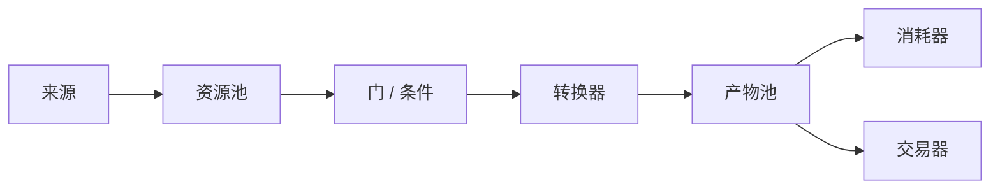
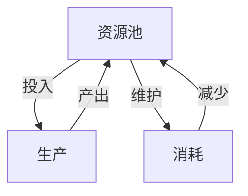

# 游戏机制：内部经济与反馈设计

<ArticleTags />

很多设计讨论把“机制”说成“玩法”，把“平衡”说成“调数值”。但机制真正决定的是：**资源如何流动、玩家如何选择、系统如何反馈**。一个射击游戏的弹药、一个 RTS 的矿场、一个 RPG 的经验曲线，本质都是内部经济。

Ernest Adams 与 Joris Dormans 的《游戏机制：高级游戏设计技术》用“内部经济”和 Machinations 图把这件事讲清楚：机制可以被画出来、模拟、比较和平衡。这篇笔记按书的十二章结构整理这条主线。

::: warning 关于本文
原书为扫描版，OCR 文本不可靠。本文依据目录、关键页面与公开资料整理，**不是译文**；示例为游戏设计场景的原创说明，不虚构原书引语。
:::

::: tip 怎么读
做经济/养成/策略游戏，重点读第 3–8 节；做关卡/流程，重点读第 9–10 节；做叙事/严肃游戏，读第 11 节。第 2 节的“突现 vs 渐进”是全书的地基。
:::

## 1. 机制不是规则：从规则到系统

书里先区分规则与机制：规则是“不能做什么、怎么做”的约束；机制是规则在运行中形成的**可交互结构**。规则是静态文本，机制是动态系统。

书里把机制分成五类：

| 机制类型 | 作用 | 例子 |
| - | - | - |
| 物理机制 | 移动、碰撞、弹道、重力 | 平台跳跃、赛车、射击 |
| 内部经济 | 资源的生产、消耗、转换、交易 | 金币、矿石、弹药、经验 |
| 渐进机制 | 解锁、升级、关卡推进 | 技能树、锁钥、章节 |
| 战术机动 | 位置、掩体、包抄、视野 | 战棋、FPS、RTS |
| 社交互动 | 合作、竞争、谈判、声誉 | 多人合作、公会、外交 |

机制独立于媒介：同一套资源/反馈结构可以做成桌游、电子游戏或纸面原型。书里强调尽早设计机制，并用软件/纸面/物理原型验证。

## 2. 突现 vs 渐进：两种玩法结构

书里用“突现（emergence）”和“渐进（progression）”区分两种玩法来源：

| | 突现型 | 渐进型 |
| - | - | - |
| 结构 | 简单规则 + 系统交互 | 设计好的关卡/任务序列 |
| 例子 | 《文明》《模拟城市》 | 《塞尔达传说》、平台跳跃 |
| 优点 | 重玩性、策略空间 | 节奏、叙事、教学 |
| 风险 | 难平衡、难预测 | 重玩性低、线性 |

突现来自复杂系统：简单部分相互作用，产生设计者没有逐条写出的局面。渐进来自设计者的编排：先教什么、再考什么、何时给新能力。

大多数商业游戏是混合体：用渐进教学，用突现提供长期策略空间。书里用《文明》讲突现，用《塞尔达传说》讲渐进，这个对照很适合作为设计起点。

## 3. 内部经济：资源、实体与四个功能

内部经济不是“有钱的游戏”才有。象棋也有经济：棋子是资源，吃子是转换，局面是状态。书里把经济系统拆成：

| 要素 | 含义 | 例子 |
| - | - | - |
| 资源 | 可积累/消耗的量 | 金币、木材、弹药、HP |
| 实体 | 拥有/生产/消耗资源的对象 | 单位、建筑、玩家 |
| 来源 | 产生资源 | 金矿、税收、刷新器 |
| 消耗器 | 移除资源 | 维护费、弹药消耗、死亡 |
| 转换器 | 输入→输出 | 木材→家具、矿石→士兵 |
| 交易器 | 交换资源 | 商店、市场、外交 |

四个功能（来源、消耗、转换、交易）构成经济的基本闭环。书里用“经济走势图”描述资源随时间的变化：是稳定、增长、震荡，还是崩溃。

经济结构决定策略空间：资源越单一，策略越容易收敛；资源越多、转换链越长，策略空间越大，但也越难平衡。

## 4. Machinations：把经济画成图

Machinations 是书里的核心工具：用节点和连线把经济画出来，并直接模拟。基本元件包括：

| 元件 | 作用 | 游戏例子 |
| - | - | - |
| 池（Pool） | 存储资源 | 金币、HP、弹药 |
| 资源通路 | 资源在节点间流动 | 收入、生产、消耗 |
| 激活模式 | 何时触发流动 | 每帧、每回合、条件触发 |
| 推送/牵引 | 资源主动流出/被拉入 | 生产/需求 |
| 状态变化 | 条件改变连接/流量 | 升级、解锁、阈值 |
| 门（Gate） | 按条件放行 | 科技要求、人口上限 |
| 来源/消耗器 | 生成/移除资源 | 金矿/维护费 |
| 转换器 | 输入转输出 | 木材→家具 |
| 交易器 | 交换资源 | 市场 |
| 延迟/队列 | 时间滞后 | 建造、匹配 |
| 寄存器 | 保存状态 | 计数、标记 |
| 倍增数 | 缩放流量 | 升级、效率 |

书里用《吃豆人》做完整示例：豆子是资源，水果是奖励，鬼是危险度，大力丸是状态变化，生命是消耗器。它说明即使是动作游戏，也能画出一张内部经济图。

Machinations 的价值不是“画得好看”，而是**让你在写代码前发现结构问题**：资源只进不出会爆炸，只有正反馈会滚雪球，延迟太长会震荡。

## 5. 反馈循环：正反馈、负反馈与延迟

书里用篮球比赛类比正/负反馈：得分后士气更高是正反馈；领先太多被“皮筋”拉回是负反馈。

- **正反馈**：资源越多，产出越多，强者愈强。它制造爽感和滚雪球，但容易让游戏早早失去悬念。
- **负反馈**：领先者受到更多阻力，落后者获得补偿。它维持悬念，但过度会惩罚优秀玩家。
- **延迟**：反馈不是即时生效时，系统可能震荡；延迟越长，越难调。

书里还讨论多个反馈循环叠加、反馈的强度/延迟/稳定性等属性。实际调参时，先画出循环，再问：哪个循环主导？它的延迟多大？玩家能否感知？

## 6. 常见机制与设计模式

书里第 6 章给出大量机制示例：动作游戏的增益/收集、竞速的皮筋约束、RPG 元素、FPS 经济、RTS 采集/建造/战斗、科技树。第 7 章把这些结构抽象成设计模式：

| 模式 | 作用 | 典型场景 |
| - | - | - |
| 静态引擎 | 固定产出 | 金矿、税收 |
| 动态引擎 | 投入越多产出越多 | 经济增长、滚雪球 |
| 转换引擎 | 输入转输出 | 生产链 |
| 阻碍力 | 消耗/维护/摩擦 | 军队维护费 |
| 渐增挑战 | 成本/难度递增 | 升级费用、关卡难度 |
| 军备竞赛 | 双方互相升级 | RTS、卡牌对抗 |
| 多反馈 | 多个循环叠加 | 复杂经济 |
| 交易 | 资源交换 | 市场、外交 |
| 劳力分配 | 有限工人分配到任务 | 工人放置、RTS 建造 |
| 慢性循环 | 长周期循环 | 赛季、长期养成 |

设计模式是词汇，不是配方。它的价值是让你说清“这里是一个动态引擎 + 阻碍力”，从而判断它会不会滚雪球、是否需要负反馈。

## 7. 模拟与平衡：人工玩家与多次运行

书里第 8 章讲如何用 Machinations 模拟玩测：设置人工玩家策略，跑多次模拟，收集资源曲线、胜负、游戏时长等数据，再调参数。

两个案例：

- **《地产大亨》**：分析运气、地租与收入的平衡；加入动态阻碍力，避免早期领先者锁死胜局。
- **《SimWar》**：把多个机制组合成模型，定义人工玩家，调节平衡，再从模型回到游戏。

模拟能回答“这个结构会不会爆炸/震荡/收敛”，但不能替代真人测试。人工玩家的策略是假设，不是玩家；模型通过不代表体验好。

## 8. 经济构建型游戏：生产链与瓶颈

书里第 9 章用《凯撒大帝 III》和《月球殖民地》讲经济构建游戏：

- **《凯撒大帝 III》**：生产链、仓储、劳动力、分配、需求满足；主导经济结构决定城市能否运转。
- **《月球殖民地》**：从规则、基本经济结构、经济构件到障碍/事件，逐步搭建一个可玩的殖民地经济。

经济构建游戏的核心不是“资源多”，而是**瓶颈**：工人不够、运输不够、存储不够、需求不满足。瓶颈决定玩家的决策顺序，也决定游戏的节奏。

## 9. 关卡与机制融合：从玩具到游乐场

书里第 10 章把机制和关卡设计接起来：

- **玩具 → 游乐场**：先做一个好玩的机制（玩具），再给它空间与目标（游乐场）。
- **任务映射**：把机制映射到主任务与游戏空间；任务不是文本，而是对机制的使用。
- **技能原子**：把玩家要学的操作拆成最小单元，按顺序教学。
- **学习曲线**：先安全练习，再组合，再考核。

关卡不是机制的装饰，而是机制的**使用说明书**：它决定玩家先遇到哪个资源、哪个瓶颈、哪个反馈。

## 10. 渐进机制：锁钥与突现型进度

书里第 11 章讲渐进：

- **锁—钥匙**：能力/物品/信息作为钥匙，打开空间/任务/机制。
- **动态锁—钥匙**：锁与钥匙的关系会变化，例如能力组合、状态变化。
- **突现型进度**：把进度本身看作资源，通过间接生产推进，而不是线性关卡。

锁钥让玩家感到“我变强了/我理解了”；突现型进度让重玩有不同路线。两者可以结合：用锁钥教学，用突现提供长期策略。

## 11. 有意义的机制：严肃游戏与符号学

书里第 12 章讨论机制如何传达意义：严肃游戏、传播理论、游戏与模拟系统中的符号学、类比模拟与象征模拟、意义的多个层次。

核心观点：机制不是中性的。资源、规则、反馈的选择会传达价值判断。一个“殖民”游戏把土地、劳动、资源抽象成数字，本身就在表达某种视角。

做严肃游戏时，别把“教育文本”贴在机制外面；让机制本身承载要表达的关系，才可能产生有意义的选择。

## 12. 机制的边界与检查清单

机制不是万能的：

- 不是所有体验都能简化成资源流；手感、叙事、社交、审美需要别的语言。
- 只有正反馈会滚雪球，只有负反馈会抹平差异；需要混合与延迟。
- 模拟通过不等于好玩；人工玩家不是真人。
- 设计模式是词汇，不是配方；套模式会失去游戏的个性。

检查清单：

- [ ] 核心资源是什么？来源、消耗、转换、交易是否闭合？
- [ ] 正反馈/负反馈各有哪些？延迟多大？
- [ ] 是否存在支配性策略或早期滚雪球？
- [ ] 经济图能否被玩家理解，还是只有设计师看得懂？
- [ ] 关卡是否映射了机制与任务，而不是只做美术？
- [ ] 锁钥/进度是否清晰，玩家是否知道“下一步能做什么”？
- [ ] 模拟是否覆盖不同策略、运气与玩家水平？
- [ ] 机制是否支持主题与意义，而不是相互矛盾？
- [ ] 是否做过真人测试，而不只看模型？
- [ ] 如果删掉一个机制，游戏会失去什么？

## 13. 参考与延伸

- 原书：Ernest Adams、Joris Dormans，《游戏机制：高级游戏设计技术》（Game Mechanics: Advanced Game Design）。本文依据目录、关键页面与公开资料整理，不是译文。
- 站内笔记：[游戏编程精粹](/notes/game-programming-gems)、[游戏 AI 开发](/notes/game-ai-development)、[心流与游戏](/notes/flow-game-design)、[游戏改变世界](/notes/games-change-the-world)。
- 站内实践：[游戏设计模式实践](/Tech/Architecture/Game_Design_Patterns_Practice)、[决策系统](/Tech/Architecture/Decision_System)。
