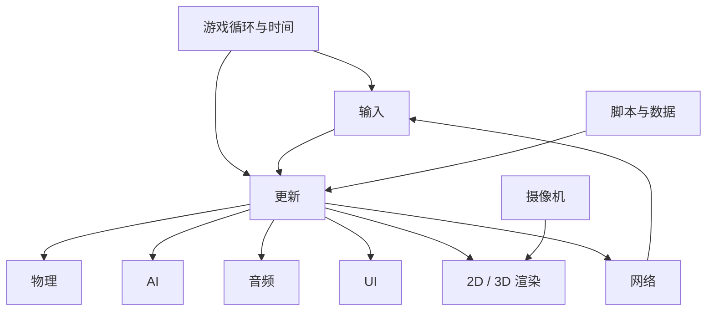

# 游戏编程算法与技巧：核心系统地图

<ArticleTags />

《游戏编程算法与技巧》讲的不是某个引擎的 API，而是把游戏拆成一组可以独立理解的系统：时间怎么推进、2D/3D 怎么画、输入怎么收、物理怎么算、AI 怎么找路、声音怎么定位、数据怎么读、网络怎么同步。每个系统都给出最小算法与工程取舍。

这篇笔记按书的章节顺序整理一张实现地图：先给问题，再给核心公式或算法，最后落到一段 C# 示例与工程注意点。

::: warning 关于本文
原书是扫描版，本文依据其目录、关键页面与公开资料整理，**不是译文**，也不替代原书。代码为游戏开发场景的原创示例，用来演示算法形态，不追求直接复制进项目即可运行。
:::

::: tip 怎么读
如果你在做一个 2D 小项目，先读第 1、2、5、8 章；做 3D 项目加读第 3、4、7 章；做多人或 AI 项目再读第 9、12 章。每章末尾的“工程注意点”比公式更值得反复看。
:::



## 1. 游戏循环与时间

### 1.1 传统循环：输入、更新、输出

书里给出的最简结构是一个 `while`：

```text
while game is running
    process inputs
    update game world
    generate outputs
loop
```

三个阶段都比字面含义更宽：

- **输入**不只是键鼠手柄，还包括网络包、录像回放、移动设备的摄像头/GPS。
- **更新**会遍历所有激活对象，可能是几千上万个。
- **输出**不只是渲染，还包括音频、震动反馈、给其他玩家发送状态。

Pac-Man 是这本书反复用的例子：摇杆输入改变方向，幽灵由 AI 更新，碰撞决定吃豆或死亡，输出只有画面与声音。

### 1.2 固定步长与累加器

可变步长写起来最直接：每帧把 `deltaTime` 传给物理和 AI。但帧率波动会让同一个跳跃在不同机器上落到不同高度，碰撞也更容易穿透。

固定步长把逻辑更新锁在稳定的 `dt` 上，用累加器补帧：

```csharp
const float FixedDt = 1f / 60f;
float _accumulator;

void Tick(float frameTime)
{
    _accumulator += Mathf.Min(frameTime, 0.25f); // 防止“死亡螺旋”
    while (_accumulator >= FixedDt)
    {
        Update(FixedDt);
        _accumulator -= FixedDt;
    }

    var alpha = _accumulator / FixedDt; // 渲染插值系数
    Render(alpha);
}
```

渲染可以用 `alpha` 在上一帧与当前帧之间插值，避免固定 60Hz 逻辑在 144Hz 屏幕上看起来抖动。书里还讨论了多线程循环：渲染线程与更新线程并行，但共享状态需要同步，复杂度会明显上升。

### 1.3 真实时间、游戏时间与对象更新

- **真实时间**：墙钟时间，用于计时、日志、网络超时。
- **游戏时间**：可以被暂停、慢放、加速的时间，用于动画、AI、冷却。
- **对象更新顺序**：输入 → AI → 物理 → 碰撞 → 音频/UI → 渲染。顺序变了，行为可能就变了。

**工程注意点**：先把时间源统一成一个可替换的接口；暂停、慢动作、回放都靠它，而不是在每个系统里写 `if (paused)`。

## 2. 2D 渲染

### 2.1 像素、垂直同步与精灵

2D 渲染的底层是像素缓冲区。书里从 CRT 讲起：电子束逐行扫描，垂直同步（vsync）用来避免画面撕裂；双缓冲让渲染在后台完成后一次性交换。

精灵（sprite）是带位置、尺寸、纹理区域、颜色与翻转的四边形。绘制顺序决定遮挡：背景 → 地图 → 角色 → 特效 → UI。

### 2.2 精灵动画与精灵表单

逐帧动画的本质是按时切换纹理区域。把所有帧放进一张精灵表单（sprite sheet），可以减少纹理切换：

```csharp
int frame = (int)(_elapsed * framesPerSecond) % frameCount;
var source = new Rect(frame * frameWidth, 0, frameWidth, frameHeight);
Draw(texture, destination, source);
```

工程上要注意：动画事件（脚步声、攻击判定）不要绑在“第几帧”上，而是绑在时间轴上；帧率变化时才能保持一致。

### 2.3 滚屏与砖块地图

书里把滚屏分成四类：

| 类型 | 做法 | 典型场景 |
| - | - | - |
| 单轴滚屏 | 摄像机只沿一个方向移动 | 横版跳跃、纵向射击 |
| 无限滚屏 | 背景/地图循环复用 | 跑酷、无尽关卡 |
| 平行滚屏 | 多层以不同速度移动 | 远景山脉、云层 |
| 四向滚屏 | 摄像机在二维平面自由移动 | 俯视角 RPG、RTS |

砖块地图（tilemap）用二维网格拼出关卡；碰撞可以单独一层。斜视等视角（isometric）需要把网格坐标转换成屏幕坐标，常见近似是：

```text
screenX = (tileX - tileY) * tileWidth / 2
screenY = (tileX + tileY) * tileHeight / 2
```

**工程注意点**：地图数据与表现分离；同一份 tile 数据可以换不同图集，也方便做关卡编辑器和寻路。

## 3. 游戏中的线性代数

### 3.1 向量、点乘与反射

向量是游戏里最常用的数学对象：位置、速度、加速度、方向、法线。点乘给出投影与夹角：

```text
a · b = |a| |b| cosθ
```

它常用来判断“目标在不在前方”“两个方向有多接近”。反射向量是碰撞与瞄准的基础：

```text
r = d - 2 (d · n) n
```

其中 `d` 是入射方向，`n` 是单位法线。书里用“向量反射”作为点乘的例题，这个公式在子弹反弹、光线追踪、台球物理里都会出现。

### 3.2 叉乘与 2D 旋转

2D 叉乘的标量值可以判断两个向量的相对方位（左/右），3D 叉乘则用来构造摄像机的三个基向量。

2D 角色旋转可以直接用三角函数：

```text
x' = x cosθ - y sinθ
y' = x sinθ + y cosθ
```

如果只需要朝向，不必每帧算角度：保存一个前向单位向量，用点乘/叉乘判断转向即可。

### 3.3 线性插值与坐标系

线性插值：

```text
lerp(a, b, t) = a + (b - a) * t
```

`t` 通常限制在 `[0,1]`。它用于位置平滑、颜色过渡、动画混合。注意：对角度插值要先处理环绕（例如 350° 到 10° 应走 20°，而不是 340°）。

坐标系是 3D 图形的骨架：模型坐标系 → 世界坐标系 → 视角坐标系 → 投影坐标系。每换一次坐标系，就是乘一个矩阵。

### 3.4 矩阵：变换、逆与转置

矩阵把平移、旋转、缩放合成一个变换。乘法顺序很重要：`世界 = 平移 × 旋转 × 缩放`（具体取决于行/列向量约定）。

- **逆矩阵**：把变换反向，用于把世界坐标变回局部坐标。
- **转置**：正交旋转矩阵的逆等于转置，法线变换也常用逆转置。

站内已有更细的推导：[3D 数学基础](/notes/3d-math-primer) 与 [四元数与三维旋转](/notes/quaternion-3d-rotation)。

## 4. 3D 图形

### 4.1 四个坐标空间

书里把 3D 管线拆成四个空间：

| 空间 | 回答的问题 |
| - | - |
| 模型空间 | 顶点相对于物体原点在哪里 |
| 世界空间 | 物体在场景中的位置、朝向、缩放 |
| 视角空间 | 以摄像机为原点看，物体在哪里 |
| 投影空间 | 透视/正交投影后，如何映射到屏幕 |

模型矩阵把顶点送到世界，观察矩阵送到摄像机，投影矩阵送到裁剪空间；最后做透视除法与视口变换。

### 4.2 光照与着色

顶点属性通常包括位置、法线、UV、颜色。Phong 光照模型把光照拆成三项：

- **环境光**：全局基础亮度。
- **漫反射**：与法线和光线方向夹角有关。
- **镜面反射**：与视角和反射方向有关。

逐顶点着色（Gouraud）计算量小但高光容易丢；逐像素着色（Phong）效果更好但更贵。现代管线通常在片元着色器里算法线与光照。

### 4.3 可见性：画家算法与深度缓冲

画家算法按物体距离排序，先画远的再画近的；它实现简单，但遇到相交三角形或循环遮挡就会出错。

深度缓冲区（z-buffer）为每个像素保存深度，绘制时比较并更新；它解决了大部分遮挡问题，但透明物体仍需排序。工程上要关注深度精度、近远裁剪面比例与 early-z。

### 4.4 四元数

四元数用四个分量表示旋转，避免欧拉角的万向锁，也方便做球面插值（slerp）。书里把它作为 3D 对象表示的补充；实际项目里，动画、相机、网络同步都常直接传四元数。

**工程注意点**：位置用向量、旋转用四元数、缩放用向量；不要把三者混成一个“万能 Transform”到处传。

## 5. 游戏输入

### 5.1 数字输入与模拟输入

- **数字输入**：按下/松开，适合按钮、菜单、跳跃。
- **模拟输入**：摇杆、扳机、鼠标位移，适合移动、瞄准、油门。

模拟输入要设死区（dead zone），避免摇杆漂移；还要做归一化，防止斜向移动比直线快。

### 5.2 基于事件的输入系统

轮询适合简单项目；事件驱动更适合复杂输入：设备层产生事件，映射层把事件翻译成游戏动作，游戏层消费动作。

```csharp
public readonly struct InputEvent
{
    public readonly string Action;
    public readonly float Value;
    public InputEvent(string action, float value)
    {
        Action = action;
        Value = value;
    }
}

// 每帧清空队列，消费后不再重复触发
while (_queue.Count > 0)
{
    var e = _queue.Dequeue();
    _bindings.Dispatch(e);
}
```

书里还讨论了更复杂的系统：输入上下文（菜单/ gameplay）、按键组合、重绑定、录制回放。

### 5.3 移动设备输入

触屏要处理按下、移动、抬起、取消与多点触控；手势（滑动、缩放、长按）通常在手势识别层做。加速度计与陀螺仪适合倾斜控制，但需要校准与滤波，否则噪声会让镜头抖。

## 6. 声音

### 6.1 声音事件与原始数据

声音的底层是 PCM 采样：采样率、位深、声道数。游戏层不应该直接操作采样，而是发出声音事件：播放、停止、设置音量/音高/位置、切换总线。

### 6.2 3D 声音

3D 声音需要两个角色：

- **监听者（listener）**：通常是摄像机。
- **发射者（emitter）**：声源。

根据距离做衰减（attenuation），根据方向做声像/环绕；距离越远越小声，超出最大距离后静音。书里还提到多声道与环绕声的通道布局。

### 6.3 DSP、区域标记、多普勒与遮挡

- **DSP**：滤波、混响、压缩、失真等实时处理。
- **区域标记**：进入洞穴/水下时切换混响与滤波。
- **多普勒**：根据声源与监听者的相对速度改变音高。
- **遮挡**：声源与监听者之间有墙时，做低通滤波或降低音量。

**工程注意点**：音频线程与游戏线程分离；限制同时播放的 voice 数量；重要音效做优先级与虚拟化。

## 7. 物理

### 7.1 碰撞几何体

书里从平面、射线、线段讲起，再到常用碰撞体：

| 几何体 | 优点 | 缺点 |
| - | - | - |
| 包围球 | 检测最快 | 贴合度差 |
| AABB | 检测简单、易做 broad phase | 旋转后需重新包围 |
| OBB | 贴合旋转物体 | 检测更贵 |
| 胶囊体 | 适合角色 | 不是精确形状 |
| 凸多边形/凸包 | 贴合度高 | 构建与检测复杂 |
| 组合体 | 用多个简单体拼复杂形状 | 管理成本高 |

### 7.2 碰撞检测

常见组合：

| 检测 | 关键点 |
| - | - |
| 球 vs 球 | 球心距 ≤ 半径和 |
| AABB vs AABB | 三个轴上的区间都重叠 |
| 线段 vs 平面 | 参数方程求交，判断参数在 `[0,1]` |
| 线段 vs 三角形 | 先求平面交点，再判断点在三角形内 |
| 球 vs 平面 | 球心到平面距离 ≤ 半径 |
| 球形扫掠体 | 解二次方程求首次接触时间，防穿透 |

broad phase 先用 AABB/网格/四叉树筛掉不可能碰撞的对象，narrow phase 再做精确检测。

### 7.3 碰撞响应

碰撞响应需要：碰撞法线、穿透深度、恢复系数（弹性）、摩擦系数。位置修正把物体推出穿透，速度修正反射法线方向的分量：

```text
v' = v - (1 + e) (v · n) n
```

高速物体要用扫掠检测（swept collision）或连续碰撞检测，否则会“穿模”。

### 7.4 数值积分

牛顿第二定律：

```text
F = m a
```

游戏里每帧由力算加速度，再积分出速度与位置。书里比较了几种数值积分：

```csharp
// 半隐式欧拉：先更新速度，再更新位置，比显式欧拉稳定
void Integrate(float dt)
{
    Velocity += Acceleration * dt;
    Position += Velocity * dt;
}

// Verlet：用当前位置与上一帧位置推导速度
void IntegrateVerlet(float dt)
{
    var next = Position + (Position - Previous) + Acceleration * dt * dt;
    Previous = Position;
    Position = next;
}
```

显式欧拉在弹簧/轨道等场景容易发散；半隐式欧拉更稳；Verlet 适合布料、绳索与位置约束。

### 7.5 可变时间步长的问题

可变 `dt` 会让物理结果依赖帧率：同一个跳跃在不同机器上高度不同，碰撞穿透概率也不同。书里建议物理用固定步长，渲染做插值；如果必须可变步长，至少要做子步拆分与上限截断。

**工程注意点**：先做单位与坐标约定（米/厘米、Y 轴向上/向下），否则物理参数会在项目中途全部重调。

## 8. 摄像机

### 8.1 摄像机类型

| 类型 | 行为 | 典型场景 |
| - | - | - |
| 固定摄像机 | 位置/朝向不变 | 固定视角解谜、格斗 |
| 第一人称 | 跟随角色眼睛，鼠标看向 | FPS |
| 跟随摄像机 | 保持与目标的偏移 | 第三人称动作、平台跳跃 |
| 场景切换摄像机 | 在预设机位之间切换/飞行 | 过场、Boss 登场 |

### 8.2 透视投影、FOV 与宽高比

透视投影让远处物体变小；视场（FOV）决定画面包容范围，宽高比决定水平/垂直 FOV 的换算。FOV 变大，画面更广但边缘畸变更明显；FOV 变小，画面更“压缩”。

### 8.3 基础跟随与弹性跟随

书里的基础跟随公式：

```csharp
Vector3 eye = target - forward * hDist + up * vDist;
Vector3 camForward = (target - eye).normalized;
Vector3 camLeft = Vector3.Cross(up, camForward).normalized;
Vector3 camUp = Vector3.Cross(camForward, camLeft).normalized;
```

它僵硬地贴着目标。弹性跟随先算理想位置，再让实际位置逐帧靠近：

```csharp
var ideal = target - forward * hDist + up * vDist;
var t = 1f - Mathf.Exp(-stiffness * Time.deltaTime);
transform.position = Vector3.Lerp(transform.position, ideal, t);
```

指数平滑与帧率无关；`stiffness` 越大，跟随越紧。书里还讨论了旋转摄像机、第一人称与样条摄像机。

### 8.4 摄像机碰撞与拣选

摄像机碰撞：从目标向理想机位做射线/球扫掠，碰到墙就把机位拉近，避免穿墙。

拣选（picking）：从屏幕坐标发射一条射线，检测与物体/地面的交点，用于点击、拖拽、瞄准。

## 9. 人工智能

### 9.1 游戏 AI 与搜索空间

游戏 AI 的目标不是“真智能”，而是“可理解、可控制、成本可接受”。寻路首先要把世界表示成搜索空间：

- 网格：实现简单，适合砖块地图。
- 路点图：节点少，适合开放场景。
- 导航网格：贴合可行走区域，适合 3D。

每条边有权重（距离、地形代价、危险度），启发式函数估计“到目标还有多远”。

### 9.2 贪婪最佳优先、A* 与 Dijkstra {#a-star}

- **贪婪最佳优先**：每次选 `h` 最小的节点，速度快，但不保证最短路径。
- **A***：`f(n) = g(n) + h(n)`，`g` 是起点到当前的真实代价，`h` 是到目标的估计；启发式可采纳（不高估）时能保证最优。
- **Dijkstra**：`h = 0`，只按 `g` 扩展，保证最短路径，但没有方向性，扩展节点更多。

A* 的核心循环：

```csharp
while (open.Count > 0)
{
    var current = open.MinBy(n => n.F);
    if (current == goal) return BuildPath(current);

    open.Remove(current);
    closed.Add(current);

    foreach (var next in current.Neighbors)
    {
        var g = current.G + Cost(current, next);
        if (g >= next.G) continue;

        next.G = g;
        next.F = g + Heuristic(next, goal);
        next.Parent = current;
        if (!open.Contains(next)) open.Add(next);
    }
}
return null; // 无路径
```

启发式常用曼哈顿距离（四向网格）、欧几里得距离（自由移动）或对角线距离（八向网格）。启发式不可采纳会破坏最优性；过大则退化成贪婪。

### 9.3 状态机

有限状态机（FSM）把 AI 拆成状态与转换：巡逻、追击、攻击、逃跑。每个状态有进入、更新、退出；更新返回下一个状态。

```csharp
public interface IState
{
    void Enter();
    IState Tick(float dt);
    void Exit();
}
```

状态机适合状态少、转换明确的敌人；状态一多，转换表会爆炸，可以升级为分层状态机或行为树。

### 9.4 策略与计划

策略（strategy）解决“怎么做”的选择，计划（planning）解决“按什么顺序做”。书里讨论了把目标拆成前置条件与效果，再搜索动作序列；这比硬编码状态转换更灵活，但调试成本更高。

**工程注意点**：AI 更新频率通常低于渲染；寻路请求要排队/分摊到多帧，避免一帧内大量 A* 造成卡顿。

## 10. 用户界面

### 10.1 菜单栈

菜单用栈管理：打开设置压栈，返回弹栈；栈顶接收输入，下层暂停或变暗。这样“返回”行为天然正确，不需要每个界面自己记父界面。

### 10.2 HUD：路点箭头、准心与雷达

- **路点箭头**：把世界目标投影到屏幕；目标在屏幕外时，把箭头夹在屏幕边缘并指向目标。
- **准心**：固定或动态扩散；动态扩散要跟武器精度/移动状态绑定。
- **雷达**：把世界坐标转换到以玩家为中心的极坐标/圆形区域，再按玩家朝向旋转。

### 10.3 分辨率与本地化

UI 要适配多分辨率与安全区：锚点、相对布局、最小/最大字号。本地化不仅是翻译，还要考虑文本膨胀、字体缺字、从右到左语言与数字格式。

**工程注意点**：UI 与玩法通过事件/视图模型解耦；不要让 HUD 直接持有玩家对象并每帧轮询所有字段。

## 11. 脚本语言与数据格式

### 11.1 脚本语言的取舍

脚本让策划/关卡设计师不重新编译就能改行为，但会带来性能、调试、安全与版本管理成本。书里比较了几类：

- **嵌入式脚本**：Lua 最常见，轻量、易嵌入。
- **引擎专用脚本**：如 UnrealScript（书写作时的例子），与引擎深度集成。
- **可视化脚本**：节点连线，门槛低，但复杂逻辑容易变成“面条图”。

### 11.2 实现一门小脚本语言的管线

书里把实现拆成四步：

1. **标记化（tokenize）**：把源码切成标识符、数字、符号。
2. **正则表达式**：用于识别数字/字符串等模式（不等于完整解析）。
3. **语法分析（parse）**：按语法生成抽象语法树。
4. **执行/生成代码**：遍历 AST 解释执行，或生成字节码/机器码。

工程上不要自己写完整语言，除非你在做工具链；优先用成熟脚本运行时，把沙箱、错误行号、热重载做好。

### 11.3 数据格式

| 格式 | 优点 | 缺点 | 适用 |
| - | - | - | - |
| 二进制 | 快、小、可内存映射 | 不可读、版本兼容难 | 运行时资源、存档 |
| INI | 简单、易手改 | 只适合扁平键值 | 配置、启动参数 |
| XML | 结构强、工具多 | 冗长、解析慢 | 复杂配置、UI 布局 |
| JSON | 可读、通用、易生成 | 无注释、数字精度有限 | 关卡/数值/网络 |

### 11.4 案例：WoW 的 UI Mod

书里用《魔兽世界》UI Mod 说明“布局 + 行为”的分离：XML 描述界面布局，Lua 描述行为与事件。它同时暴露了两个问题：自动化脚本可能破坏玩法平衡；插件与游戏版本/其他插件兼容性差。

## 12. 网络游戏

### 12.1 协议：IP、ICMP、TCP、UDP

- **IP**：负责寻址与路由，不保证送达。
- **ICMP**：控制消息（如 ping、不可达）。
- **TCP**：可靠、有序、有流控；但重传与队头阻塞会带来延迟。
- **UDP**：无连接、不可靠、低开销；游戏常用它，再在应用层实现需要的可靠性/排序。

书里的判断很直接：位置这类“稍旧也能用”的数据可以丢；开枪、拾取这类关键事件必须可靠送达。端口约 65000 个可用，游戏要避开常见服务端口。

### 12.2 拓扑：客户端/服务器与点对点

- **客户端/服务器**：服务器权威，易防作弊、易管理，但服务器与带宽成本高。
- **点对点**：主机之间直连，延迟可能更低、成本更低，但一致性、NAT 穿透与作弊更难处理。

### 12.3 作弊与防护

书里列了三类：

- **信息作弊**：读取本不该看到的信息（地图全开、透视）。
- **状态作弊**：修改内存/存档（无敌、改金币）。
- **中间人攻击**：截获/篡改通信。

基础防护是服务器权威 + 输入校验 + 关键数据加密/签名；客户端永远不可信。

## 13. 两个完整案例

### 13.1 横版卷轴（iOS / Cocos2D）

书的第一个案例用 Objective-C + Cocos2D 做一个横向滚屏射击：`AppDelegate` 启动、`MainMenuLayer` 菜单、`GameplayScene` 组合滚动层与对象层，`Ship`/`Projectile`/`Enemy` 分别管理玩家、子弹与敌人。

它把前面的系统串起来：滚动层做无限滚屏，对象层做碰撞与生成，输入驱动飞船，音频/UI 提供反馈。

### 13.2 塔防（PC/Mac / C# / XNA / MonoGame）

第二个案例用 C# + XNA/MonoGame 做塔防：单例管理游戏入口，游戏状态管理开始/暂停/失败，关卡与计时器驱动波次，A* 做敌人寻路，摄像机做投影，输入/物理/本地化/图形/声音/UI 各自成模块。

它更接近真实项目结构：系统多、状态多，但每个模块都能单独讲清楚。

## 14. 学习路线与检查清单

建议顺序：

1. 游戏循环与固定步长 → 2D 精灵/滚屏 → 输入。
2. 向量/矩阵 → 3D 坐标空间 → 光照与深度。
3. 碰撞几何/检测/响应 → 数值积分 → 摄像机。
4. A* / FSM → UI/HUD → 脚本与数据。
5. 网络协议/拓扑 → 做一个可联机的小原型。

检查清单：

- [ ] 逻辑更新是否固定步长？渲染是否做了插值？
- [ ] 时间源是否可暂停/慢放/回放？
- [ ] 2D 绘制的排序与图集切换是否可控？
- [ ] 点乘/叉乘/插值的坐标系与单位是否统一？
- [ ] 3D 变换顺序、法线变换、深度精度是否验证过？
- [ ] 输入是否区分数字/模拟，并处理死区与重绑定？
- [ ] 3D 声音的监听者/发射者、衰减与遮挡是否配置？
- [ ] 碰撞是否分 broad/narrow phase，高速物体是否防穿透？
- [ ] 摄像机是否防穿墙，FOV/宽高比是否适配？
- [ ] A* 的启发式是否可采纳，寻路是否分摊到多帧？
- [ ] UI 是否适配多分辨率/本地化，HUD 是否与玩法解耦？
- [ ] 数据格式是否可版本化，脚本是否有沙箱与错误行号？
- [ ] 网络是否服务器权威，关键事件是否可靠送达？

## 15. 参考与延伸

- 原书：Sanjay Madhav，《游戏编程算法与技巧》（Game Programming Algorithms and Techniques）。本文依据目录、关键页面与公开资料整理，不是译文。
- 站内笔记：[3D 数学基础](/notes/3d-math-primer)、[四元数与三维旋转](/notes/quaternion-3d-rotation)、[守望先锋的 ECS 与网络代码](/notes/overwatch-ecs-netcode)、[战斗公式](/notes/combat-formulas)。
- 站内实践：[ECS 完整指南](/Tech/Architecture/ECS_Complete_Guide)、[决策系统](/Tech/Architecture/Decision_System)。
