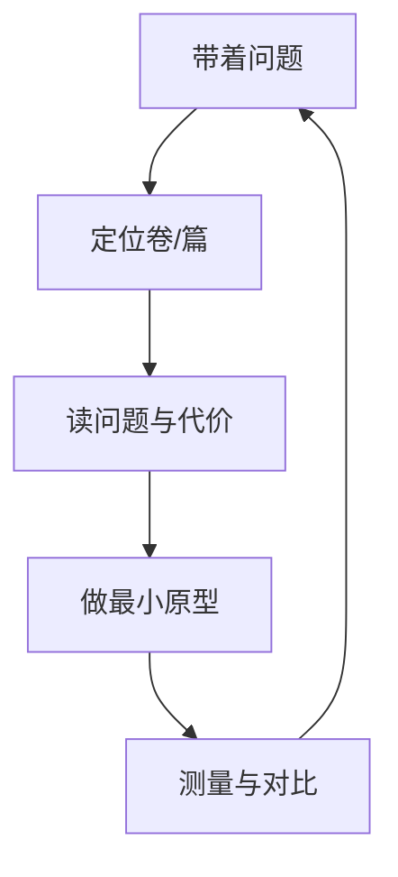

# 游戏编程精粹：六卷精选的十种工程技巧

<ArticleTags />

《Game Programming Gems》（常译作《游戏编程精粹》）不是一本连续教材，而是一套“宝石集”：每篇文章解决一个具体工程问题，给出方案、代码与代价。六卷加起来有数百篇，逐篇读完不现实；更有用的读法是**带着问题去翻**，把 gem 当成“问题—方案—代价”的卡片。

这篇笔记从 Gems 1–4、6、8 中提炼十个跨卷主题，每个主题列出对应的 gem 编号，说明它解决什么问题、核心思路是什么、今天可以怎么用。

::: warning 关于本文
六卷 PDF 的文本层质量不一（部分为扫描/OCR，部分带水印），本文依据各卷目录、可读页面与公开资料整理，**不是译文**，也没有覆盖全部 gem。引用的篇名与编号以目录为准；示例为本站原创。
:::

::: tip 怎么读
先看第 2 节的十个主题，找到与你当前问题最接近的一节；再用第 4 节的速查表定位具体卷/篇。不要从第 1 页开始顺序读，Gems 的价值在“按需取用”。
:::

## 1. 六卷怎么读：gem 是一张工程卡片

Gems 系列的起源可以追溯到 Mark DeLoura 在 2000 年发起的这套书：它借鉴 Graphics Gems 的形式，把一线开发者的经验拆成独立文章。每篇通常包含：

| 部分 | 你要看什么 |
| - | - |
| 问题 | 它解决的是哪类工程痛点 |
| 方案 | 数据结构、算法、关键公式 |
| 代码 | 可直接借鉴的实现骨架 |
| 代价 | 内存、性能、平台限制、维护成本 |
| 适用边界 | 什么情况下不该用 |

六卷的侧重不同，但共同点是**平台与引擎无关**：它们讲的是“怎么做”，不是“某个 API 怎么调”。这也是二十年后仍然值得读的原因。



## 2. 十个跨卷主题

### 2.1 数据驱动与实体工厂

**问题**：硬编码的关卡、敌人、技能让每次改数值都要重新编译；对象创建逻辑散落在各处，新增类型要改很多地方。

**核心思路**：把“数据”和“逻辑”分开。Gems 1 的《The Magic of Data-Driven Design》讲的就是这条原则：数据决定内容，代码只负责解释数据。Gems 2 §1.8《A Game Entity Factory》把对象创建收进工厂；Gems 3 §1.11《Using Lex and Yacc To Parse Custom Data Files》给出自定义数据文件的解析路径；Gems 4 §1.13《Using XML Without Sacrificing Speed》讨论如何在不牺牲加载速度的前提下使用 XML。

**今天怎么用**：用 ScriptableObject/JSON/表格做配置，用工厂或注册表创建实体；解析器优先用成熟库，把错误行号、热重载和 schema 校验做好。不要自己写一门语言，除非你在做工具链。

### 2.2 先测量再优化：性能与内存

**问题**：帧率掉了，团队凭感觉加缓存、换容器、关特效，结果优化了不重要的地方。

**核心思路**：先有测量，再有优化。Gems 2 §1.10 的调试内存管理器、§1.11 的内建性能分析模块，Gems 3 §1.6 的自定义 STL 分配器、§1.17 的实时分层性能分析，Gems 4 §1.5 的模板化 freelist，Gems 6 §2.1 的浮点技巧，都是围绕“看清成本”展开的。

**今天怎么用**：先用引擎 profiler 和内存快照定位热点，再考虑对象池、分配器、批处理。浮点技巧在现代 CPU 上收益有限，先确认瓶颈在算术还是在内存/分支。

### 2.3 数值稳定性与坐标空间

**问题**：大世界坐标抖动、远处物体穿透、四元数插值异常、IK 解不稳定。

**核心思路**：很多“图形 bug”其实是数值问题。Gems 2 §2.2 的向量/平面技巧、§2.7 的递归维度聚类（RDC）碰撞；Gems 3 §2.4 的四元数压缩、§2.5 的约束 IK；Gems 4 §2.3 的大世界坐标、§2.4 的非均匀样条、§2.6 的 Jacobian 转置 IK；Gems 6 §2.2 的投影空间 GPU 计算、§2.3 的叉乘解线性方程组。

**今天怎么用**：大世界用相机相对坐标或双精度；物理与渲染分空间；插值先处理环绕；IK 用阻尼/约束而不是硬解。

```csharp
// 大世界渲染：把世界坐标转换成相机相对坐标，减少浮点误差
Vector3 renderPos = (Vector3)(worldPos - cameraPos);
```

### 2.4 AI 的分层架构：战略、战术、转向

**问题**：AI 要么太笨（只会直线追），要么太贵（全员 A*），要么难以调试（一堆 if）。

**核心思路**：把 AI 拆层。Gems 2 §3.5 的砖块地图视线与搜索、§3.6 的影响力图、§3.8 的地形推理、§3.11 的捕食者/猎物群集、§3.12 的模糊状态机；Gems 3 §3.2 的区域导航、§3.6 的战术 A*、§3.7 的导航网格；Gems 4 §4.2 的叙事战斗、§4.4 的效用决策、§4.5 的分布式投票、§4.7 的 RTS 建墙；Gems 6 §3.1 的 Quake III Locust AI、§3.2 的 NPC 协调、§3.3 的行为机器人架构、§3.4 的目标导向机器人。

**今天怎么用**：战略层做影响图/资源分配，战术层做寻路/掩体，执行层做转向/动画；决策用效用或行为树，别把所有逻辑塞进一个状态机。

### 2.5 碰撞、约束与物理稳定性

**问题**：高速物体穿透、角色卡在墙角、布料/水体抖动、约束爆炸。

**核心思路**：碰撞分 broad phase / narrow phase；物理分积分、约束、接触求解。Gems 2 §2.7 的 RDC、§4.3 的球树、§4.4 的压缩 AABB 树；Gems 3 §2.6 的元胞自动机物理、§2.7 的摩擦处理；Gems 4 §3.3 的 Verlet 引擎、§3.4 的刚体约束、§3.5 的快速接触裁剪、§3.6 的交互水面、§3.7 的多层形变、§3.8 的模态分析；Gems 6 §2.6 的实时粒子流体。

**今天怎么用**：先选对几何体（球/AABB/胶囊/凸包），再做 broad phase；高速物体用扫掠/CCD；固定步长 + 子步；约束求解优先稳定性而不是真实感。

### 2.6 渲染：批处理、剔除、阴影与光照

**问题**：Draw call 太多、遮挡物没剔掉、阴影闪烁、风格化效果做不出来。

**核心思路**：Gems 2 §5.1/§5.2 的卡通渲染、§5.3 的逐像素光照、§5.6 的优先级缓冲阴影；Gems 3 §4.4 的快速遮挡剔除、§4.5 的 TriangleStrip、§4.6 的阴影体、§4.7 的细分曲面、§4.14 的动态地形光照、§4.16 的程序化纹理；Gems 4 §5.3 的透视阴影贴图、§5.4 的深度/ID 阴影缓冲、§5.12 的四元数硬件蒙皮、§5.13 的动作捕捉压缩；Gems 8 §1.1 的实例化字体渲染、§1.2 的 SSAO、§1.3 的多分辨率延迟着色、§1.4 的 Catmull-Clark 补丁视锥剔除、§1.5 的 Compute Shader 环境光遮蔽、§1.6 的不规则阴影贴图抗锯齿。

**今天怎么用**：先做批处理与剔除，再谈高端效果；阴影先解决稳定性和偏移，再追求分辨率；风格化渲染优先控制形状与色块，而不是堆后处理。

### 2.7 网络：权威、序列化与位打包

**问题**：延迟高、不同步、带宽爆、服务器撑不住。

**核心思路**：Gems 3 §5.1 的 RTS 延迟最小化、§5.2 的 RTS 网络协议、§5.3 的 MMO 模拟架构、§5.4 的服务器扩展、§5.5 的模板化对象序列化、§5.6 的安全套接字；Gems 4 §6.2 的单服数千客户端、§6.3 的 MMP 状态存储、§6.5 的位打包、§6.6 的多服务器时间与一致性。

**今天怎么用**：服务器权威 + 客户端预测；状态同步只发变化量；位打包适合紧凑的状态字段；序列化要有版本号与兼容策略；先测 RTT/丢包，再调同步频率。

```csharp
// 位打包：把多个小字段塞进一个 uint，减少带宽
uint Pack(byte health, byte ammo, bool crouch) =>
    (uint)health | ((uint)ammo << 8) | (crouch ? 1u << 16 : 0);
```

### 2.8 音频：DSP 图与 3D 声场

**问题**：音效听起来“平”、3D 定位不准、交互音乐切换生硬、语音/环境声占内存。

**核心思路**：Gems 2 §6.1 的游戏音频设计模式、§6.4 的交互式数字音频处理管线；Gems 3 §6.1 的 Ogg Vorbis 压缩、§6.2 的 3D 音频环境、§6.3 的 AABB 遮挡、§6.4 的双二阶滤波器、§6.6 的复杂音效随机合成、§6.7 的实时模块化音频处理；Gems 4 §7.2 的实时口型同步、§7.4 的音频脚本系统、§7.6 的由物理驱动的实时声音合成。

**今天怎么用**：用总线/子混音组织 DSP 图；3D 音频先校准监听者与衰减，再做遮挡/多普勒；交互音乐用分层/水平重组，不要频繁硬切；语音压缩优先考虑流式与内存预算。

### 2.9 工具链：日志、回放、调参

**问题**：bug 复现不了、日志太多/太少、参数调一次要重编译、性能问题靠猜。

**核心思路**：Gems 2 §1.16 的输入录制与回放、§1.18 的通用调参器；Gems 3 §1.15 的轻量日志、§1.16 的日志服务、§1.17 的实时分层性能分析；Gems 4 §1.1 的游戏调试科学、§1.2 的 HTML 日志系统、§1.3 的游戏时钟。

**今天怎么用**：输入回放 + 确定性随机 = 可复现；日志分级、结构化、可过滤；调参面板热重载；性能分析带调用栈与帧标记；把“可观测性”当功能做，而不是出事后补。

### 2.10 跨平台与大世界

**问题**：平台 API 差异、32 位地址空间不够、远处坐标抖动、不同市场的内容/合规差异。

**核心思路**：Gems 3 §1.4 的平台无关函数绑定代码生成器；Gems 4 §1.4 的大型跨平台库设计、§1.9 的地址空间管理动态数组、§2.3 的大世界坐标；Gems 8 §1.7 的可编程图形硬件重叠执行、§1.8 的 SPU 顶点/片元着色技巧。

**今天怎么用**：平台差异收进薄抽象层；大世界用分块/浮动原点/双精度；资源与本地化从第一天就分目录；不要为了“跨平台”把所有平台特性都抹平。

## 3. 三条跨卷方法论

1. **先问代价，再看代码**：每篇 gem 都有适用边界；先读“为什么这样做”，再决定要不要抄实现。
2. **先做最小原型，再进引擎**：gem 的代码往往依赖作者当时的引擎/平台；抽出算法与数据结构，在自己的环境里重测。
3. **测量优先于信仰**：性能、内存、网络、音频都遵循同一条：先量，再改，再量。

## 4. 问题 → 卷/篇速查

| 你遇到的问题 | 先翻 |
| - | - |
| 配置/关卡数据难改 | Gems 1 数据驱动；Gems 2 §1.8；Gems 4 §1.13 |
| 帧率/内存不明 | Gems 2 §1.10–1.11；Gems 3 §1.6、§1.17；Gems 4 §1.5 |
| 大世界抖动/数值不稳 | Gems 4 §2.3；Gems 6 §2.2–2.3 |
| AI 太笨/太贵 | Gems 2 §3.5–3.12；Gems 3 §3.2–3.7；Gems 4 §4.4–4.7 |
| 穿透/抖动/约束爆炸 | Gems 4 §3.3–3.8；Gems 6 §2.6 |
| Draw call/阴影/风格化 | Gems 3 §4.4–4.16；Gems 4 §5.3–5.13；Gems 8 §1.1–1.6 |
| 延迟/带宽/服务器扩展 | Gems 3 §5.1–5.6；Gems 4 §6.2–6.6 |
| 3D 音频/交互音乐 | Gems 2 §6.1–6.4；Gems 3 §6.1–6.7；Gems 4 §7.2–7.6 |
| 复现/日志/调参 | Gems 2 §1.16–1.18；Gems 3 §1.15–1.17；Gems 4 §1.1–1.3 |
| 跨平台/大世界 | Gems 3 §1.4；Gems 4 §1.4、§1.9、§2.3 |

## 5. 阅读路线

- **第一次读**：Gems 1 的数据驱动与 OOP 两篇，建立“数据/逻辑分离”的直觉。
- **做 3D 项目**：Gems 3 的图形与数学、Gems 4 的物理/阴影、Gems 8 的现代 GPU 技术。
- **做多人项目**：Gems 3 的网络、Gems 4 的服务器扩展与位打包。
- **做 AI**：Gems 2 的感知/影响图/群集、Gems 3 的导航、Gems 4 的效用决策、Gems 6 的行为架构。
- **做音频**：Gems 2 的交互 DSP、Gems 3 的 3D 音频与滤波、Gems 4 的脚本与物理驱动合成。

## 6. 参考与延伸

- 原书：Game Programming Gems 1–4、6、8（Mark DeLoura 发起，各卷编辑不同）。本文依据目录、可读页面与公开资料整理，不是译文。
- 站内笔记：[游戏编程算法与技巧](/notes/game-programming-algorithms)、[游戏感](/notes/game-feel)、[守望先锋的 ECS 与网络代码](/notes/overwatch-ecs-netcode)、[Unity 的 50 个技巧](/notes/unity-50-tips)。
- 站内实践：[ECS 完整指南](/Tech/Architecture/ECS_Complete_Guide)、[Unity 反模式](/Tech/Architecture/Unity_Anti_Patterns)。
