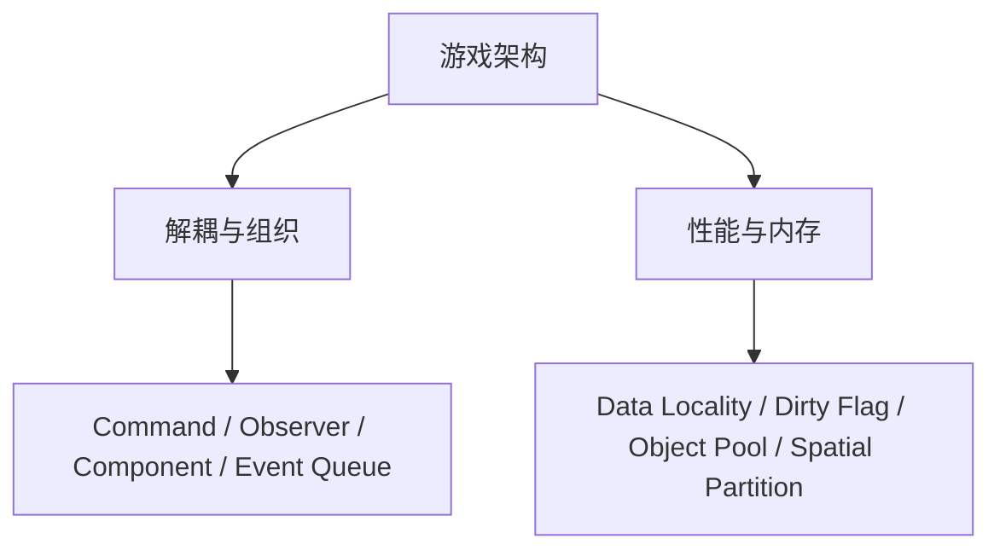

# 游戏编程模式：19 个模式的取舍

<ArticleTags />

《游戏编程模式》不是一本“23 个设计模式”的复述。它从游戏代码的特殊约束出发：帧预算、缓存、平台差异、实时交互，然后把模式放回这些约束里讨论。作者 Robert Nystrom 反复强调一件事：**架构的目标，是减少你在动手前必须同时装在脑子里的知识**。

这篇笔记按书的五部分整理 19 个模式。每个模式给出意图、问题、方案、C# 示例与取舍；代码是游戏场景的原创示例，不是原书代码。

::: warning 关于本文
原书 PDF 为中英双语页面，本文依据目录、关键章节与公开资料整理，**不是译文**；示例为本站原创，用来演示结构，不追求直接复制进项目即可运行。
:::

::: tip 怎么读
先读第 2 节的地图，再按问题查模式。不要从第一个模式顺序背；模式是词汇，不是清单。每个模式最后的“取舍”比代码更重要。
:::

## 1. 游戏架构的目标

书里对“好架构”的定义很实用：**让开发者不需要在脑子里同时装下整个系统，也能安全地做改动**。模式通过引入间接层、明确的边界和可替换的结构，减少这种“脑内负担”。

但间接层有代价：更多的类、更多的调用、更多的调试路径。游戏还多一层约束：每帧只有 16ms（60fps），缓存未命中、虚函数调用、内存分配都会直接变成掉帧。

所以模式不是“用了就专业”，而是**在可维护性与运行成本之间做选择**。



## 2. 模式地图

| 部分 | 模式 | 主要解决的问题 |
| - | - | - |
| 重访设计模式 | 命令、享元、观察者、原型、单例、状态 | 把经典模式放回游戏语境 |
| 序列模式 | 双缓冲、游戏循环、更新方法 | 时间、帧、对象更新 |
| 行为模式 | 字节码、子类沙箱、类型对象 | 用数据/组合表达行为 |
| 解耦模式 | 组件、事件队列、服务定位器 | 降低模块之间的直接依赖 |
| 优化模式 | 数据局部性、脏标识、对象池、空间分区 | 缓存、重复计算、分配与查询 |

## 3. 重访设计模式

### 3.1 命令 Command {#command}

**意图**：把“请求”封装成对象，让输入、AI、回放、撤销都能用同一种方式表达。

**问题**：输入处理里直接调用 `player.Jump()`、`player.Fire()`，按键映射、回放、撤销都要改这段代码；不同角色还要各自判断。

**方案**：把动作封装成命令对象，调用方只持有命令接口；具体命令知道接收者与参数。

```csharp
public interface ICommand { void Execute(); }

public sealed class JumpCommand : ICommand
{
    private readonly Player _player;
    public JumpCommand(Player player) => _player = player;
    public void Execute() => _player.Jump();
}

// 输入映射：按键 -> 命令
var bindings = new Dictionary<Key, ICommand>
{
    [Key.Space] = new JumpCommand(player),
    [Key.J] = new FireCommand(player)
};
```

- **取舍**：解耦输入与角色，支持重绑定/回放/撤销；但多一层对象，简单输入会显得绕。
- **关系**：与事件队列结合可做输入缓冲；与备忘录结合可做撤销。

### 3.2 享元 Flyweight {#flyweight}

**意图**：把大量对象中相同的状态共享出来，只保留每个对象的差异状态。

**问题**：同屏几千棵树/子弹，每棵都存一份网格、材质、纹理，内存爆炸；这些数据其实按类型完全相同。

**方案**：把状态拆成内禀（共享、不可变）和外赋（每个实例独有）；用工厂缓存共享类型。

```csharp
public sealed class TreeType
{
    public Mesh Mesh;
    public Material Material;
}

public sealed class Tree
{
    public Vector3 Position;
    public float Scale;
    public TreeType Type; // 共享
}
```

- **取舍**：显著省内存；但要把状态拆成两份，代码更复杂，外赋状态查询有成本。
- **关系**：常与对象池、空间分区一起用；与类型对象的思想相近。

### 3.3 观察者 Observer {#observer}

**意图**：让对象在状态变化时通知多个订阅者，而不直接依赖它们。

**问题**：血量变化要更新血条、成就、音效、伤害数字；发布方不应该逐个引用这些系统。

**方案**：发布者维护订阅列表，状态变化时通知；订阅者实现统一接口或事件处理器。

```csharp
public sealed class Health
{
    public event Action<int> Changed;
    private int _hp = 100;

    public void TakeDamage(int amount)
    {
        _hp -= amount;
        Changed?.Invoke(_hp);
    }
}

health.Changed += hp => healthBar.Set(hp);
health.Changed += hp => achievements.Check(hp);
```

- **取舍**：解耦发布/订阅；但通知顺序不确定，忘记取消订阅会泄漏，事件过多难调试。
- **关系**：C# 的 `event` 是观察者的语言级形态；与事件队列结合可延迟分发。

### 3.4 原型 Prototype {#prototype}

**意图**：通过复制已有对象来创建新对象，而不依赖具体类。

**问题**：敌人/道具模板的初始化很复杂，重新构造要重复加载与配置；运行期还需要按模板生成变体。

**方案**：对象实现 `Clone()`，自己负责复制状态；用模板对象生成实例。

```csharp
public interface IEnemy { IEnemy Clone(); }

public sealed class Enemy : IEnemy
{
    public int Health;
    public float Speed;
    public List<string> Skills = new();

    public IEnemy Clone() => new Enemy
    {
        Health = Health,
        Speed = Speed,
        Skills = new List<string>(Skills) // 可变集合要深拷贝
    };
}
```

- **取舍**：避免为每种配置建子类；但循环引用/外部资源难复制，深拷贝有成本。
- **关系**：可作备忘录的简化版；与生成器结合可做模板化生成。

### 3.5 单例 Singleton {#singleton}

**意图**：保证一个类只有一个实例，并提供全局访问点。

**问题**：音频、时钟、输入等系统确实只需要一份；但直接 `static` 又难替换、难测试。

**方案**：私有构造 + 静态实例；更推荐让依赖注入容器管理“单例生命周期”。

```csharp
public sealed class AudioService
{
    public static AudioService Instance { get; } = new AudioService();
    private AudioService() { }
    public void Play(string cue) { }
}
```

- **取舍**：全局访问方便；但隐藏依赖、测试困难、生命周期与域重载容易出问题。书里对单例相当克制。
- **关系**：服务定位器是它的“可替换”版本；两者都可能变成全局垃圾抽屉。

### 3.6 状态 State {#state}

**意图**：对象内部状态变化时改变行为，看起来像换了类。

**问题**：敌人 AI 用枚举 + `switch`，状态一多，每个方法都要判断；转换规则散落。

**方案**：每个状态做成独立类，上下文委托给当前状态；状态决定下一个状态。

```csharp
public interface IEnemyState { IEnemyState Tick(Enemy enemy, float dt); }

public sealed class Enemy
{
    public float Distance;
    public IEnemyState State = new IdleState();
    public void Tick(float dt) => State = State.Tick(this, dt);
}

public sealed class IdleState : IEnemyState
{
    public IEnemyState Tick(Enemy e, float dt) =>
        e.Distance < 8f ? new ChaseState() : this;
}
```

- **取舍**：消除状态分支，转换显式；但状态少时过度设计，状态类之间可能耦合。
- **关系**：与策略结构相似，但状态自己触发转换，策略由客户端选择。

## 4. 序列模式

游戏代码和普通应用最大的区别之一是：它必须按帧运行。序列模式处理“时间怎么推进、对象什么时候更新、画面什么时候交换”。

### 4.1 双缓冲 Double Buffer {#double-buffer}

**意图**：让“正在被读取的状态”和“正在被写入的状态”分离，避免读写同时发生导致撕裂。

**问题**：渲染线程一边画当前帧，逻辑线程一边改像素/状态，玩家会看到半新半旧的画面。

**方案**：维护两份缓冲，写入 back，完成后一次交换；读取方始终看 front。

```csharp
var front = new Color[Width * Height];
var back = new Color[Width * Height];

void Present()
{
    (front, back) = (back, front);
}
```

- **取舍**：消除撕裂、简化并发；但内存翻倍，交换时机要设计好。
- **关系**：常用于像素缓冲/渲染目标；与游戏循环的“更新—渲染”阶段配合。

### 4.2 游戏循环 Game Loop {#game-loop}

**意图**：让游戏持续运行：处理输入、更新世界、渲染输出，并控制时间步长。

**问题**：不同平台的事件循环不同；帧率波动会让物理/AI 行为不一致；`sleep` 不准会导致抖动。

**方案**：主循环按时间推进；逻辑用固定步长或可变步长，渲染可以做插值。

```csharp
double previous = Now();
while (running)
{
    double current = Now();
    double frameTime = current - previous;
    previous = current;

    Update(frameTime);
    Render();
}
```

- **取舍**：可变步长简单但物理不稳；固定步长稳定但需要累加器/插值。移动平台还要考虑省电与后台暂停。
- **关系**：与更新方法、双缓冲共同构成“帧”的基本结构。

### 4.3 更新方法 Update Method {#update-method}

**意图**：让每个游戏对象自己处理每帧行为，而不是把所有逻辑写在一个大循环里。

**问题**：所有对象的移动、AI、动画都塞进 `Game.Update()`，代码越来越长，新增对象要改主循环。

**方案**：对象实现 `Update(dt)`，主循环遍历调用；对象自己管理状态与行为。

```csharp
public interface IEntity { void Update(float dt); }

foreach (var entity in _entities)
    entity.Update(dt);
```

- **取舍**：结构清晰、易扩展；但更新顺序会影响结果，对象多时虚调用/缓存不友好。
- **关系**：与组件模式结合，把 Update 拆到组件；与数据局部性结合，改成批量数组更新。

## 5. 行为模式

这一组用数据、组合或受控的继承来表达行为，减少“为每个变体写一个子类”。

### 5.1 字节码 Bytecode {#bytecode}

**意图**：把行为编译成一组指令/数据，由虚拟机解释执行，从而让行为可配置、可热更新。

**问题**：技能/法术/AI 行为如果用代码写死，策划改一个数值就要重新编译；用脚本又可能太重。

**方案**：定义一套小指令集，把行为表示为指令序列；运行时用栈/寄存器解释。

```csharp
enum Op { Push, Add, Mul, JumpIfFalse }

// 伪指令：push 2, push 3, add, mul 10
var code = new[] { Op.Push, 2, Op.Push, 3, Op.Add, Op.Mul, 10 };
```

- **取舍**：数据驱动、易热更新；但 VM 有性能/调试成本，指令集设计不好会变成“自制烂语言”。
- **关系**：与类型对象/子类沙箱结合，用数据描述技能；与脚本语言相比更轻量。

### 5.2 子类沙箱 Subclass Sandbox {#subclass-sandbox}

**意图**：父类提供一组受保护的操作，子类只组合这些操作来实现具体能力，避免直接碰引擎底层。

**问题**：每个技能子类都直接调用音频、粒子、物理 API，重复且容易出错；引擎 API 变化会波及所有子类。

**方案**：基类封装 `PlaySound`、`SpawnParticles` 等受保护方法，子类只写 `Activate()`。

```csharp
public abstract class Superpower
{
    protected abstract void Activate();
    protected void PlaySound(string id) { }
    protected void SpawnParticles(string id, Vector3 at) { }
}

public sealed class Fireball : Superpower
{
    protected override void Activate()
    {
        PlaySound("fire");
        SpawnParticles("explosion", Vector3.zero);
    }
}
```

- **取舍**：减少重复、限制耦合面；但基类会变大，继承层次可能变脆。
- **关系**：是模板方法/外观在游戏能力上的变体；与类型对象结合可数据驱动。

### 5.3 类型对象 Type Object {#type-object}

**意图**：把“类型”从编译期的类变成运行期的数据对象，让内容/数值可配置。

**问题**：每种怪物一个子类，策划加一只换皮怪就要程序加类；数值和表现散落在代码里。

**方案**：定义 `MonsterType` 数据对象，`Monster` 持有类型引用；类型可从配置加载。

```csharp
public sealed class MonsterType
{
    public string Name;
    public int MaxHealth;
    public Sprite Sprite;
}

public sealed class Monster
{
    public MonsterType Type;
    public int Health;
}
```

- **取舍**：数据驱动、易扩展；但失去编译期类型安全，运行时错误更多。
- **关系**：与享元结合共享类型数据；与原型结合做模板生成。

## 6. 解耦模式

这一组让模块之间不直接互相认识，从而能独立替换、测试与扩展。

### 6.1 组件 Component {#component}

**意图**：用组合代替继承，把对象的能力拆成可插拔的组件。

**问题**：`FlyingEnemy : Enemy`、`FlyingArmoredEnemy : ...` 继承树爆炸；一个能力变化影响整棵树。

**方案**：`GameObject` 持有组件列表；每个组件负责一块能力（渲染、物理、AI、生命）。

```csharp
public interface IComponent { void Update(float dt); }

public sealed class GameObject
{
    private readonly List<IComponent> _components = new();
    public void Add(IComponent c) => _components.Add(c);
    public void Update(float dt)
    {
        foreach (var c in _components) c.Update(dt);
    }
}
```

- **取舍**：灵活组合、易扩展；但组件之间通信、更新顺序、生命周期管理更复杂。
- **关系**：与更新方法结合；与 ECS（实体-组件-系统）相比，组件模式更偏对象化。

### 6.2 事件队列 Event Queue {#event-queue}

**意图**：把事件的发送与处理解耦，并延迟到安全的时间点统一分发。

**问题**：战斗中直接回调会引发重入（处理事件时又触发事件）、顺序混乱、UI/音频/成就互相打断。

**方案**：事件先入队，主循环在固定阶段统一分发；发送者不需要知道接收者。

```csharp
var queue = new Queue<IEvent>();
void Send(IEvent e) => queue.Enqueue(e);

void Dispatch()
{
    while (queue.Count > 0)
        _handlers.Handle(queue.Dequeue());
}
```

- **取舍**：解耦、可延迟/异步；但增加延迟，顺序与重入要设计，调试更绕。
- **关系**：与观察者互补；与命令结合做输入/回放；与双缓冲的“交换”思想相近。

### 6.3 服务定位器 Service Locator {#service-locator}

**意图**：提供一个全局注册表，让代码按接口获取服务，而不直接依赖具体实现。

**问题**：音频、存档、网络等服务到处 `new`，难替换、难测试；构造参数一层层传很麻烦。

**方案**：用静态定位器注册/获取接口实现；调用方只依赖接口。

```csharp
public static class Services
{
    public static IAudio Audio { get; set; }
    public static ISave Save { get; set; }
}

Services.Audio.Play("hit");
```

- **取舍**：访问方便、可替换实现；但隐藏依赖、测试要重置全局状态，容易变成全局垃圾抽屉。书里更推荐依赖注入。
- **关系**：是单例的“可替换”版本；与组件/事件队列结合可做系统级服务。

## 7. 优化模式

优化模式不是“让代码更快”的魔法，而是针对具体瓶颈（缓存、重复计算、分配、查询）的结构调整。先测量，再选择。

### 7.1 数据局部性 Data Locality {#data-locality}

**意图**：把数据按访问顺序放在连续内存里，减少缓存未命中与指针追逐。

**问题**：`List<Entity>` 里每个对象都指向一堆组件/资源，遍历时 CPU 在内存里跳来跳去，缓存命中率低。

**方案**：把热数据放进连续数组（struct/SoA），按批处理；冷数据/对象身份另存。

```csharp
struct Particle
{
    public Vector3 Position;
    public Vector3 Velocity;
}

var particles = new Particle[10000];

for (var i = 0; i < particles.Length; i++)
    particles[i].Position += particles[i].Velocity * dt;
```

- **取舍**：缓存友好、批量处理快；但结构更僵、调试更难，AoS/SoA 要按平台实测。
- **关系**：与组件/更新方法结合，把逐对象更新改成逐数组更新；与对象池配合复用内存。

### 7.2 脏标识 Dirty Flag {#dirty-flag}

**意图**：用标记表示“数据已变化”，只在需要时重算，避免每帧做昂贵计算。

**问题**：角色层级/包围盒/UI 布局每帧都重算，即使这一帧什么都没变。

**方案**：修改数据时置脏；读取时检查标记，脏了才重算并清标记。

```csharp
private bool _dirty = true;
private Matrix4x4 _cached;

public Matrix4x4 WorldMatrix
{
    get
    {
        if (_dirty) { _cached = ComputeWorld(); _dirty = false; }
        return _cached;
    }
}

public void SetParent(Transform parent)
{
    _parent = parent;
    _dirty = true;
}
```

- **取舍**：省掉大量重复计算；但漏置脏会导致数据过期，标记传播要设计好。
- **关系**：与观察者结合做失效通知；与空间分区结合，移动时才更新网格。

### 7.3 对象池 Object Pool {#object-pool}

**意图**：复用对象，避免频繁分配/回收造成的 GC 峰值与碎片。

**问题**：子弹/粒子/伤害数字每秒创建销毁成百上千个，GC 卡顿直接变成掉帧。

**方案**：预分配一批对象，取出时激活，归还时重置；池满时扩容或丢弃。

```csharp
private readonly Stack<Bullet> _pool = new();

public Bullet Get()
{
    var bullet = _pool.Count > 0 ? _pool.Pop() : new Bullet();
    bullet.gameObject.SetActive(true);
    return bullet;
}

public void Release(Bullet bullet)
{
    bullet.Reset();
    bullet.gameObject.SetActive(false);
    _pool.Push(bullet);
}
```

- **取舍**：减少 GC/分配；但池化对象可能保留状态、增加内存占用，生命周期要严格管理。
- **关系**：与享元共享类型数据；与数据局部性结合做连续数组池。

### 7.4 空间分区 Spatial Partition {#spatial-partition}

**意图**：把空间划分成网格/树，快速查询附近对象，而不是每次遍历全场。

**问题**：碰撞/索敌/范围技能每次都遍历所有单位，O(n²) 在单位多时直接爆炸。

**方案**：用网格、四叉树、BSP 等结构按位置索引对象；查询只访问相关分区。

```csharp
var grid = new Dictionary<(int, int), List<Enemy>>();

void Insert(Enemy e)
{
    var cell = ((int)(e.X / CellSize), (int)(e.Y / CellSize));
    if (!grid.TryGetValue(cell, out var list))
        grid[cell] = list = new List<Enemy>();
    list.Add(e);
}
```

- **取舍**：查询快；但对象移动要更新索引，内存与维护成本上升。
- **关系**：与对象池/数据局部性结合；与碰撞检测的 broad phase 对应。

## 8. 什么时候不该用模式

模式是工具，不是身份象征。以下情况优先考虑“不引入模式”：

1. **直接调用更清楚**：只有一处调用、没有变化轴，不需要接口/工厂/事件。
2. **语言特性已够用**：C# 的 `event`、委托、`IEnumerable`、DI 容器可以替代一部分模式结构。
3. **性能优先且已测量**：优化模式可能增加复杂度；先 profiler，再决定。
4. **团队规模小、生命周期短**：过度抽象的成本可能高于收益。
5. **模式会掩盖坏设计**：用服务定位器/单例掩盖依赖混乱，只会让问题更晚爆发。
6. **数据导向更合适**：ECS/SoA 可能比深继承/组件对象更适合你的项目。

书里对单例、服务定位器的谨慎态度值得记住：**全局访问不是架构，依赖清晰才是**。

## 9. 检查清单

- [ ] 我要隔离的变化轴是什么？
- [ ] 不加这层间接，最坏后果是什么？
- [ ] 模式减少了“脑子里要装的知识”，还是只增加了类？
- [ ] 运行成本（CPU/内存/GC）是否测量过？
- [ ] 调试、日志、断点是否仍然可用？
- [ ] 是否有更简单的语言特性/引擎能力？
- [ ] 团队能否理解并维护这个模式？
- [ ] 模式的生命周期/清理/取消订阅是否处理？
- [ ] 性能模式是否针对真实瓶颈，而不是猜测？
- [ ] 如果半年后删掉它，成本有多大？

## 10. 参考与延伸

- 原书：Robert Nystrom，《游戏编程模式》（Game Programming Patterns）。本文依据目录、关键章节与公开资料整理，不是译文。
- 站内笔记：[深入设计模式](/notes/dive-into-design-patterns)、[重构手册](/notes/refactoring-handbook)、[游戏编程算法与技巧](/notes/game-programming-algorithms)、[游戏感](/notes/game-feel)、[游戏 AI 开发](/notes/game-ai-development)。
- 站内实践：[ECS 完整指南](/Tech/Architecture/ECS_Complete_Guide)、[游戏设计模式实践](/Tech/Architecture/Game_Design_Patterns_Practice)、[Unity 反模式](/Tech/Architecture/Unity_Anti_Patterns)。


