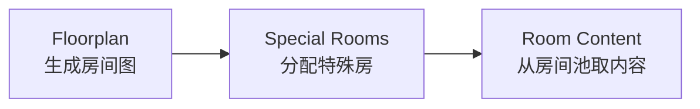

# 以撒的房间生成：BFS 布局、特殊房与形状扩展

<ArticleTags />

以撒的地牢看起来像简单的方格迷宫，真正难的是让每次生成都同时满足：房间数量合理、Boss 足够远、特殊房有位置、普通房永远接得上。它的原版实现没有复杂算法，核心是一套约束明确的广度优先生长。

这篇笔记按「布局 → 特殊房 → 内容」三层拆解原版规则，再讨论重生版与自研大房间时需要注意的边界。

## 1. 三步生成：布局、角色、内容

以撒的房间生成可以拆成三个互不耦合的阶段：



| 阶段 | 产出 | 主要约束 |
| - | - | - |
| 布局 | 房间坐标图 | 数量、连通、无环、Boss 距离 |
| 特殊房 | Boss / 商店 / 宝箱 / 隐藏 | 远端、邻接数、概率 |
| 内容 | 具体房间与怪物 | 四向门位、章节池、变体 |

把「房间在哪」和「房间里有什么」分开，是这套生成器最值得借鉴的地方。布局只关心图结构，内容只关心池子与门位，任何一侧的修改都不会把另一侧推翻。

## 2. 布局：从起点向外生长

原版在 9×8 的格子上生成，起点固定在 35 号格。房间总数大致为：

$$
N = \text{random}(2) + 5 + \lfloor level \times 2.6 \rfloor
$$

也就是第一层 7–8 间，之后每层增加 2–3 间左右。

生成过程是一个队列驱动的 BFS：

1. 起点入队，标记为已占用。
2. 取出一间房，向上下左右四个方向尝试扩展。
3. 邻居越界、已占用、或邻居周围已有两个以上房间时，跳过。
4. 房间数已达标、或 50% 随机失败时，跳过。
5. 否则占用邻居、入队，继续扩展。

```csharp
var queue = new Queue<Vector2Int>();
var rooms = new HashSet<Vector2Int> { start };
queue.Enqueue(start);

while (queue.Count > 0 && rooms.Count < target)
{
    var cell = queue.Dequeue();
    foreach (var dir in Directions.Cardinal)
    {
        var next = cell + dir;
        if (!InBounds(next) || rooms.Contains(next)) continue;
        if (CountFilledNeighbors(next, rooms) >= 2) continue;
        if (Random.value < 0.5f) continue;

        rooms.Add(next);
        queue.Enqueue(next);
        if (rooms.Count >= target) break;
    }
}
```

「邻居周围不能已有两个房间」是防止回环的关键：每个新房间只能接上一个父房间，图因此保持树状。没有这个限制，BFS 很快会把地图填成一团带环的实心区域。

没有成功扩展任何邻居的房间就是叶子，也就是 `end rooms`。它们会被保留下来，供 Boss 与特殊房使用。

房间多时（超过 16 间），起点会被周期性重新放回队列，让生长从中心再次向外扩张，避免所有路径都从同一条主廊延伸。

生成结束后还要做一致性检查：房间数是否达标，Boss 房是否与起点相邻。不满足就整层重来。重试是算法的一部分，不是异常处理。

## 3. 特殊房：把语义压在布局上

### Boss 房：最远的叶子

Boss 房直接取 `end rooms` 列表的最后一个。由于 BFS 从起点向外生长，叶子通常位于离起点较远的位置。这个选择不需要额外计算距离，代价是「最远」只是近似，但足够稳定。

### 隐藏房：挤在交叉口

隐藏房是唯一允许与多个房间相邻的例外。生成器会随机寻找一个空格，满足：

- 至少与 3 个已有房间相邻；
- 不与任何叶子房间相邻。

如果 300 次找不到，就放宽条件；600 次仍找不到，再放宽。这样既保证隐藏房几乎总能放下，又让它在多数情况下位于路口附近，而不是随便贴在一条走廊边上。

### 其他特殊房：叶子上的概率

商店、宝箱、献祭房等大多从叶子房间中挑选。部分是必出，部分按概率或条件出现。献祭房这类房间的生成概率还会受到玩家状态影响，说明「特殊房」并不一定是纯布局阶段决定的，也可能在运行期做条件判断。

## 4. 普通房：门位固定，内容从池里取

相邻房间之间总有一扇居中的门，或一面可破坏的墙；每个房间都保证四个方向可进入。因此普通房不需要为「邻居长什么样」做特殊适配，房间池可以独立设计。

普通房按章节阶段分为简单、中等、困难三类池：

- 章节前半段从简单 + 中等取；
- 后半段从中等 + 困难取；
- 第一层的 Basement 就有上百个普通房模板；
- 房间布局、怪物组合、精英变体、染色岩石等再叠加随机。

这层设计把「难度曲线」交给池子，而不是在生成器里写复杂的权重规则。布局算法保持稳定，难度只改变抽样范围。

## 5. 双倍地图：Labyrinth 的例外

迷宫诅咒会生成双倍大小的地图。它不只是把房间数量翻倍：

- 普通房增加约 80%，上限 45；
- 特殊房只从最远的 6 个叶子中选；
- 不再按章节阶段分池，而是简单、中等、困难混用；
- 额外普通房用类似隐藏房的方式塞进布局。

这些改动说明：当地图规模变化时，原本的「叶子数量」「最远距离」「池子分段」都会失效，需要重新定义约束，而不是简单放大参数。

## 6. 重生版：从格子到多格房间

重生版最大的结构变化是房间可以占多个格子、形状不规则。实现上不再只遍历四个方向，而是遍历房间的所有出口；一个 2×2 房间最多可以有 8 个出口。

这带来几个新问题：

1. **占位检查**：不仅要检查门口那一格，还要检查整个房间 footprint 是否为空。
2. **出口匹配**：门必须对着相邻房间或走廊，不能对着墙。
3. **回环**：大房间可能同时连接多个邻居，原本无环的树状图会出现环。
4. **池子消耗**：大房间成功放置后通常从池中移除，否则会被反复选中。
5. **Boss 房**：如果指定位置放不下大 Boss 房，需要尝试所有最远叶子，最后才放弃。

从「格子 = 房间」变成「房间 = 一组格子 + 一组出口」，生成器的主数据就从网格点变成了房间图。这个抽象更复杂，但能支持更丰富的关卡形状。

## 7. 自研实现建议

如果要从零实现类似的生成器，可以按下面的结构拆分：

### 7.1 布局与内容分离

```csharp
public sealed class RoomNode
{
    public Vector2Int Anchor;
    public RoomShape Shape;
    public List<Vector2Int> Exits = new();
    public RoomRole Role;
    public RoomTemplate Content;
}
```

布局阶段只产出 `RoomNode` 与连接关系；内容阶段再根据 `Role`、章节和难度池填充 `Content`。

### 7.2 形状房间的放置

```csharp
bool TryPlace(RoomShape shape, Vector2Int anchor, HashSet<Vector2Int> occupied)
{
    foreach (var local in shape.Cells)
    {
        var cell = anchor + local;
        if (!InBounds(cell) || occupied.Contains(cell)) return false;
    }

    // 检查每个出口外侧是否可连通
    foreach (var exit in shape.Exits)
        if (!CanConnect(anchor + exit, occupied)) return false;

    foreach (var cell in shape.Cells)
        occupied.Add(anchor + cell);
    return true;
}
```

先验证 footprint，再验证出口，最后才提交占位。任何一步失败都直接回滚，不要留下半套状态。

### 7.3 可控随机

- 用独立种子驱动布局，保证同一种子可复现；
- 布局、特殊房、内容分别使用不同随机流，避免改动内容池影响布局；
- 记录每次重试的原因（房间数、Boss 相邻、特殊房无位置），这些统计比「生成失败」四个字更有用。

### 7.4 可视化调试

把 floorplan、叶子、Boss 距离、特殊房候选画出来。以撒这类算法的 bug 往往不是异常，而是「图看起来不对」：走廊太长、房间挤成一团、隐藏房贴边。可视化能在几秒内暴露这些问题。

## 8. 验收清单

- 每层房间数是否落在目标区间？
- 图是否连通、是否存在非预期回环？
- Boss 是否在远端叶子，且不与起点相邻？
- 隐藏房是否有足够邻接、又不贴叶子？
- 特殊房是否都能找到合法位置？
- 普通房门位是否都能与邻居对上？
- 大房间 footprint 与出口是否全部验证后再提交？
- 同一种子能否复现同一张图？
- 失败重试是否有原因统计？

以撒原版的优雅之处不是算法多复杂，而是每一层只做一件事：BFS 保证生长，邻接约束保证无环，叶子列表承载特殊房语义，房间池负责内容。重生版把格子换成形状后，规则变复杂了，但这个分层结构仍然成立。

## 参考与延伸

- 原文：[Dungeon Generation in Binding of Isaac](https://www.boristhebrave.com/2020/09/12/dungeon-generation-in-binding-of-isaac/)，Boris the Brave。
- 相关视频：Florian Himsl 对生成算法的说明（原文引用）。
- 参考笔记：《以撒的结合（原版）房间生成规则》。本文为独立整理，代码与形状房间部分为补充实现。
- 相关文档：[Binding of Isaac 核心设计知识图谱](/Case_Studies/Roguelike/Binding_of_Isaac)、[程序化生成完整指南](/Tech/Algorithms/Procedural_Generation_Complete)、[Roguelike 随机系统](/Tech/Algorithms/Roguelike_RNG_Systems)。
