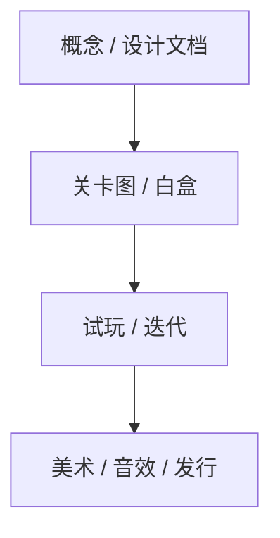
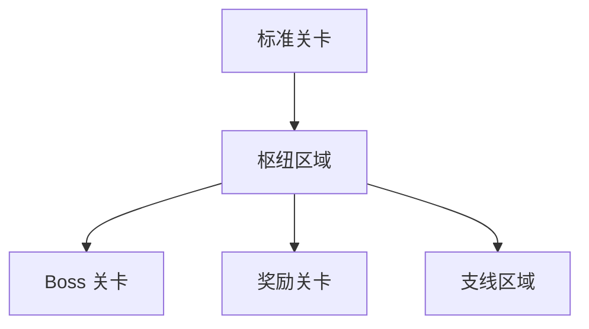

# 游戏关卡设计：从纸面到可玩空间

<ArticleTags />

关卡设计不是“摆场景”，而是**用空间、节奏和挑战，把核心玩法教给玩家，再让玩家用出来**。Phil Co 的《游戏关卡设计》（Level Design for Games）把这件事拆成一条可执行的生产线：先定义游戏，再设计挑战，画关卡图，做白盒，反复试玩，最后才做视觉与音效。

这篇笔记按书的九章流程整理：每一步产出什么、检查什么、常见问题是什么。

::: warning 关于本文
原书为扫描版，OCR 文本不可靠。本文依据目录、关键页面与公开资料整理，**不是译文**；示例为关卡设计场景的原创说明，不虚构原书引语。
:::

::: tip 怎么读
如果你在做第一关，先读第 3、4、5 节；如果你在白盒阶段，重点读第 6、7 节；如果你在 Alpha/Beta，读第 8、9 节。
:::

## 1. 关卡设计在制作流程中的位置

书里先讲“怎样制作一个游戏”，因为关卡设计不是孤立的：

| 阶段 | 主要产出 | 关卡设计师关注什么 |
| - | - | - |
| 概念/设计文档 | 核心玩法、目标平台、受众 | 空间是否支持核心动词 |
| 原型/垂直切片 | 可玩的核心循环 | 关卡是否能教会玩家 |
| 白盒/模板 | 灰盒空间、路径、战斗区 | 尺度、视线、节奏、可读性 |
| 试玩/迭代 | 问题清单、修改方案 | 玩家是否迷路/受挫/无聊 |
| 美术/音效 | 视觉层次、氛围、反馈 | 装饰是否服务玩法 |
| Alpha/Beta/发行 | 优化、平衡、修 bug | 性能、碰撞、可读性是否达标 |

关卡设计师不是最后才进场的人。越早参与，越能避免“玩法很好，但空间装不下”的返工。

## 2. 先定义游戏，再设计关卡

书里第 2 章讲视角、类型、主题、受众、平台与操作。这些不是“设定”，而是关卡设计的约束：

| 维度 | 对关卡的影响 |
| - | - |
| 视角（第一/第三人称） | 视野、镜头、掩体、空间尺度 |
| 类型（动作/射击/冒险/RPG/策略/竞速） | 节奏、战斗区、路径、信息密度 |
| 主题（幻想/现代/科幻/另类现实） | 建筑风格、材质、地标、可读性 |
| 受众/年龄分级 | 难度、暴力表现、教学密度 |
| 平台/操作 | 关卡尺度、检查点、UI、性能预算 |

第一人称关卡要特别关注**视线与转角**：玩家看不到自己，空间就是身体；第三人称关卡要关注**镜头遮挡与角色可读性**。同一个战斗区，在第一人称和第三人称里可能需要完全不同的尺寸。

## 3. 挑战设计：教、练、考

书里第 3 章讲“挑战玩家”和“给予玩家真正需要的”。核心不是把难度调高，而是设计一条学习曲线：

1. **最早接触的技能**：安全环境里教基础操作。
2. **加入新技能**：一次只引入一个新变量。
3. **组合技能**：把已学技能组合成新挑战。
4. **考核**：在压力下使用组合技能。

关卡类型也对应不同功能：

| 关卡类型 | 作用 | 设计重点 |
| - | - | - |
| 标准关卡 | 推进主线、教学、战斗 | 节奏与挑战曲线 |
| 枢纽区域 | 连接多个区域、提供选择 | 方向感、地标、回流 |
| Boss 关卡 | 高潮、综合考核 | 读招、阶段、场地 |
| 奖励关卡 | 额外挑战/收集 | 可选、风险回报 |

“教—练—考”不是三段式模板，而是循环：每个新机制都值得一次“安全教学 → 组合练习 → 压力测试”。

## 4. 头脑风暴：故事、参考图、地标、谜题

书里第 4 章讲关卡创意：

- **关卡故事**：这个空间里发生过什么？玩家为什么来这里？
- **参考图/原画**：建立外观与感觉，但不要过早锁死细节。
- **地标**：让玩家在空间里有方向感；地标可以是塔、光、颜色、声音。
- **关卡描述**：用一段话写清玩家从进入到离开的体验曲线。
- **谜题**：谜题要教玩家观察规则，而不是猜设计师的心思。
- **过场动画**：过场是节奏的一部分，不要用它替代玩法叙事。

一个实用的 brainstorming 模板：

| 问题 | 目的 |
| - | - |
| 玩家进入时看到什么？ | 第一印象与目标 |
| 玩家要学会什么？ | 教学点 |
| 中间的压力从哪里来？ | 挑战曲线 |
| 玩家如何知道自己走对了？ | 引导与反馈 |
| 离开时记得什么？ | 记忆点/地标 |

## 5. 用图表设计：先画关系，再画空间

书里第 5 章讲关卡图：在引擎里摆几何之前，先用图表表达关卡之间的关系、顺序与流程。

| 图表要素 | 作用 |
| - | - |
| 关卡范围 | 这一关有多大、要玩多久 |
| 关卡顺序 | 玩家先去哪、后去哪 |
| 特殊关卡 | Boss、奖励、枢纽 |
| 线性/非线性 | 有向导的路径 vs 分支探索 |
| 区域 | 战斗区、解谜区、休息区、过渡区 |
| 粘合 | 区域之间如何连接、如何回流 |
| 可玩要素 | 敌人、掩体、机关、收集品 |

关卡图不是美术图，而是**体验的流程图**：它应该能回答“玩家为什么往这走”“走错会怎样”“什么时候给奖励”。

## 6. 白盒/模板：用简单几何验证空间

书里第 6 章讲用简单多边形（正方形、圆柱体、菱形）和临时贴图做模板，并在虚幻编辑器里搭建。白盒的目的不是好看，而是验证：

- **尺度**：门、走廊、房间、跳跃距离是否符合角色能力。
- **视线**：玩家能看到什么、看不到什么；狙击点、掩体、转角。
- **路径**：主路径是否清晰，分支是否有回报。
- **节奏**：战斗—休息—探索—高潮的节拍。
- **可读性**：地标、颜色、光照是否让玩家知道下一步。

白盒阶段要尽早试玩。不要等美术做完才发现“这个房间太大/太小/太绕”。

## 7. 可玩性测试：观察、记录、修正

书里第 7 章讲试玩的阶段、测试计划、观察者角色、常见问题与“让关卡感觉正常”。

试玩的基本原则：

- **不要解释**：玩家卡住时，先观察他为什么卡住，而不是立刻给答案。
- **记录行为**：在哪里停、在哪里回头、在哪里死亡、在哪里放弃。
- **区分问题类型**：迷路、难度、操作、反馈、性能。
- **一次只改一个变量**：否则不知道哪个改动起作用。

| 常见问题 | 症状 | 修正方向 |
| - | - | - |
| 迷路 | 玩家反复走错/回头 | 加强地标、光照、路径引导 |
| 难度尖刺 | 某处死亡率骤增 | 调整敌人/掩体/检查点 |
| 无聊 | 长走廊/无决策 | 加入选择、事件、节奏变化 |
| 不公平 | 玩家说“不知道怎么就死了” | 提前提示、降低突袭、增加反馈 |
| 视觉噪音 | 玩家忽略关键物体 | 降低装饰对比、突出交互物 |

## 8. 视觉层与功能层：让空间“好看”也“好用”

书里第 8 章讲视觉层次与功能层：

- **视觉层次**：建筑风格、装饰、边沿、框架、不完美的美感；让玩家先看到重要的东西。
- **功能层**：声音、特效、光照；它们不是装饰，而是玩法反馈。

视觉设计要服务可读性：

| 层次 | 作用 | 反例 |
| - | - | - |
| 建筑风格 | 建立世界可信度 | 风格混杂、没有统一语言 |
| 装饰/边沿/框架 | 引导视线、划分区域 | 装饰盖住交互物 |
| 不完美的美感 | 让空间像真实使用过 | 过度对称、像展厅 |
| 音频 | 提示危险/方向/交互 | 音效与画面反馈不一致 |
| 特效 | 强化事件/状态 | 特效遮挡战斗信息 |

“好看”不是堆细节，而是让玩家在正确的时间看到正确的东西。

## 9. 发行阶段：替换美术、优化、平衡、归档

书里第 9 章讲 Alpha/Beta/发行：

- **Alpha**：替换临时美术、优化关卡、平衡难度。
- **Beta**：最终 bug 测试、兼容性、认证。
- **发行**：归档资料、项目总结、从错误中学习。

关卡设计师在 Alpha/Beta 的重点不是“再加内容”，而是**收尾**：碰撞、性能、可读性、检查点、难度曲线、本地化文本、平台限制。

## 10. 关卡设计检查清单

- [ ] 这一关要教/练/考哪个核心技能？
- [ ] 玩家进入时能看到目标或地标吗？
- [ ] 主路径是否清晰，分支是否有回报？
- [ ] 空间尺度是否符合角色能力（跳跃/冲刺/射击距离）？
- [ ] 战斗区是否有掩体、视线与撤退路线？
- [ ] 难度曲线是否有起伏，而不是一直高压？
- [ ] 失败是否可归因，检查点是否合理？
- [ ] 视觉层次是否突出交互物，而不是装饰？
- [ ] 音频/特效是否强化了玩法反馈？
- [ ] 是否做过真人试玩，而不是只看白盒？

## 11. 参考与延伸

- 原书：Phil Co，《游戏关卡设计》（Level Design for Games: Creating Compelling Game Experiences）。本文依据目录、关键页面与公开资料整理，不是译文。
- 站内笔记：[游戏机制](/notes/game-mechanics)、[游戏感](/notes/game-feel)、[心流与游戏](/notes/flow-game-design)、[人月神话](/notes/mythical-man-month)。
- 站内实践：[游戏设计模式实践](/Tech/Architecture/Game_Design_Patterns_Practice)、[决策系统](/Tech/Architecture/Decision_System)。
