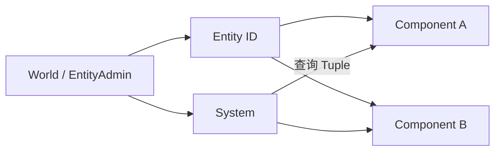
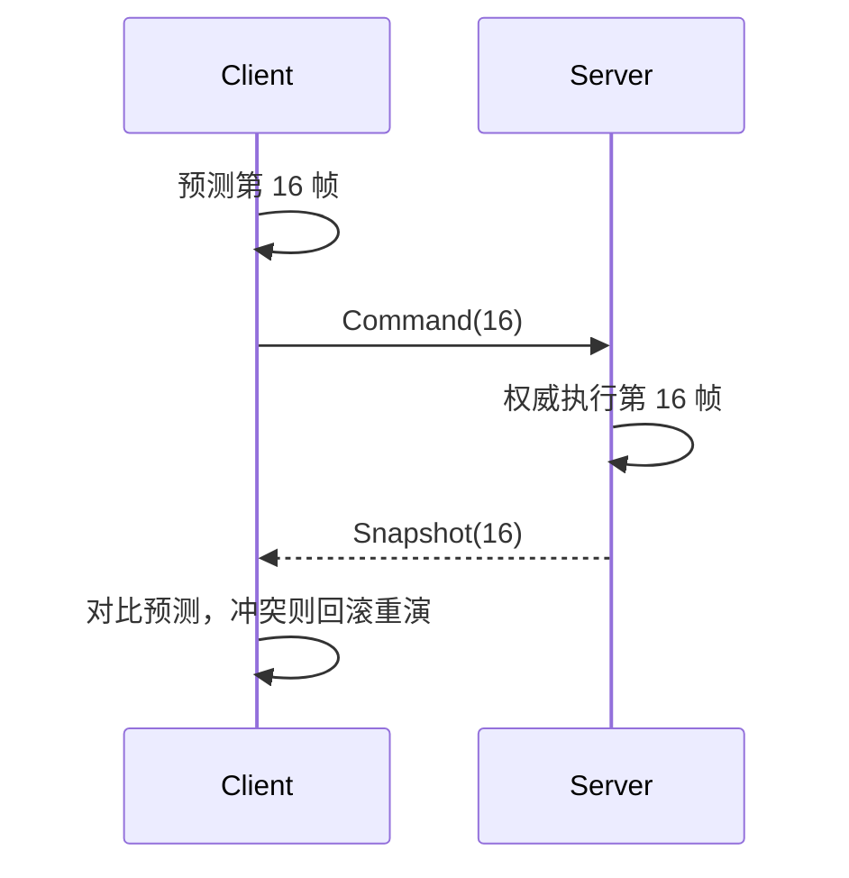

# 守望先锋的 ECS 架构与网络代码：从命令帧到命中回溯

<ArticleTags />

守望先锋的架构分享里，ECS 与网络代码不是两个独立话题：ECS 决定了状态放在哪里、系统如何按顺序读写；网络代码决定了这些状态在客户端与服务器之间如何对齐、回滚与验证。

这篇笔记按「ECS 结构 → 固定帧 → 预测与回滚 → 命中检测 → 生命周期」整理，并给出适合中小型项目的简化实现。

## 1. ECS：把状态与行为彻底分开

ECS 的核心不是「用 Component 代替继承」，而是三个明确的分工：

- **Entity**：只是一个 ID，用来聚合若干 Component。
- **Component**：纯数据，不包含行为。
- **System**：纯逻辑，不持有实体数据，只处理符合条件的 Component 组合。



一个 System 关心的是「哪些 Entity 同时拥有这些 Component」，而不是某个具体 Entity。这个组合通常称为 Archetype 或 Component Tuple。System 之间按固定顺序执行，前一个 System 写的数据，后一个 System 才能读到。

```csharp
public readonly struct Health { public float Current; public float Max; }
public readonly struct Position { public Vector3 Value; }
public readonly struct Frozen { public float Remain; }

// System 只处理同时拥有 Health、Position、Frozen 的实体
public sealed class FrozenDamageSystem : ISystem
{
    public void Tick(World world, float dt)
    {
        foreach (var entity in world.Query<Health, Frozen>())
        {
            ref var health = ref world.Get<Health>(entity);
            ref var frozen = ref world.Get<Frozen>(entity);
            frozen.Remain -= dt;
            if (frozen.Remain <= 0f)
                world.Remove<Frozen>(entity);
        }
    }
}
```

这种结构在大型代码库里的价值是「可枚举」：看到 Tuple 就知道 System 依赖什么数据，看到 System 列表就知道一帧的执行顺序。

## 2. 一个 World，而不是多个 Admin

早期实现容易把 System 变成「有状态的模块」，再让其他 System 去取它，结果 System 之间产生耦合，回放、测试与并行都变难。

更稳的结构是只保留一个 World，把全局状态放进 **Singleton Component**，挂在一个匿名实体上：

```text
World
├─ System[]（按顺序执行）
├─ Entity → Component[]（生命周期管理）
└─ Singleton Entity
   ├─ InputState
   ├─ TimeState
   ├─ NetworkState
   └─ MatchState
```

输入、时间、网络连接这类全局数据都通过 Singleton Component 暴露，System 只读写组件，不直接持有另一个 System。分享中提到这类 Singleton 数据在代码中占比很高，这也说明「全局状态」本身不是问题，问题是没有统一的数据入口。

## 3. 固定命令帧：逻辑时间与渲染时间分离

网络同步需要可重放的逻辑时间。做法是把真实时间量化为固定长度的命令帧：

$$
frame = \left\lfloor \frac{simTime}{16ms} \right\rfloor
$$

客户端每 16ms 生成一个输入命令，服务器按同样的节奏消费命令。逻辑更新不跟随渲染帧率，而是由固定步长累加器驱动：

```csharp
public sealed class FixedClock
{
    const float Step = 0.016f;
    float _accumulator;

    public void Advance(float deltaTime, Action<float> tick)
    {
        _accumulator += deltaTime;
        while (_accumulator >= Step)
        {
            tick(Step);
            _accumulator -= Step;
        }
    }
}
```

这个循环必须保留余数，否则逻辑帧会持续漂移。引擎的固定更新、物理步长、网络命令帧最好使用同一个时间基准，减少「客户端看到的时间」和「服务器执行的时间」之间的隐性偏差。

为了进一步降低同步误差，位置、角度等状态可以做量化（例如定点数或固定精度整数）。量化既能压缩带宽，也能让回放与校验更稳定。

## 4. 客户端预测、服务器权威与回滚

守望先锋是服务器权威模型，但客户端不会等服务器确认才移动。客户端会：

1. 立即用本地输入执行一次预测；
2. 把输入命令发给服务器；
3. 服务器按自己的时间线执行，并周期性下发快照；
4. 客户端收到快照后，如果与预测冲突，就从对应帧回滚并重放后续输入。



服务器通常会缓存一小段命令（Command Buffer），按半 RTT 的节奏读取。这个缓存吸收了网络抖动，也让服务器在丢包时有回退空间。

### 丢包时怎么办

如果服务器耗尽命令缓存，它不会直接停住，而是用上一帧输入做一次「假模拟」，并在回包中标记输入丢失。客户端收到标记后可以：

- 提高输入发送频率；
- 扩大服务器的命令缓存；
- 在后续包中重复携带最近几帧输入。

冗余发送输入是降低丢包影响的常见手段：多花一点带宽，换取命令到达率。

### 回滚的边界

回滚不是「把整个世界倒回去」。服务器只回滚与校验相关的实体与时间段，客户端也只重放自己预测过的输入。回滚窗口越大，CPU 与状态快照成本越高，所以需要明确：

- 哪些状态需要进入快照；
- 快照保留多少帧；
- 哪些系统是确定性的、可以重放；
- 哪些效果只做表现层补偿，不参与回滚。

## 5. 命中检测：客户端预测，服务器回溯验证

射击游戏的命中判定通常分为两层：

- **客户端**：本地立即反馈命中效果，保证手感；
- **服务器**：在权威时间线上回溯目标位置，验证射线是否真的命中。

服务器收到命中请求时，不能直接用目标当前位置，而要回到射击发生的时刻：

1. 根据命令帧确定射击时间；
2. 把候选目标回溯到该时间附近的历史碰撞盒；
3. 用射线或扫掠体与历史碰撞盒相交；
4. 只有验证通过才结算伤害。

分享中提到一个很实用的优化：先对一段时间窗口（示例为 0.5 秒）内的目标包围盒做粗筛，只有与射线相交的候选才做精确回溯，而不是回滚所有实体。

```csharp
public bool ValidateHit(HitRequest request, World world)
{
    foreach (var candidate in world.Query<HitboxHistory, Team>())
    {
        if (!request.CanHit(world.Get<Team>(candidate))) continue;
        if (!world.Get<HitboxHistory>(candidate)
                 .Intersects(request.Ray, request.ShotTime)) continue;
        return true;
    }
    return false;
}
```

当 RTT 很高时，客户端的目标外插值会变得不可信。分享给出的经验是：超过约 220ms 后，客户端预测命中的收益迅速下降，可以直接交给服务器处理，避免「客户端先飙血、服务器后否决」的割裂感。

## 6. 延迟处理：把副作用集中到一个调用点

ECS 中常见的问题是：多个 System 都想修改同一个状态，或者在处理过程中触发大量副作用。更稳的做法是「先记录，后统一处理」：

- 有耦合的 System 只向 Pending 队列写入请求；
- 最终的 Resolve System 在固定阶段统一消费；
- 所有副作用集中在 Resolve 调用点，便于排序、去重、限流与异步加载。

例如弹孔与墙面特效：射击 System 不直接生成贴花，而是写入 `PendingContact`；最后由 `ResolveContactSystem` 统一做 LOD、合并与生成，避免同一区域的贴花互相 Z-fighting。

```csharp
public readonly struct PendingContact
{
    public Vector3 Point;
    public Vector3 Normal;
    public ContactType Type;
}

public sealed class ResolveContactSystem : ISystem
{
    readonly List<PendingContact> _pending = new();

    public void Queue(in PendingContact contact) => _pending.Add(contact);

    public void Tick(World world, float dt)
    {
        // 统一排序、去重、LOD、异步生成
        _pending.Clear();
    }
}
```

这种数据流的好处是解耦：产生请求的 System 不需要知道最终如何表现；消费端可以批量处理，也可以把重活移到工作线程。

## 7. 生命周期与线程

延迟创建和延迟销毁能避免遍历过程中修改容器，但会带来「一帧延迟」：实体在本帧创建，下一帧才能被所有 System 看到。规则要写清楚：

- 结构变更在固定阶段提交；
- 创建后的实体在本帧不参与需要完整初始化的 System；
- 销毁先标记，再在安全点清理引用；
- 回滚时快照要覆盖生命周期状态，而不只是位置。

主线程负责 Update System；投射物模拟、导航重建等独立任务可以放到工作线程。ECS 不是并发安全的自动保证，System 的读写集合仍然需要显式约束。

## 8. ECS 不是强制原则

分享最后给了一个重要提醒：ECS 不是把所有代码都塞进 System 的理由。工具链、编辑器、一次性流程、纯表现层逻辑，用更直接的结构可能更好。

判断标准可以很简单：

- 这段逻辑是否需要按帧、按组件组合被查询？
- 是否需要参与回滚或并行？
- 是否有多个消费者需要共享同一份状态？

如果答案都是否，就不必为了「统一架构」增加一层 System。

## 9. 最小实现检查清单

- Entity 是否只是 ID，Component 是否保持纯数据？
- System 是否有明确顺序与读写依赖？
- 全局状态是否集中在 Singleton Component，而不是散落在 System 字段里？
- 逻辑是否由固定步长驱动，并保留时间余数？
- 命令帧、快照、回滚窗口是否可配置？
- 丢包时是否有假模拟、标记与冗余输入？
- 命中验证是否回溯到射击时刻，并只回滚候选目标？
- 副作用是否集中到 Resolve 调用点？
- 延迟创建/销毁对 System 可见性的影响是否写清楚？
- 哪些逻辑明确不进入 ECS？

守望先锋的实现规模不适合直接照搬，但这套分层可以拆开使用：ECS 负责状态与顺序，固定帧负责可重放时间，命令缓冲负责网络抖动，回滚负责一致性，延迟处理负责副作用。先把这些边界划清，再决定每一层做到多复杂。

## 参考与延伸

- 视频：[Overwatch Gameplay Architecture and Netcode](https://www.youtube.com/watch?v=W3aieHjyNvw)，GDC 分享。
- 中文解析：[OW GDC Gameplay Architecture and Netcode](https://www.lfzxb.top/ow-gdc-gameplay-architecture-and-netcode/)。
- 参考笔记：《守望先锋的游戏架构与网络代码》。本文为独立整理，代码与检查清单为补充实现。
- 相关文档：[ECS 完整指南](/Tech/Architecture/ECS_Complete_Guide)、[网络架构与协议](/Tech/Network_Architecture)、[投射物系统深度解析](/Tech/Mechanics/Projectile_System_DeepDive)。
