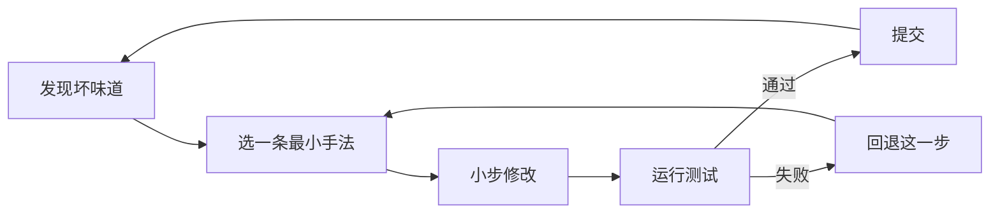

# 重构手册：23 种坏味道与 66 种手法

<ArticleTags />

重构不是重写。它是在**不改变外部行为、不增加新功能**的前提下，持续改善代码结构：把难读的代码变短，把纠缠的依赖拆开，把重复的逻辑收拢。参考站把它拆成两半：先用代码坏味道定位问题，再用重构手法小步修改。

这篇笔记按这个顺序覆盖目录中的全部条目：23 种坏味道、66 种手法。每一条都给出症状或目的、成因或步骤、以及一段游戏开发场景的 C# 示例。

::: warning 关于本文
本文是中文阅读整理与游戏开发视角的重写，**不是原站译文**。示例为本站原创，用来演示代码形态，不追求直接复制进项目即可运行。
:::

::: tip 怎么读
先读第 2 节的纪律，再按“坏味道 → 对应手法”查。不要一次背完 89 条；遇到具体代码时，先定位症状，再选一条最小手法，改完跑测试，再继续下一条。
:::

## 1. 重构地图

| 维度 | 内容 |
| - | - |
| 重构的定义 | 系统化地改善代码，不新增功能，把混乱变成清晰的设计 |
| 坏味道 | 问题的可观察信号，通常只是深层问题的表面症状 |
| 重构手法 | 具体的最小变换步骤，多数有代价，需要动机与谨慎 |
| 安全前提 | 小步修改，每一步之后运行测试；测试不足时先补特征测试 |
| 提交节奏 | 一次提交只做一种变换，失败时能快速回退 |

| 坏味道分组 | 数量 | 典型问题 |
| - | - | - |
| 膨胀类 Bloaters | 5 | 方法、类、参数、数据长到难以处理 |
| 面向对象滥用者 | 4 | 继承、多态、封装被误用 |
| 变更阻止者 | 3 | 改一处被迫改多处 |
| 可有可无 | 6 | 重复、死代码、过度设计 |
| 耦合者 | 5 | 类之间知道得太多，或中间人太多 |

| 手法分组 | 数量 | 主要目标 |
| - | - | - |
| 重新组织方法 | 9 | 把长方法拆短，把临时变量变清楚 |
| 在对象之间搬移特性 | 8 | 把职责放到真正使用它的类 |
| 重新组织数据 | 15 | 用对象、封装与关联替代裸数据 |
| 简化条件表达式 | 8 | 把嵌套与分支变成可读的卫语句或多态 |
| 简化方法调用 | 14 | 让接口表达意图，减少参数与错误码 |
| 处理概括关系 | 12 | 整理继承、接口与委托 |



## 2. 重构前的三条纪律

1. **不混入新功能**：重构提交里只出现结构变化。需要加功能时，先提交功能，再单独重构。
2. **每一步都可运行**：把大改拆成一系列能编译、能跑测试的小步骤；不要一次改十个文件再验证。
3. **测试是安全网**：没有测试的代码，先写描述现状的特征测试，再动结构；测试只验行为，不绑实现细节。

## 3. 膨胀类 Bloaters

膨胀类不会一夜出现，而是每次“就加两行”累积出来的。它们的共同点是体积已经超过可读、可测、可改的边界。

### 过长方法 Long Method {#long-method}

**症状**：一个方法几十上百行，需要注释才能看懂；局部变量多，分支和循环缠在一起；改一处要通读全篇。

**成因**：往现有方法里加代码比新建方法容易；读代码比写代码难，于是问题一直没被看见。

**重构路线**：[提炼方法](#extract-method)；局部变量碍事时用[以查询取代临时变量](#replace-temp-with-query)、[引入参数对象](#introduce-parameter-object)或[保持对象完整](#preserve-whole-object)；仍拆不动时用[以方法对象取代方法](#replace-method-with-method-object)；条件与循环分别用[分解条件表达式](#decompose-conditional)和提炼方法处理。

```csharp
void Update()
{
    var input = ReadInput();
    if (input.Jump && _grounded) _velocity.y = 8f;
    _velocity.y -= 9.8f * Time.deltaTime;
    transform.position += _velocity * Time.deltaTime;
    if (_hp <= 0)
    {
        _animator.Play("Die");
        _ui.ShowGameOver();
    }
}
```

**验收**：方法能用一个动词短语命名；每一段都能单独测试；注释可以删掉而不损失信息。

### 过大的类 Large Class {#large-class}

**症状**：一个类字段多、方法多，名称里出现 And、Manager、System；不同功能的方法只用到各自的字段子集。

**成因**：把“相关的东西”都塞进一个类，而不是按变化原因分开。

**重构路线**：[提炼类](#extract-class)、[提炼子类](#extract-subclass)、[提炼接口](#extract-interface)；如果字段成组出现，先看[数据泥团](#data-clumps)。

```csharp
class Player
{
    public int Hp, Mp, Gold;
    public List<Item> Bag;
    public void Move() { }
    public void Attack() { }
    public void Save() { }
    public void DrawUI() { }
}
```

**验收**：每个类只有一个主要变化原因；删掉一个功能时，能整块删掉对应字段与方法。

### 基本类型偏执 Primitive Obsession {#primitive-obsession}

**症状**：用 `string` 表示物品 ID、用 `int` 表示元素类型、用数组表示坐标；同一套校验在多个地方重复。

**成因**：一开始用基本类型最快，后来领域概念变复杂，却没人把它提升为类型。

**重构路线**：[以对象取代数据值](#replace-data-value-with-object)、[以类取代类型码](#replace-type-code-with-class)、[以子类取代类型码](#replace-type-code-with-subclasses)、[以状态/策略取代类型码](#replace-type-code-with-state-strategy)、[以对象取代数组](#replace-array-with-object)。

```csharp
void Equip(string weaponId, int element, int rarity) { }

// 调用方：含义全靠猜，非法值也拦不住
Equip("fire_sword", 2, 5);
```

**验收**：领域概念有名字、有校验、有行为；非法状态在构造时就无法表示。

### 过长参数列表 Long Parameter List {#long-parameter-list}

**症状**：方法参数超过三四个，出现连续布尔值、ID 与配置项；调用方经常传错顺序。

**成因**：需要的数据太多，或把“怎么取数据”的责任推给了调用方。

**重构路线**：[引入参数对象](#introduce-parameter-object)、[保持对象完整](#preserve-whole-object)、[以方法调用取代参数](#replace-parameter-with-method-call)。

```csharp
void SpawnEnemy(string name, int hp, float speed, bool elite,
                int lootTable, float scale, string aiProfile) { }
```

**验收**：参数对象有领域名称；布尔参数消失或变成具名方法；调用方不需要查签名顺序。

### 数据泥团 Data Clumps {#data-clumps}

**症状**：三五个字段总是一起出现、一起传递，删掉其中一个其余就失去意义，例如坐标、血量上下限、伤害区间。

**成因**：缺少一个承载这组数据的类型，于是它们在各个签名里“抱团旅行”。

**重构路线**：[提炼类](#extract-class)、[引入参数对象](#introduce-parameter-object)、[保持对象完整](#preserve-whole-object)；如果这组数据还有行为，优先提炼成值对象。

```csharp
void Move(float x, float y, float z, float vx, float vy, float vz) { }

// 位置与速度总是一起出现，却没有自己的类型
```

**验收**：这组字段只出现在一个类型里；方法的参数从六个变成一个。

## 4. 面向对象滥用者 Object-Orientation Abusers

这一组是继承、多态与封装的误用：结构看起来像面向对象，但职责并没有真正分配好。

### 重复的 switch 语句 Switch Statements {#switch-statements}

**症状**：同一个类型判断在伤害、表现、UI、存档里反复出现；新增一个类型要改多处 switch。

**成因**：用类型码驱动行为，而不是让类型自己承担行为。

**重构路线**：[以多态取代条件表达式](#replace-conditional-with-polymorphism)、[以子类取代类型码](#replace-type-code-with-subclasses)、[以状态/策略取代类型码](#replace-type-code-with-state-strategy)。

```csharp
int Damage(Enemy e)
{
    switch (e.Type)
    {
        case EnemyType.Slime: return 5;
        case EnemyType.Bat: return 8;
        case EnemyType.Boss: return 20;
        default: throw new ArgumentOutOfRangeException();
    }
}
```

**验收**：新增类型时只新增一个类，不改现有 switch；行为与数据放在同一个类型里。

### 临时字段 Temporary Field {#temporary-field}

**症状**：字段只在某几个操作中有值，其他时候是 `null` 或默认值；阅读代码时要先猜“现在这个字段有效吗”。

**成因**：算法需要跨方法共享中间状态，于是把局部变量提升成了字段。

**重构路线**：[提炼类](#extract-class)、[引入空对象](#introduce-null-object)、[以方法对象取代方法](#replace-method-with-method-object)。

```csharp
class EnemyAi
{
    private Enemy _tickTarget; // 只在 Tick 里有意义
    public void Tick() { _tickTarget = FindTarget(); /* ... */ }
}
```

**验收**：字段在对象生命周期内始终有效；只在算法内使用的状态被收进方法对象或参数。

### 被拒绝的遗赠 Refused Bequest {#refused-bequest}

**症状**：子类继承父类，却重写方法为空实现、抛异常，或只使用一小部分继承来的成员。

**成因**：为了复用少量代码而继承，但子类并不符合父类的契约。

**重构路线**：[方法下移](#push-down-method)、[字段下移](#push-down-field)、[以委托取代继承](#replace-inheritance-with-delegation)。

```csharp
class FlyingEnemy : Enemy
{
    public override void Walk() => throw new NotSupportedException();
}
```

**验收**：子类能替换父类而不破坏调用方；不支持的行为不再出现在接口里。

### 异曲同工的类 Alternative Classes with Different Interfaces {#alternative-classes-with-different-interfaces}

**症状**：两个类做同一件事，方法名与参数却不同；调用方要写分支来适配。

**成因**：不同时间、不同人实现同一概念，没有及时统一接口。

**重构路线**：[重命名方法](#rename-method)、[搬移方法](#move-method)、[提炼超类](#extract-superclass)、[提炼接口](#extract-interface)。

```csharp
class Health { public void TakeDamage(int v) { } }
class HitPoints { public void Reduce(int v) { } }

// 同一概念，两套接口
```

**验收**：同一概念只有一套词汇；调用方不需要知道具体实现类。

## 5. 变更阻止者 Change Preventers

这类坏味道的直接后果是：改一个需求，代码却要求你在很多不相关的地方同时修改。

### 发散式变化 Divergent Change {#divergent-change}

**症状**：同一个类因为输入、存档、UI、音频等不同原因被修改；每次需求变化都改这个类。

**成因**：把多个职责塞进一个类，变化原因没有分开。

**重构路线**：[提炼类](#extract-class)、[提炼超类](#extract-superclass)、[提炼子类](#extract-subclass)。

```csharp
class GameManager
{
    public void ReadInput() { }
    public void SaveGame() { }
    public void RefreshUI() { }
    public void PlayMusic() { }
}
```

**验收**：一个类只因为一个原因变化；不同需求能落到不同类。

### 霰弹式修改 Shotgun Surgery {#shotgun-surgery}

**症状**：加一种伤害类型、改一个字段名，要动很多文件；漏改一处就出现不一致。

**成因**：本应聚在一起的知识被分散到多个类。

**重构路线**：[搬移方法](#move-method)、[搬移字段](#move-field)、[内联类](#inline-class)。

```csharp
// 新增一种伤害类型，要改：
// DamageType.cs, DamageCalculator.cs, DamagePopup.cs,
// AchievementTracker.cs, AudioBank.cs, SaveMapper.cs ...
```

**验收**：一个概念的变化集中在一个类或一个模块；改动点数量与概念数量成正比。

### 平行继承体系 Parallel Inheritance Hierarchies {#parallel-inheritance-hierarchies}

**症状**：为 `Enemy` 增加一个子类，必须同时为 `EnemyView` 增加一个对应子类；两个继承体系一一对应。

**成因**：把数据/逻辑与表现拆成两套继承，却没有用组合连接。

**重构路线**：[搬移方法](#move-method)、[搬移字段](#move-field)、[折叠继承体系](#collapse-hierarchy)、[以委托取代继承](#replace-inheritance-with-delegation)。

```csharp
class Slime : Enemy { }
class SlimeView : EnemyView { }
class Bat : Enemy { }
class BatView : EnemyView { }
// 每加一种敌人，必须同时加一个 View 子类
```

**验收**：新增一种敌人只需要一个子类；表现通过组合或数据驱动，而不是平行继承。

## 6. 可有可无 Dispensables

这一类东西删掉之后，代码会更短、更清楚，功能不会少。

### 注释 Comments {#comments-smell}

**症状**：注释在解释代码“做了什么”，而不是“为什么这样做”；注释与代码逐渐不一致。

**成因**：代码本身不够表达意图，于是用注释补救。

**重构路线**：[提炼方法](#extract-method)、[重命名方法](#rename-method)、[引入断言](#introduce-assertion)；只保留解释约束、权衡与坑的注释。

```csharp
// 如果玩家死了就返回
if (player.Hp <= 0) return;

// 这里把伤害乘以 1.5 因为暴击
damage *= 1.5f;
```

**验收**：删掉解释性注释后，代码仍然能读懂；剩下的注释都在解释“为什么”。

### 重复代码 Duplicate Code {#duplicate-code}

**症状**：同一段逻辑出现在多个方法/类里；修一个 bug 要同步改多处。

**成因**：复制粘贴最快；或者两段代码只是“看起来相似”，没有抽出共同意图。

**重构路线**：[提炼方法](#extract-method)、[方法上移](#pull-up-method)、[塑造模板方法](#form-template-method)、[替换算法](#substitute-algorithm)；跨类重复用[搬移方法](#move-method)或[提炼超类](#extract-superclass)。

```csharp
int PlayerDamage() => Mathf.Max(1, attack * 2 - enemy.defense);
int EnemyDamage() => Mathf.Max(1, attack * 2 - player.defense);
```

**验收**：同一规则只有一个实现；差异通过参数、策略或模板方法表达。

### 冗余类 Lazy Class {#lazy-class}

**症状**：一个类几乎没有行为，只是转发一两个调用；删掉它，代码反而更直接。

**成因**：提前为“以后可能扩展”预留了类型，或重构后职责被搬空。

**重构路线**：[内联类](#inline-class)、[折叠继承体系](#collapse-hierarchy)。

```csharp
class DamageHelper
{
    public static int Clamp(int v) => Mathf.Max(0, v);
}
```

**验收**：每个类都有不可替代的职责；删除后没有信息损失。

### 数据类 Data Class {#data-class}

**症状**：类只有字段和 getter/setter，没有行为；业务逻辑散落在外部，反复读写这些字段。

**成因**：把数据结构当成了对象，没有把与数据强相关的行为放进去。

**重构路线**：[搬移方法](#move-method)、[封装字段](#encapsulate-field)、[封装集合](#encapsulate-collection)、[移除设值方法](#remove-setting-method)。

```csharp
class PlayerData
{
    public int Hp;
    public int MaxHp;
    public void SetHp(int v) { Hp = v; }
    public int GetHp() => Hp;
}
```

**验收**：数据与约束放在一起；外部不能把对象改成非法状态。

### 死代码 Dead Code {#dead-code}

**症状**：不再被调用的方法、字段、类；被注释掉的旧实现；永远不会执行的分支。

**成因**：需求变更后只加不删；担心“以后可能用到”。

**重构路线**：直接删除；如果参数不再使用，配合[移除参数](#remove-parameter)；如果方法只剩转发，配合[内联方法](#inline-method)。

```csharp
// 旧版暴击公式，已不再调用
int LegacyCrit(int damage) => damage * 3;
```

**验收**：搜索不到引用即可删除；版本控制会保留历史，不需要靠注释保存旧代码。

### 夸夸其谈通用性 Speculative Generality {#speculative-generality}

**症状**：为不存在的需求预留抽象、参数、钩子；只有一个实现的接口；从未使用的扩展点。

**成因**：把“以后可能”当成“现在需要”，用模式替代了真实变化。

**重构路线**：[折叠继承体系](#collapse-hierarchy)、[内联类](#inline-class)、[移除参数](#remove-parameter)、[重命名方法](#rename-method)。

```csharp
interface IEntityFactory<T> where T : Entity { T Create(); }
// 全项目只有一个 EnemyFactory 实现
```

**验收**：每个抽象都有至少两个实现或一个明确的替换点；没有真实变化轴就删掉。

## 7. 耦合者 Couplers

耦合本身不是坏事，但过度耦合会让一个类的修改波及另一个类；反过来，过度委托又会制造一堆中间人。

### 依恋情结 Feature Envy {#feature-envy}

**症状**：一个方法大量读取另一个对象的数据，对自己类的字段几乎不碰；计算逻辑放错了位置。

**成因**：数据与行为分离，方法留在了“调用方便”的地方，而不是“数据所在”的地方。

**重构路线**：[搬移方法](#move-method)、[提炼方法](#extract-method)、[搬移字段](#move-field)。

```csharp
class DamageCalculator
{
    public int Calc(Player p) => p.Attack * 2 - p.Target.Defense;
}
// 计算器大量读取 Player 的数据，自己几乎没有状态
```

**验收**：方法放在它最常使用的数据旁边；移动后调用方更简单。

### 不适当的亲密关系 Inappropriate Intimacy {#inappropriate-intimacy}

**症状**：两个类互相访问私有/内部字段，频繁双向调用；改一个类的内部表示会破坏另一个类。

**成因**：缺少清晰的边界，或为了省事直接操作对方内部。

**重构路线**：[搬移方法](#move-method)、[搬移字段](#move-field)、[提炼类](#extract-class)、[隐藏委托关系](#hide-delegate)、[以委托取代继承](#replace-inheritance-with-delegation)。

```csharp
class Enemy
{
    public void Hit(Player p) { p._hp -= 5; } // 直接改私有字段
}
```

**验收**：类只通过公开接口协作；内部表示可以独立修改。

### 不完整的库类 Incomplete Library Class {#incomplete-library-class}

**症状**：第三方库/引擎类缺少你需要的方法；于是业务代码里到处写同样的辅助逻辑。

**成因**：库不能改，或改库的成本高于在本地扩展。

**重构路线**：[引入外加函数](#introduce-foreign-method)、[引入本地扩展](#introduce-local-extension)。

```csharp
// 第三方库的 Vector3 没有 ClampMagnitude
// 于是在业务代码里到处手写长度判断
```

**验收**：缺失能力集中在一个扩展点；业务代码不再重复库补丁。

### 消息链 Message Chains {#message-chains}

**症状**：`a.B().C().D()` 这样的长链；调用方依赖了整条对象导航路径。

**成因**：客户端知道太多对象关系，或中间对象没有提供合适的快捷方法。

**重构路线**：[隐藏委托关系](#hide-delegate)、[提炼方法](#extract-method)、[搬移方法](#move-method)。

```csharp
var damage = player.Inventory.Weapon.Stats.Damage;
```

**验收**：调用方只与直接协作者交互；对象内部结构变化不会穿透到客户端。

### 中间人 Middle Man {#middle-man}

**症状**：一个类的大部分方法只是转发给另一个对象；删掉它，调用链更短。

**成因**：过度使用委托/外观，或重构后原职责被搬空。

**重构路线**：[移除中间人](#remove-middle-man)、[内联类](#inline-class)、[以继承取代委托](#replace-delegation-with-inheritance)。

```csharp
class PlayerFacade
{
    private readonly Player _player;
    public void Move() => _player.Move();
    public void Attack() => _player.Attack();
    public int Hp => _player.Hp;
}
```

**验收**：中间人提供了额外价值（缓存、权限、协议转换）才保留；否则让调用方直接协作。

## 8. 手法：重新组织方法

长方法是最常见的起点。这一组手法只动方法内部与调用关系，风险低，适合作为重构的第一刀。

### 提炼方法 Extract Method {#extract-method}

**目的**：把一段能用一个名字概括的代码从长方法中拆出来，让调用处只表达意图。

**步骤**：新建方法并用动词短语命名；把片段搬进去；处理局部变量与参数；原位置改为调用；运行测试。

```csharp
// before
void Update()
{
    _velocity.y -= 9.8f * Time.deltaTime;
    transform.position += _velocity * Time.deltaTime;
    if (_hp <= 0) Die();
}

// after
void Update()
{
    ApplyGravity();
    if (_hp <= 0) Die();
}

void ApplyGravity()
{
    _velocity.y -= 9.8f * Time.deltaTime;
    transform.position += _velocity * Time.deltaTime;
}
```

**注意**：一次只提炼一段；方法名描述“做什么”，不要描述“怎么做”。

### 内联方法 Inline Method {#inline-method}

**目的**：当方法体比方法名更清楚，或方法只是转发时，把调用替换为方法体并删除方法。

**步骤**：确认方法没有多态覆盖；把方法体复制到调用处；替换参数；删除原方法；运行测试。

```csharp
// before
bool IsDead() => _hp <= 0;
if (IsDead()) Die();

// after
if (_hp <= 0) Die();
```

**注意**：如果方法名本身承担了表达意图的作用，保留它可能更好。

### 提炼变量 Extract Variable {#extract-variable}

**目的**：给复杂表达式一个有意义的名字，降低阅读时的认知负担。

**步骤**：选中子表达式；声明局部变量并命名；用变量替换表达式；运行测试。

```csharp
// before
if (attack * 2 - defense > threshold && !invulnerable) { }

// after
var damage = attack * 2 - defense;
var canHurt = damage > threshold && !invulnerable;
if (canHurt) { }
```

**注意**：变量名要表达业务含义；不要为每个中间值都起名。

### 内联临时变量 Inline Temp {#inline-temp}

**目的**：当临时变量只被使用一次，且表达式本身足够清楚时，去掉这层间接。

**步骤**：确认变量只赋值一次、只读取一次；把读取处替换为表达式；删除变量。

```csharp
// before
var damage = attack * 2;
Apply(damage);

// after
Apply(attack * 2);
```

**注意**：如果表达式很长或需要解释，保留变量更好。

### 以查询取代临时变量 Replace Temp with Query {#replace-temp-with-query}

**目的**：把临时变量背后的计算抽成方法，让多个方法共享同一规则，也便于单独测试。

**步骤**：提炼表达式为查询方法；把临时变量的读取替换为调用；删除变量；运行测试。

```csharp
// before
var damage = attack * 2 - defense;
if (damage > 0) Hit(damage);

// after
int Damage() => attack * 2 - defense;
if (Damage() > 0) Hit(Damage());
```

**注意**：查询方法应当无副作用；如果计算很昂贵，先测量再决定是否缓存。

### 拆分临时变量 Split Temporary Variable {#split-temporary-variable}

**目的**：一个临时变量承担了多个含义时，拆成多个变量，避免读者追踪它的多次赋值。

**步骤**：找出每次赋值的不同用途；为每种用途声明新变量；替换读取；删除旧变量。

```csharp
// before
var value = attack * 2;
Apply(value);
value = hp - damage;
SetHp(value);

// after
var damage = attack * 2;
Apply(damage);
var newHp = hp - damage;
SetHp(newHp);
```

**注意**：循环里的累加变量通常不该拆；只拆语义发生变化的变量。

### 移除对参数的赋值 Remove Assignments to Parameters {#remove-assignments-to-parameters}

**目的**：不要修改传入参数，避免调用方与 callee 之间的隐式耦合。

**步骤**：声明局部变量承接参数；把对参数的赋值改为对局部变量；返回或使用局部变量。

```csharp
// before
int Apply(int damage)
{
    damage = Mathf.Max(0, damage);
    return damage;
}

// after
int Apply(int damage)
{
    var result = Mathf.Max(0, damage);
    return result;
}
```

**注意**：C# 的值参数本身是副本，但修改它仍会让读者误以为调用方会受影响。

### 以方法对象取代方法 Replace Method with Method Object {#replace-method-with-method-object}

**目的**：当一个方法局部变量太多、无法安全提炼时，把方法整体搬进一个对象，让局部变量变成字段。

**步骤**：为新类建字段保存原对象与参数；把方法体搬进新类的 `Compute()`；原方法委托给新对象；再逐步提炼。

```csharp
// before
class DamagePipeline
{
    int Calc(Player p, Enemy e)
    {
        var baseDamage = p.Attack * 2;
        var mitigation = e.Defense + e.Buff;
        return Mathf.Max(1, baseDamage - mitigation);
    }
}

// after
class DamagePipeline
{
    int Calc(Player p, Enemy e) => new DamageCalc(p, e).Run();
}

sealed class DamageCalc
{
    private readonly Player _p;
    private readonly Enemy _e;

    public DamageCalc(Player p, Enemy e) { _p = p; _e = e; }
    public int Run() => Mathf.Max(1, _p.Attack * 2 - (_e.Defense + _e.Buff));
}
```

**注意**：这是“拆不动时的跳板”，不是最终形态；拆完通常还要继续提炼方法。

### 替换算法 Substitute Algorithm {#substitute-algorithm}

**目的**：用更清晰、更可靠的算法替换现有实现，保持输入输出不变。

**步骤**：用测试固定现有行为；写新算法；对比结果；替换旧实现；删除旧代码。

```csharp
// before：手写遍历找最近敌人
Enemy nearest = null;
var best = float.MaxValue;
foreach (var e in enemies)
{
    var d = Vector3.Distance(pos, e.Pos);
    if (d < best) { best = d; nearest = e; }
}

// after
var nearest = enemies.OrderBy(e => Vector3.Distance(pos, e.Pos)).FirstOrDefault();
```

**注意**：先有行为测试再替换；新算法若改变边界行为，要明确这是需求变化还是缺陷修复。

## 9. 手法：在对象之间搬移特性

职责放错位置时，代码会出现依恋情结、中间人和不适当的亲密关系。这一组手法把方法和字段搬到真正使用它们的地方。

### 搬移方法 Move Method {#move-method}

**目的**：把方法移到它最常使用的数据所在的类，减少跨对象取值。

**步骤**：确认目标类；把方法复制到目标类并调整引用；原方法委托或删除；运行测试。

```csharp
// before
class DamageCalculator
{
    public int Calc(Player p) => p.Attack * 2 - p.Target.Defense;
}

// after：计算属于 Player 的领域行为
class Player
{
    public int CalcDamage() => Attack * 2 - Target.Defense;
}
```

**注意**：如果方法使用了多个类的数据，先判断哪一边是“主人”，不要机械搬移。

### 搬移字段 Move Field {#move-field}

**目的**：把字段移到更常读写它的类，让数据与行为聚在一起。

**步骤**：在目标类新增字段；更新所有引用；删除原字段；运行测试。

```csharp
// before：敌人类保存掉落表 ID，但只有掉落系统使用
class Enemy { public int LootTableId; }

// after：掉落配置归掉落系统
class LootTable { public int Id; }
class Enemy { public LootTable Loot; }
```

**注意**：搬字段会改变序列化与存档格式，先确认兼容策略。

### 提炼类 Extract Class {#extract-class}

**目的**：把一个承担多个职责的类拆成两个，让每个类只有一个变化原因。

**步骤**：识别一组相关字段与方法；新建类；搬移成员；在原类中保留引用；运行测试。

```csharp
// before
class Player
{
    public int Hp;
    public int MaxHp;
    public void TakeDamage(int v) { Hp = Mathf.Max(0, Hp - v); }
}

// after
class Health
{
    public int Current { get; private set; }
    public int Max { get; }
    public void TakeDamage(int v) => Current = Mathf.Max(0, Current - v);
}
```

**注意**：拆完后原类应继续表达它的核心职责，而不是变成新的中间人。

### 内联类 Inline Class {#inline-class}

**目的**：把一个几乎没有职责的类合并回使用它的类，减少无意义的间接层。

**步骤**：把成员搬回目标类；更新引用；删除原类；运行测试。

```csharp
// before
class DamageHelper
{
    public static int Clamp(int v) => Mathf.Max(0, v);
}

// after：直接在使用处表达
var damage = Mathf.Max(0, raw - defense);
```

**注意**：如果这个类将来会承载真实职责，先不要内联；用真实变化轴判断。

### 隐藏委托关系 Hide Delegate {#hide-delegate}

**目的**：让客户端只与直接对象交互，不依赖对象的内部导航链。

**步骤**：在服务类上新增快捷方法；把客户端调用改为快捷方法；删除对外暴露的委托访问。

```csharp
// before
var damage = player.Inventory.Weapon.Stats.Damage;

// after
var damage = player.WeaponDamage;
```

**注意**：快捷方法要有领域含义；不要把所有委托都藏起来，否则会制造新的中间人。

### 移除中间人 Remove Middle Man {#remove-middle-man}

**目的**：当中间人只做转发、没有附加价值时，让客户端直接与真正的对象协作。

**步骤**：找出只转发的方法；让客户端直接调用被委托对象；删除转发方法；运行测试。

```csharp
// before
facade.Move();          // PlayerFacade 只是转发
// after
player.Move();
```

**注意**：如果中间人承担缓存、权限、协议转换或生命周期管理，保留它。

### 引入外加函数 Introduce Foreign Method {#introduce-foreign-method}

**目的**：当第三方类缺少一个小能力，又无法修改它时，在客户端加一个只服务于该调用的辅助方法。

**步骤**：在客户端声明静态辅助方法；把缺失逻辑放进去；用辅助方法替换重复代码。

```csharp
// 第三方 Vector3 没有 ClampMagnitude
static Vector3 ClampMagnitude(Vector3 v, float max)
{
    var length = v.magnitude;
    return length > max ? v / length * max : v;
}
```

**注意**：外加函数只应服务一个调用点；如果多处使用，升级为本地扩展。

### 引入本地扩展 Introduce Local Extension {#introduce-local-extension}

**目的**：为无法修改的库类建立本地子类或包装类，集中承载缺失能力。

**步骤**：新建子类/包装类；把辅助方法放进去；替换客户端对原类的直接使用；运行测试。

```csharp
static class VectorExtensions
{
    public static Vector3 ClampMagnitude(this Vector3 v, float max)
    {
        var length = v.magnitude;
        return length > max ? v / length * max : v;
    }
}

// 使用：velocity.ClampMagnitude(maxSpeed);
```

**注意**：C# 扩展方法是“外加函数”的语言级形态；需要保存额外状态时改用包装类。

## 10. 手法：重新组织数据

这一组把裸数据、类型码和混乱关联整理成有行为、有约束的对象。它通常和“基本类型偏执”“数据类”一起出现。

### 自封装字段 Self Encapsulate Field {#self-encapsulate-field}

**目的**：让类内部也通过访问器读写字段，为以后增加校验、懒加载或通知留出缝隙。

**步骤**：把字段改为私有；新增 getter/setter；把类内引用改为访问器；运行测试。

```csharp
// before
private int _hp;
void Heal(int v) { _hp += v; }

// after
private int _hp;
public int Hp
{
    get => _hp;
    private set => _hp = Mathf.Max(0, value);
}
void Heal(int v) => Hp += v;
```

**注意**：如果访问器只是裸转发，且没有校验需求，不要为了形式而封装。

### 以对象取代数据值 Replace Data Value with Object {#replace-data-value-with-object}

**目的**：给有含义、有校验、有行为的基本类型值一个自己的类型。

**步骤**：新建值对象；把字段改为该类型；把相关校验/行为搬进去；更新调用方。

```csharp
// before
string weaponId;
int damage;

// after
sealed class Weapon
{
    public string Id { get; }
    public int Damage { get; }
    public Weapon(string id, int damage)
    {
        if (damage <= 0) throw new ArgumentOutOfRangeException(nameof(damage));
        Id = id;
        Damage = damage;
    }
}
```

**注意**：值对象应当不可变；否则共享引用会带来新的耦合。

### 将值对象改为引用对象 Change Value to Reference {#change-value-to-reference}

**目的**：当同一实体需要共享身份与状态时，用引用对象替代各自独立的值副本。

**步骤**：建立对象仓库/缓存；把构造改为从仓库获取；确保同一 ID 返回同一实例；运行测试。

```csharp
// before：每个敌人各有一份类型数据副本
var type = new EnemyType("slime", hp: 10);

// after：共享同一个类型实例
var type = EnemyTypeCatalog.Get("slime");
```

**注意**：只有需要共享身份或可变状态时才改；不可变值对象用值语义更安全。

### 将引用对象改为值对象 Change Reference to Value {#change-reference-to-value}

**目的**：当对象很小、不可变、按内容比较更合理时，用值对象替代引用对象。

**步骤**：让对象不可变；实现按内容相等；去掉仓库/身份依赖；更新调用方。

```csharp
// before：共享的可变对象，改一处影响所有引用
class DamageRange { public int Min; public int Max; }

// after
readonly struct DamageRange
{
    public int Min { get; }
    public int Max { get; }
    public DamageRange(int min, int max) { Min = min; Max = max; }
}
```

**注意**：值对象复制成本要低；包含大数组或资源句柄时不适合。

### 以对象取代数组 Replace Array with Object {#replace-array-with-object}

**目的**：用有字段名的对象替代靠下标记忆的数组，消除位置约定。

**步骤**：新建类；为每个下标建字段；替换读写；删除数组；运行测试。

```csharp
// before
float[] stats = { hp, attack, defense };
var attack = stats[1];

// after
class Stats
{
    public float Hp;
    public float Attack;
    public float Defense;
}
```

**注意**：如果数组长度动态、元素同质，数组仍然合适。

### 复制被监视数据 Duplicate Observed Data {#duplicate-observed-data}

**目的**：当领域数据与 UI 数据分离时，用观察者同步两份数据，避免 UI 直接依赖领域对象。

**步骤**：把数据复制到 UI 侧；建立通知机制；领域变化时更新 UI；确保双向同步规则明确。

```csharp
// before：UI 直接读领域对象，领域结构一变 UI 就坏
label.text = player.Hp.ToString();

// after：领域发通知，UI 持有自己的显示数据
player.HealthChanged += hp => label.text = hp.ToString();
```

**注意**：同步是双向的就要定义冲突规则；只读展示通常不需要复制。

### 将单向关联改为双向 Change Unidirectional Association to Bidirectional {#change-unidirectional-association-to-bidirectional}

**目的**：当被引用方也需要反向查找引用方时，增加反向指针，并集中维护两侧一致性。

**步骤**：在反向类加集合/字段；提供添加/移除方法同时更新两侧；禁止外部直接改集合。

```csharp
// before
class Enemy { public Player Target; }

// after
class Player
{
    private readonly List<Enemy> _targeting = new List<Enemy>();
    public IReadOnlyList<Enemy> Targeting => _targeting;
    public void AddTargeter(Enemy e) => _targeting.Add(e);
    public void RemoveTargeter(Enemy e) => _targeting.Remove(e);
}
```

**注意**：双向关联容易失去同步；必须把维护逻辑收进一个方法。

### 将双向关联改为单向 Change Bidirectional Association to Unidirectional {#change-bidirectional-association-to-unidirectional}

**目的**：当反向引用不再需要时删掉它，减少同步负担与生命周期纠缠。

**步骤**：确认没有代码使用反向引用；删除字段与维护逻辑；改用查询或事件获取信息。

```csharp
// before
class Player { public List<Enemy> Enemies; }
class Enemy { public Player Player; }

// after：只保留 Player -> Enemy，反向需求用查询解决
class Player { public List<Enemy> Enemies; }
```

**注意**：删除前检查序列化、调试工具与外部插件是否依赖反向引用。

### 以符号常量取代魔法数 Replace Magic Number with Symbolic Constant {#replace-magic-number-with-symbolic-constant}

**目的**：给有业务含义的数字起名，让代码表达“为什么是这个数”。

**步骤**：识别魔法数；声明具名常量；替换所有字面量；运行测试。

```csharp
// before
if (hp < 30) PlayLowHealthWarning();

// after
const int LowHealthThreshold = 30;
if (hp < LowHealthThreshold) PlayLowHealthWarning();
```

**注意**：常量名要表达业务含义；纯数学常量（如 2、0.5）不必强行命名。

### 封装字段 Encapsulate Field {#encapsulate-field}

**目的**：把公开字段改为私有，通过访问器控制读写，避免外部把对象改成非法状态。

**步骤**：字段改私有；新增属性；更新引用；在 setter 中加校验。

```csharp
// before
public int Hp;

// after
private int _hp;
public int Hp
{
    get => _hp;
    private set => _hp = Mathf.Clamp(value, 0, MaxHp);
}
```

**注意**：只读字段用 `{ get; }` 或 `readonly` 更直接；不要为封装而封装。

### 封装集合 Encapsulate Collection {#encapsulate-collection}

**目的**：不让外部直接拿到可变集合，防止绕过校验增删元素。

**步骤**：集合改私有；暴露只读视图；提供 Add/Remove 方法；运行测试。

```csharp
// before
public List<Item> Items = new List<Item>();

// after
private readonly List<Item> _items = new List<Item>();
public IReadOnlyList<Item> Items => _items;
public void AddItem(Item item) => _items.Add(item);
```

**注意**：只读视图仍可能暴露元素引用；需要时返回副本或只读包装。

### 以类取代类型码 Replace Type Code with Class {#replace-type-code-with-class}

**目的**：用有名字、有校验的类替代整数/字符串类型码，避免非法值。

**步骤**：新建类型类；为每种取值建静态实例；替换字段与比较；运行测试。

```csharp
// before
int element = 2;
if (element == 2) ApplyFire();

// after
sealed class Element
{
    public static readonly Element Fire = new Element("fire");
    public string Id { get; }
    private Element(string id) => Id = id;
}
```

**注意**：如果类型码还驱动不同行为，继续用子类或状态/策略。

### 以子类取代类型码 Replace Type Code with Subclasses {#replace-type-code-with-subclasses}

**目的**：当类型码决定行为时，把每个类型变成子类，让多态替代条件判断。

**步骤**：为每种类型建子类；把类型相关逻辑搬进子类；用工厂创建；删除类型码判断。

```csharp
// before
class Enemy
{
    public int Type;
    public int Damage() => Type == 0 ? 5 : 8;
}

// after
abstract class Enemy { public abstract int Damage(); }
sealed class Slime : Enemy { public override int Damage() => 5; }
sealed class Bat : Enemy { public override int Damage() => 8; }
```

**注意**：类型数量稳定、行为差异明显时才值得；否则用状态/策略更灵活。

### 以状态/策略取代类型码 Replace Type Code with State/Strategy {#replace-type-code-with-state-strategy}

**目的**：当类型码对应可切换的行为或状态时，用状态/策略对象替代分支。

**步骤**：定义状态/策略接口；为每种类型建实现；把类型码字段改为接口引用；用工厂或配置选择实现。

```csharp
// before
if (enemy.Mode == 0) Chase();
else if (enemy.Mode == 1) Patrol();

// after
interface IEnemyMode { void Tick(Enemy e); }
sealed class ChaseMode : IEnemyMode { public void Tick(Enemy e) { } }
sealed class PatrolMode : IEnemyMode { public void Tick(Enemy e) { } }
```

**注意**：状态会自行转换，策略由外部选择；先分清是哪一种。

### 以字段取代子类 Replace Subclass with Fields {#replace-subclass-with-fields}

**目的**：当子类之间只有数据不同、没有行为差异时，用字段表达差异，减少类数量。

**步骤**：找出仅返回不同常量的子类方法；在父类加字段；用构造参数赋值；删除子类。

```csharp
// before
class Slime : Enemy { public override int Hp() => 10; }
class Bat : Enemy { public override int Hp() => 6; }

// after
class Enemy
{
    public int Hp { get; }
    public Enemy(int hp) => Hp = hp;
}
```

**注意**：一旦子类开始有不同行为，字段方案就会退化回条件判断。

## 11. 手法：简化条件表达式

条件逻辑会随时间变复杂。这一组手法把嵌套、重复条件和类型分支变成可读的卫语句、命名方法或多态。

### 分解条件表达式 Decompose Conditional {#decompose-conditional}

**目的**：把复杂的条件、then 分支和 else 分支分别提炼成命名方法，让主流程只表达决策结构。

**步骤**：提炼条件为布尔方法；提炼两个分支为方法；用方法调用替换原表达式。

```csharp
// before
if (enemy.Hp < 20 && !enemy.Invulnerable && player.HasLineOfSight)
    Execute(enemy);
else
    Chase(enemy);

// after
if (CanExecute(enemy)) Execute(enemy);
else Chase(enemy);

bool CanExecute(Enemy e) =>
    e.Hp < 20 && !e.Invulnerable && player.HasLineOfSight;
```

**注意**：方法名要表达业务判断，而不是 `CheckCondition1`。

### 合并条件表达式 Consolidate Conditional Expression {#consolidate-conditional-expression}

**目的**：把返回同一结果的一系列条件合并成一个表达式，减少重复分支。

**步骤**：确认各条件副作用一致；用逻辑运算符合并；提炼为命名方法。

```csharp
// before
if (hp <= 0) return;
if (isStunned) return;
if (isFrozen) return;

// after
if (hp <= 0 || isStunned || isFrozen) return;
```

**注意**：如果条件需要分别记录日志或埋点，不要合并。

### 合并重复的条件片段 Consolidate Duplicate Conditional Fragments {#consolidate-duplicate-conditional-fragments}

**目的**：把在多个分支中重复出现的代码移到条件之外，只保留真正不同的部分。

**步骤**：找出各分支相同的前置/后置代码；移到条件外；确认执行顺序不变。

```csharp
// before
if (isCrit)
{
    damage *= 2;
    PlayHitEffect();
}
else
{
    PlayHitEffect();
}

// after
if (isCrit) damage *= 2;
PlayHitEffect();
```

**注意**：移动后会改变副作用顺序时，先确认没有依赖。

### 移除控制标记 Remove Control Flag {#remove-control-flag}

**目的**：用 `break`、`return` 或异常替代布尔控制标记，让循环/方法的退出条件更直接。

**步骤**：找出控制标记；把标记判断改为直接退出；删除标记变量。

```csharp
// before
var found = false;
foreach (var enemy in enemies)
{
    if (enemy.Id == id) { found = true; break; }
}

// after
foreach (var enemy in enemies)
{
    if (enemy.Id == id) return enemy;
}
return null;
```

**注意**：多层嵌套退出时，提炼方法通常比多重 `break` 更清楚。

### 以卫语句取代嵌套条件 Replace Nested Conditional with Guard Clauses {#replace-nested-conditional-with-guard-clauses}

**目的**：把异常/边界情况提前返回，让主路径保持在最外层，减少缩进。

**步骤**：识别不满足前置条件的分支；改为提前 return/throw；把主逻辑移到外层。

```csharp
// before
if (alive)
{
    if (hasTarget)
    {
        if (inRange) Attack();
    }
}

// after
if (!alive) return;
if (!hasTarget) return;
if (!inRange) return;
Attack();
```

**注意**：卫语句适合“异常路径短、主路径长”的情况；不要把所有条件都拆成提前返回。

### 以多态取代条件表达式 Replace Conditional with Polymorphism {#replace-conditional-with-polymorphism}

**目的**：当条件根据类型选择行为时，让每个类型自己实现行为，消除重复 switch。

**步骤**：建立共同接口/基类；为每种类型建子类；把分支逻辑搬进子类；用工厂创建；删除条件。

```csharp
// before
int Damage(Enemy e) => e.Type switch
{
    EnemyType.Slime => 5,
    EnemyType.Bat => 8,
    _ => 0
};

// after
abstract class Enemy { public abstract int Damage(); }
sealed class Slime : Enemy { public override int Damage() => 5; }
sealed class Bat : Enemy { public override int Damage() => 8; }
```

**注意**：类型集合稳定、行为差异明显时才用；类型频繁增加时，访问者可能更合适。

### 引入空对象 Introduce Null Object {#introduce-null-object}

**目的**：用行为中性的空对象替代 `null` 判断，让调用方不必到处检查。

**步骤**：定义与真实对象相同的接口；实现无操作版本；在获取对象处返回空对象；删除判空分支。

```csharp
// before
if (target != null) target.TakeDamage(damage);

// after
ITarget target = FindTarget() ?? NullTarget.Instance;
target.TakeDamage(damage);
```

**注意**：空对象只适用于“什么都不做”语义；需要区分“未找到”和“无目标”时不要混用。

### 引入断言 Introduce Assertion {#introduce-assertion}

**目的**：把代码隐含的前提写成显式断言，让错误在靠近源头处暴露。

**步骤**：找出方法假设；加 `Debug.Assert` 或显式校验；在发布版决定保留还是降级。

```csharp
void ApplyDamage(int damage)
{
    Debug.Assert(damage >= 0, "damage 不应为负");
    Hp = Mathf.Max(0, Hp - damage);
}
```

**注意**：断言不是用户输入校验；外部输入仍要正常处理。

## 12. 手法：简化方法调用

接口是类之间的契约。这一组手法让方法名、参数与错误处理更准确地表达意图。

### 重命名方法 Rename Method {#rename-method}

**目的**：让方法名说明它做什么，减少读者跳进方法体才能理解的成本。

**步骤**：选一个动词短语；更新声明与所有调用；保留过渡别名（如需要）；运行测试。

```csharp
// before
void DoIt(Enemy e);

// after
void ApplyDamage(Enemy e);
```

**注意**：名字表达意图，而不是实现细节；同一概念在项目里用同一词汇。

### 添加参数 Add Parameter {#add-parameter}

**目的**：把方法需要的数据显式传入，而不是让方法去猜或读全局状态。

**步骤**：新增参数；更新所有调用；删除方法内部的隐式取值。

```csharp
// before
void Attack(Enemy target) { var mult = _player.CritMultiplier; }

// after
void Attack(Enemy target, float critMultiplier) { }
```

**注意**：参数变多时考虑参数对象；不要用参数传递整个全局上下文。

### 移除参数 Remove Parameter {#remove-parameter}

**目的**：删除不再使用的参数，减少调用方负担与误用空间。

**步骤**：确认参数未被使用；删除声明与所有实参；运行测试。

```csharp
// before
void Move(float speed, bool unusedLegacyFlag) { }

// after
void Move(float speed) { }
```

**注意**：公共 API 删参数属于破坏性变更，先确认调用方与版本策略。

### 将查询与修改分离 Separate Query from Modifier {#separate-query-from-modifier}

**目的**：让查询方法无副作用，修改方法不返回值，调用方一眼能看出是否改变状态。

**步骤**：把有副作用的查询拆成两个方法；更新调用方；运行测试。

```csharp
// before
int TakeDamage(int amount)
{
    Hp -= amount;
    return Hp;
}

// after
void ApplyDamage(int amount) => Hp -= amount;
int Hp { get; private set; }
```

**注意**：命令/查询分离能减少“调用一次却改了状态”的意外。

### 参数化方法 Parameterize Method {#parameterize-method}

**目的**：把只有参数值不同的多个方法合并成一个，减少重复。

**步骤**：找出相似方法；合并为一个带参数的方法；更新调用方；删除旧方法。

```csharp
// before
void Heal10() => Heal(10);
void Heal20() => Heal(20);

// after
void Heal(int amount) { }
```

**注意**：参数化后如果出现复杂分支，说明这些方法可能并不真正相同。

### 以明确方法取代参数 Replace Parameter with Explicit Methods {#replace-parameter-with-explicit-methods}

**目的**：当布尔/枚举参数决定完全不同的行为时，拆成具名方法，让调用处自解释。

**步骤**：为每种取值建方法；把分支逻辑搬进去；更新调用方；删除参数。

```csharp
// before
void SetState(bool frozen) { }

// after
void Freeze() { }
void Unfreeze() { }
```

**注意**：取值很少且行为稳定时才拆；取值多时考虑策略/状态。

### 保持对象完整 Preserve Whole Object {#preserve-whole-object}

**目的**：当调用方从对象里取出多个字段再传参时，直接传对象，减少参数并保持数据完整性。

**步骤**：把多个参数替换为对象参数；方法内部按需取字段；更新调用方。

```csharp
// before
Spawn(enemy.X, enemy.Y, enemy.Z, enemy.Hp, enemy.Speed);

// after
Spawn(enemy);
```

**注意**：传整个对象会增加耦合；如果方法只需要一两个值，保留参数更清楚。

### 以方法调用取代参数 Replace Parameter with Method Call {#replace-parameter-with-method-call}

**目的**：当 callee 自己能获取某个值时，删掉该参数，减少调用方重复计算。

**步骤**：确认 callee 能访问数据源；在 callee 内部调用查询；删除参数与实参。

```csharp
// before
ApplyDamage(rawDamage, player.Defense);

// after
ApplyDamage(rawDamage); // 内部读取 player.Defense
```

**注意**：会引入对数据源的依赖；如果数据源不稳定或需要测试替换，保留参数更好。

### 引入参数对象 Introduce Parameter Object {#introduce-parameter-object}

**目的**：把总是一起出现的参数合并成一个对象，减少签名长度并承载校验。

**步骤**：新建参数对象；把相关参数搬进去；修改方法签名；更新调用方。

```csharp
// before
Spawn("slime", 10, 2.5f, false, 3);

// after
var spec = new EnemySpec("slime", hp: 10, speed: 2.5f, lootTable: 3);
Spawn(spec);
```

**注意**：参数对象应有领域名称；不要把它变成新的“万能参数袋”。

### 移除设值方法 Remove Setting Method {#remove-setting-method}

**目的**：当字段只应在构造时设置，删除 setter，防止对象在生命周期中被改成非法状态。

**步骤**：确认没有外部写入；把 setter 改为构造参数或初始化；删除 setter。

```csharp
// before
public int Id { get; set; }

// after
public int Id { get; }
public Player(int id) => Id = id;
```

**注意**：序列化/ORM 可能需要 setter；用构造函数或专用反序列化入口解决。

### 隐藏方法 Hide Method {#hide-method}

**目的**：缩小方法可见性，只暴露调用方真正需要的接口。

**步骤**：搜索引用；把 `public` 改为 `private`/`internal`；编译并运行测试。

```csharp
// before
public void RecalculateInternals() { }

// after
private void RecalculateInternals() { }
```

**注意**：测试需要访问内部方法时，优先测公开行为，而不是放宽可见性。

### 以工厂方法取代构造函数 Replace Constructor with Factory Method {#replace-constructor-with-factory-method}

**目的**：当构造需要命名、返回子类或复用实例时，用工厂方法表达创建意图。

**步骤**：新增静态工厂方法；把构造逻辑搬进去；把 `new` 调用改为工厂；按需隐藏构造函数。

```csharp
// before
var boss = new Enemy(EnemyType.Boss, 500);

// after
var boss = Enemy.CreateBoss();
```

**注意**：工厂方法名要说明产品变体；不要为每个构造都加一层工厂。

### 以异常取代错误码 Replace Error Code with Exception {#replace-error-code-with-exception}

**目的**：用异常表达无法继续的错误，避免调用方忽略返回码。

**步骤**：定义异常类型；在错误分支抛出；删除错误码返回；更新调用方。

```csharp
// before
int Equip(Item item)
{
    if (!CanEquip(item)) return -1;
    return 0;
}

// after
void Equip(Item item)
{
    if (!CanEquip(item))
        throw new InvalidOperationException("无法装备该物品");
}
```

**注意**：可预期的业务分支（如“金币不足”）不一定要用异常；异常留给真正的异常情况。

### 以测试取代异常 Replace Exception with Test {#replace-exception-with-test}

**目的**：当调用方可以先检查条件时，用条件判断替代捕获异常，避免用异常做流程控制。

**步骤**：找出可预先判断的异常；改为条件检查；保留真正无法预判的异常处理。

```csharp
// before
try { var item = inventory[slot]; }
catch (ArgumentOutOfRangeException) { }

// after
if (slot >= 0 && slot < inventory.Count)
{
    var item = inventory[slot];
}
```

**注意**：并发/外部资源失败无法预判，仍应使用异常处理。

## 13. 手法：处理概括关系

继承与接口是强耦合的概括方式。这一组手法把共同点上移、差异下移，或在继承与委托之间切换。

### 字段上移 Pull Up Field {#pull-up-field}

**目的**：多个子类都有同一字段时，把它移到父类，消除重复。

**步骤**：确认字段语义一致；在父类声明；删除子类字段；更新引用。

```csharp
// before
class Slime { public int Hp; }
class Bat { public int Hp; }

// after
abstract class Enemy { public int Hp; }
```

**注意**：如果字段只是同名但语义不同，不要上移。

### 方法上移 Pull Up Method {#pull-up-method}

**目的**：多个子类有相同方法时，把它移到父类，统一行为。

**步骤**：确认方法实现一致；移到父类；删除子类重写；运行测试。

```csharp
// before
class Slime { public void TakeDamage(int v) => Hp -= v; }
class Bat { public void TakeDamage(int v) => Hp -= v; }

// after
abstract class Enemy { public void TakeDamage(int v) => Hp -= v; }
```

**注意**：方法依赖子类特有字段时，先用模板方法或参数化处理差异。

### 构造函数本体上移 Pull Up Constructor Body {#pull-up-constructor-body}

**目的**：多个子类构造函数重复相同的初始化代码时，把公共部分移到父类构造函数。

**步骤**：在父类新增构造参数；把公共初始化搬进去；子类调用 `base(...)`；删除重复代码。

```csharp
// before
class Slime : Enemy
{
    public Slime() { Hp = 10; Speed = 2; }
}

// after
abstract class Enemy
{
    protected Enemy(int hp, float speed) { Hp = hp; Speed = speed; }
}
class Slime : Enemy
{
    public Slime() : base(hp: 10, speed: 2) { }
}
```

**注意**：构造函数调用虚方法容易踩生命周期坑，父类构造中避免调用可重写方法。

### 方法下移 Push Down Method {#push-down-method}

**目的**：父类方法只被一个子类使用时，把它移到该子类，缩小父类接口。

**步骤**：确认其他子类不用；移到目标子类；更新调用方类型；运行测试。

```csharp
// before
abstract class Enemy { public void Fly() { } } // 只有 Bat 用

// after
class Bat : Enemy { public void Fly() { } }
```

**注意**：如果调用方持有父类引用，下移后需要类型判断，可能说明抽象本身有问题。

### 字段下移 Push Down Field {#push-down-field}

**目的**：父类字段只被一个子类使用时，把它移到该子类，避免污染其他子类。

**步骤**：确认使用范围；移到子类；更新引用；运行测试。

```csharp
// before
abstract class Enemy { protected float WingSpan; } // 只有 Bat 用

// after
class Bat : Enemy { private float WingSpan; }
```

**注意**：与序列化兼容性一起检查。

### 提炼子类 Extract Subclass {#extract-subclass}

**目的**：当一个类只有部分实例需要特殊行为/数据时，把这部分抽成子类。

**步骤**：识别特殊行为；建子类；搬移字段与方法；用工厂创建；运行测试。

```csharp
// before
class Enemy
{
    public bool CanFly;
    public void Fly() { if (!CanFly) return; }
}

// after
class FlyingEnemy : Enemy { public void Fly() { } }
```

**注意**：如果特殊行为可通过数据/策略表达，子类不是唯一选择。

### 提炼超类 Extract Superclass {#extract-superclass}

**目的**：两个类有共同字段与方法时，抽取共同父类，消除重复。

**步骤**：建父类；上移共同成员；让原类继承；运行测试。

```csharp
// before
class Player { public int Hp; public void TakeDamage(int v) { } }
class Enemy { public int Hp; public void TakeDamage(int v) { } }

// after
abstract class Actor { public int Hp; public void TakeDamage(int v) { } }
class Player : Actor { }
class Enemy : Actor { }
```

**注意**：共同点必须是真正的同一种概念，而不只是代码长得像。

### 提炼接口 Extract Interface {#extract-interface}

**目的**：当多个类只需要共享一部分能力时，用接口表达角色，而不是强行共用父类。

**步骤**：识别共同方法子集；建接口；让相关类实现；把调用方依赖改为接口。

```csharp
// before
void ApplyDamage(Player p) { }
void ApplyDamage(Enemy e) { }

// after
interface IDamageable { void TakeDamage(int amount); }
void ApplyDamage(IDamageable target) => target.TakeDamage(10);
```

**注意**：接口代表角色，父类代表“是什么”；按调用方需要选择。

### 折叠继承体系 Collapse Hierarchy {#collapse-hierarchy}

**目的**：当父类与子类几乎没有差异时，合并成一个类，减少无意义的层级。

**步骤**：确认没有多态依赖；把子类成员上移/父类成员下移；删除空层；运行测试。

```csharp
// before
class Enemy { }
class FlyingEnemy : Enemy { } // 没有任何新增成员

// after
class Enemy { }
```

**注意**：如果未来确实需要区分，等需求出现再拆，不要为假设保留空层。

### 塑造模板方法 Form Template Method {#form-template-method}

**目的**：多个子类算法骨架相同、步骤不同，把骨架上移到父类，差异留给钩子。

**步骤**：对比算法步骤；上移骨架方法；把差异步骤声明为抽象/虚方法；子类实现钩子。

```csharp
// before：两个子类各自复制回合流程
class CombatPhase { public void Run() { Begin(); Resolve(); End(); } }
class BuildPhase { public void Run() { Begin(); Resolve(); End(); } }

// after
abstract class TurnPhase
{
    public void Run() { Begin(); Resolve(); End(); }
    protected virtual void Begin() { }
    protected abstract void Resolve();
    protected virtual void End() { }
}
```

**注意**：模板方法依赖继承；如果需要在运行时切换整个算法，用策略。

### 以委托取代继承 Replace Inheritance with Delegation {#replace-inheritance-with-delegation}

**目的**：当子类只复用父类实现、并不符合“是一个”的关系时，改用组合/委托。

**步骤**：在子类中持有父类实例；把继承来的调用转发给它；删除继承；运行测试。

```csharp
// before
class Inventory : List<Item> { } // 只用到 Add/Remove

// after
class Inventory
{
    private readonly List<Item> _items = new List<Item>();
    public void Add(Item item) => _items.Add(item);
    public void Remove(Item item) => _items.Remove(item);
}
```

**注意**：委托会增加转发代码；如果关系确实是“是一个”，继承更直接。

### 以继承取代委托 Replace Delegation with Inheritance {#replace-delegation-with-inheritance}

**目的**：当委托类几乎转发所有方法、且确实是被委托类的一种特化时，改回继承，减少样板代码。

**步骤**：确认“是一个”关系；让类继承；删除转发方法与委托字段；运行测试。

```csharp
// before
class BossEnemy
{
    private readonly Enemy _enemy;
    public void TakeDamage(int v) => _enemy.TakeDamage(v);
    public void Move() => _enemy.Move();
}

// after
class BossEnemy : Enemy { }
```

**注意**：只有委托是“纯转发”且没有额外状态/约束时才用；否则保留组合。

## 14. 重构检查清单

- [ ] 这次提交只改变结构，没有混入新功能？
- [ ] 动手前测试是绿的？没有测试时先补了特征测试？
- [ ] 每次只做一种手法，改完立即运行测试？
- [ ] 坏味道的根因被处理，而不是只把代码挪了个位置？
- [ ] 新增的抽象有真实变化轴，不是为了“以后可能”？
- [ ] 命名表达意图，读者不需要跳进实现才能理解？
- [ ] 删除的代码没有残留引用、注释掉的旧实现或死分支？
- [ ] 性能敏感路径先测量再优化，没有凭感觉引入缓存/池？
- [ ] 序列化、存档、网络协议等外部契约保持兼容？
- [ ] 重构后跑过全量测试，并检查了关键玩法的手动冒烟？

## 15. 参考与延伸

- 原文参考：[重构首页](https://refactoringguru.cn/refactoring)、[重构目录](https://refactoringguru.cn/refactoring/catalog)、[过长方法](https://refactoringguru.cn/smells/long-method)。
- 站内笔记：[深入设计模式](/notes/dive-into-design-patterns)、[GoF 设计模式](/notes/gof-design-patterns)、[设计模式与游戏完美开发](/notes/design-patterns-game-dev)。
- 站内实践：[游戏设计模式实践](/Tech/Architecture/Game_Design_Patterns_Practice)、[Unity 反模式](/Tech/Architecture/Unity_Anti_Patterns)、[塔防索敌重构示例](/Tech/Code_Snippets/TowerTargeting_Refactor_Demo)。


